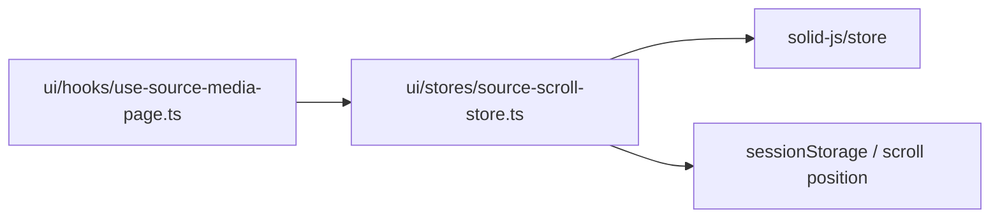
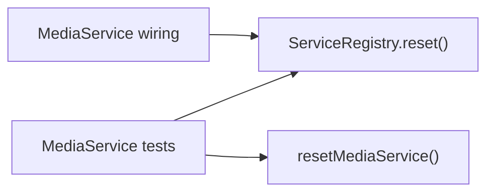

# 依存関係の監査と修正 — 2026-11-01

`b22d4dd6` を基点に監査し、見つかった3点を修正した。[パッケージ依存マップ](package-dependency-graph.md) と [ソース依存マップ](indexion-dependency-graph.md) は修正後の状態。

**coreのUI依存、ServiceRegistry.reset()を入口とする動的循環、UI内の型相互参照を解消した。** 再解析では、パッケージ間の逆向き依存・循環、静的および動的な値参照の循環はいずれも0。残る型参照込みの循環は、生成ルートとrouterの型を接続する2組のみ。

## 修正内容

### スクロール位置の保存を共有UIへ移動

coreに置かれていたSolidのstoreと `sessionStorage` のスクロール位置保存を、[source-scroll-store.ts](../../packages/ui/src/stores/source-scroll-store.ts) に移した。[use-source-media-page.ts](../../packages/ui/src/hooks/use-source-media-page.ts) は同じUIパッケージ内のstoreを参照する。

保存キー `solid-imager-scroll-positions`、保存形式、history entry単位の復元処理は維持した。coreの `solid-js` peer dependencyをBunで削除し、lockfileも更新した。



`sessionStorage` はimportではないため、上図の最後の辺は実装から補足したもの。

### registryのresetから具象サービスへの参照を除去

[ServiceRegistry.reset()](../../apps/server/src/infrastructure/service-registry.ts#L227) は登録済みの参照だけを同期的に消す。以前の `services/media-service` の動的importを削除し、MediaServiceのキャッシュを消す処理は、利用する [unit test](../../apps/server/src/tests/unit/media/copy-media-job.test.ts) と [integration test](../../apps/server/src/tests/integration/media/copy-media-integration.test.ts) で明示的に呼ぶ。

以前は `registry -> media-service -> registry` の逆参照によって、job・tagging・backupなど15ファイルが1つの循環グループになっていた。入口はテスト用resetで、通常起動時の静的循環ではなかった。具象サービスを読み込まずにresetできることを [registry.test.ts](../../apps/server/src/tests/unit/application/registry.test.ts#L4) で検証する。



### UIの共通型を独立モジュールへ分離

| 以前の相互参照 | 共通型の移動先 |
| --- | --- |
| `use-manager-page` と `use-batch-job-events` | [batch-job-events.types.ts](../../packages/ui/src/hooks/batch-job-events.types.ts) — `ManagerJobHandlers`、`UseBatchJobEventsOptions` |
| authors画面とverification panel | [authors.types.ts](../../packages/ui/src/screens/manager/authors.types.ts) — `AuthorManagementActions` |

server/Tauriのadapterを含む全参照元を新しい型モジュールへ更新した。イベントのschema・payload・購読処理、作者操作の契約、画面の表示・操作は変更していない。

## 再解析結果

| 項目 | 修正前 | 修正後 |
| --- | ---: | ---: |
| TypeScript/JavaScriptファイル | 738 | 740 |
| indexion 0.19.0の抽出レコード | 1,945 | 1,947 |
| ASTで確認した参照箇所 | 3,763 | 3,766 |
| ソース図の一意な `(source, target, kind)` | 3,670 | 3,673 |
| テストファイルを除く参照箇所 | 2,983 | 2,986 |
| AST構文解析エラー / 内部参照の未解決 | 0 / 0 | 0 / 0 |
| workspaceパッケージ間の循環 / 逆向き依存 | 0 / 0 | 0 / 0 |
| 静的な値参照だけの循環グループ | 0 | 0 |
| 動的importを含む値参照の循環グループ | 1（15ファイル） | 0 |
| 型参照込みの循環グループ | 5 | 2（生成ルート関連のみ） |
| core内のSolid import | 1 | 0 |

対象は `apps/{cli,server,tauri,xtracter}/src` と `packages/{application,client,core,db,ui}/src`。ソース図にはテストとローカルに生成済みの `routeTree.gen.ts` を含む。パッケージ図と循環・境界監査では、参照元が `tests/`、`__tests__/`、`*.test.*`、`*.spec.*`、`test-utils.*` のものを除いた。CSS、Rust、管理スクリプト、ビルド成果物、外部依存の内部実装は対象外。

参照数はimport/re-export/文字列リテラルの動的importなどの出現数であり、importされるシンボル数ではない。ソース図は同じsource/target/kindをまとめる。型判定は `import type`、`export type`、specifierの `type`、型位置の `import()` に基づく。バンドラーによる消去・tree shaking・実際の呼び出し経路までは評価していない。

残る2組はserverの `router.tsx <-> routeTree.gen.ts`、Tauriの `router.tsx -> routeTree.gen.ts -> routes/__root.tsx -> router.tsx`。戻り辺が型参照であり、生成済みルートとrouter contextの型の接続なので手動修正していない。

外部パッケージ参照とmanifestも照合し、対象の非テストファイルでdependencies/devDependencies/peerDependencies/optionalDependenciesのいずれにもないものは検出されなかった。配布時にdevDependenciesを除く条件は未検証。

## indexionの抽出制約

indexion単独の `circular_count: 0` を、そのまま「循環なし」の証拠にはできなかった。

- `~/...`、`@/...`、workspaceのsubpathが `npm:` の参照先になり、node_modulesのsymlink経由で同じモジュールが別名になる。各パッケージのtsconfig paths、package exports/main、実ファイルで正規化した。
- 最初の監査時、3ファイルだけに絞った再実行でも [jobs-page.tsx](../../apps/server/src/components/pages/jobs-page.tsx) の12参照中、先頭3つのみが出力された。同時に指定したregistry（14参照）とclientのindex（5参照）は0件だった。複数行import、再export、動的importなどの欠落があり、原因の修正はindexion側の別作業になる。
- `kind: value` には明示的な `import type` も含まれていた。既存node_modules内の `@babel/parser` をBunから利用してASTを確認し、型・値・動的参照を分類した。
- 修正後のAST参照のうち、同じ `(source, module specifier)` がindexionにないものは1,808箇所（import 1,541、re-export 123、型位置のimport 40、動的import 104）。これはレコード総数同士の単純差ではない。

更新した図はASTで確認した辺を用い、型だけの辺を点線、動的importをラベルで区別する。内部ファイルの強連結成分を使い、静的値のみ・動的参照込み・型込みを別々に集計した。以前のマップの1,783 indexionレコードから3,673辺への増加は、抽出方法の補完を含むためコードの依存増加とは解釈できない。計算されたimport先やDI・ネットワーク接続による依存は網羅しない。

## 再取得と証跡

indexionはこの環境のサンドボックス内でabortするため、以下はサンドボックス外で実行する。

```sh
rtk summary indexion doc graph --format=json \
  --output=/tmp/solid-imager-indexion-dependencies.json \
  apps/cli/src apps/server/src apps/tauri/src apps/xtracter/src \
  packages/application/src packages/client/src packages/core/src \
  packages/db/src packages/ui/src
```

生のJSON、補助解析結果、今回の監査・描画スクリプトは `.indexion/audits/2026-11-01/`、修正前の証跡はその `before-fixes/` に保存した。gitignore対象なのでcloneには含まれない。スクリプトは今回の作業パス・日付を持つ一時的な監査証跡であり、CIコマンドではない。

検証結果:

- `bun install --frozen-lockfile --offline` 成功。
- `bun run check` 成功（既存のlint warningは残存）。
- `bun run test` 成功。初回はサンドボックスの子プロセス制限でZIP復元テストがEPERMになったため、サンドボックス外で全件再実行して成功した。
- 3,673辺がAST・全体図・11分割ブロックで一致。各分割ブロックは450辺以下で、29個のMarkdownリンクと行参照も確認した。
- `git diff --check` 成功。

CodeRabbit CLIはこの環境に未導入のため、自動レビューは実行していない。
