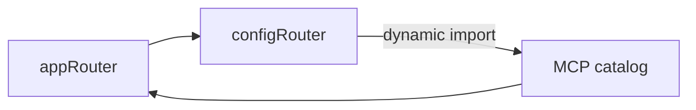

# パッケージ境界整理後の依存関係

公開 API 整理直前の `dcd8b6e2` と、メディアの用途別 port を導入した `f67c0183` を比較した。テストを除くワークスペース間の参照は **875 → 758**、参照先のファイルは **190 → 103**。パッケージ間の依存方向は同じ15組で、各パッケージの内部構成を利用側が知る必要が減った。[パッケージ図](package-dependency-graph.md) · [ソース図](indexion-dependency-graph.md) · [旧 import の棚卸し](workspace-public-api.md)

## 利用側が参照するファイル

各行は、他のワークスペースの本番ソースから対象パッケージを直接参照する import、再 export、文字列リテラルの動的 import を集計したもの。ファイル数は別名経由の参照を同じ実ファイルにまとめた。

| 参照先 | 参照箇所（変更前 → 後） | 異なる参照先ファイル（変更前 → 後） |
| --- | ---: | ---: |
| core | 599 → 527 | 77 → 27 |
| application | 37 → 28 | 27 → 18 |
| db | 22 → 9 | 16 → 2 |
| ui | 202 → 179 | 69 → 55 |
| client | 15 → 15 | 1 → 1 |

DB では server が個別の repository factory や内部ヘルパーを import していた。現在は repository の組み立てが `@solid-imager/db`、テーブル定義の利用が `@solid-imager/db/schema` の2か所に収まる。メディアの検索・アップロード・転送は application 内で組み立て、server は `@solid-imager/application/media` の `createMediaService` を使う。

5つの共有パッケージで wildcard の export は **21 → 0**。対象の旧 `core/domain/*`、`application/services/*`、`application/ports/*`、`db/repositories/*` の直接参照は `src` 内で **674 → 0**（テスト込み）。管理スクリプト・設定を含む棚卸しは **681 → 0** で、対象が異なる。[集計範囲と移行先](workspace-public-api.md)

## グラフ全体と残る循環

| 指標 | 変更前 | 変更後 |
| --- | ---: | ---: |
| 解析した TS・JS ファイル | 771 | 809 |
| AST の参照箇所（テスト込み） | 3,998 | 3,884 |
| 一意なソース図の辺（参照元・参照先・種別） | 3,902 | 3,790 |
| 本番ソースの参照箇所（外部・パッケージ内を含む） | 3,194 | 3,137 |
| ワークスペース間の循環グループ | 0 | 0 |
| ファイル間の静的な値参照の循環グループ | 0 | 0 |
| 動的 import を含む値参照の循環グループ | 1 | 1 |
| 型参照も含めた循環グループ | 3 | 3 |

server 内では `appRouter` が `configRouter` を登録し、そのハンドラが MCP カタログを動的に読み込む。カタログはツール一覧を作るために `appRouter` を参照する。3ファイルは整理前から同じ循環を形成している。[ルーター登録](../../apps/server/src/infrastructure/api/app-router.ts) · [設定ハンドラ](../../apps/server/src/infrastructure/api/routers/config-router.ts) · [カタログ生成](../../apps/server/src/infrastructure/mcp/catalog.ts)



型参照を含めると、Web と Tauri に生成 route tree と router の型を結ぶグループが1つずつ加わる。両時点で core から他のワークスペースへの依存、application から infrastructure への逆向き依存は0件だった。

## 集計方法

- 9ワークスペースの `src` にある TS・JS を解析した。ソース図にはテストを含め、パッケージ図と循環数では `tests/`、`__tests__/`、`*.test.*`、`*.spec.*`、`test-utils.*` からの参照を除いた。Web・Tauri の `routeTree.gen.ts` も対象に含めた。両コミットでルートのパス一覧が同じことを確認し、比較には同じ生成ファイルを使用した。
- 前回と同じ Babel AST 解析で宣言・型位置・リテラルの動的参照を分類し、各コミットの tsconfig、package exports、実ファイルから参照先を解決した。構文解析エラーと未解決の内部参照はいずれも両コミットで0件。循環数はワークスペース単位またはファイル単位の強連結成分で数えた。
- 変更後の indexion 0.19.0 は1,946件を抽出した。同じ参照元と module specifier が indexion 出力にない AST 参照は1,942箇所（import 1,612、再 export 184、動的 import 106、型位置の import 40）。indexion 単体では server の動的循環も検出しなかった。図には AST で確認した辺を使った。

indexion の JSON はリポジトリのルートで再取得できる。この環境では AGENTS.md に従いサンドボックス外で実行する。

```sh
indexion doc graph --format=json --output=/tmp/solid-imager-indexion-dependencies.json \
  apps/cli/src apps/server/src apps/tauri/src apps/xtracter/src \
  packages/application/src packages/client/src packages/core/src \
  packages/db/src packages/ui/src
```

この作業環境で使った AST 集計・描画スクリプトと両時点の集計 JSON は `.indexion/audits/2026-11-04/` に保存した（Git 管理外）。11月1日の監査は当時のコードを対象としている。[前回の監査](dependency-audit-2026-11-01.md)
