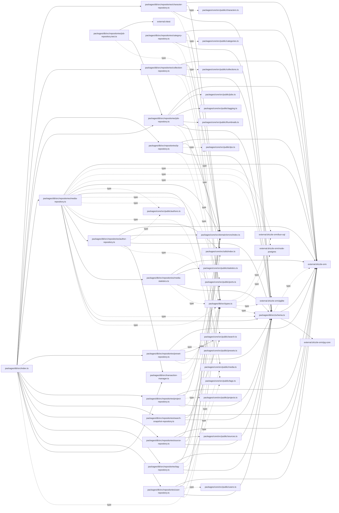

# solid-imager dependencies: Apps and shared packages

Generated 2026-11-04 from `50d5336c`. The [dependency audit](dependency-audit-2026-11-04.md) compares the indexion graph with the TypeScript/JavaScript AST.

Solid arrows show value imports and re-exports. Dotted arrows show explicit type-only references. Arrows labeled `dynamic` show literal `import()` and `require()` calls. Workspace references resolve to files and `external:` identifies third-party and platform modules. Each edge represents a unique source, target and reference kind.

1,009 edges, with at most 450 per Mermaid block.

## Part 1

```mermaid
flowchart LR
  N0["apps/cli/src/commands/ai.test.ts"]
  N1["apps/cli/src/commands/ai.ts"]
  N2["apps/cli/src/commands/db.ts"]
  N3["apps/cli/src/commands/job.ts"]
  N4["apps/cli/src/commands/media.test.ts"]
  N5["apps/cli/src/commands/media.ts"]
  N6["apps/cli/src/index.ts"]
  N7["apps/cli/src/orpc-client.ts"]
  N8["apps/cli/src/utils.ts"]
  N9["apps/tauri/src/api/entities-api.ts"]
  N10["apps/tauri/src/api/media-api.ts"]
  N11["apps/tauri/src/api/sources-api.ts"]
  N12["apps/tauri/src/collections/authors-collection.ts"]
  N13["apps/tauri/src/collections/characters-collection.ts"]
  N14["apps/tauri/src/collections/index.ts"]
  N15["apps/tauri/src/collections/ips-collection.ts"]
  N16["apps/tauri/src/collections/projects-collection.ts"]
  N17["apps/tauri/src/collections/query-keys.ts"]
  N18["apps/tauri/src/collections/sources-collection.ts"]
  N19["apps/tauri/src/collections/tags-collection.ts"]
  N20["apps/tauri/src/components/imports/import-review-modal.tsx"]
  N21["apps/tauri/src/components/imports/pending-downloads-indicator.tsx"]
  N22["apps/tauri/src/components/media/ai-tagging-modal.tsx"]
  N23["apps/tauri/src/components/media/character-crop-modal.tsx"]
  N24["apps/tauri/src/components/media/media-actions.tsx"]
  N25["apps/tauri/src/components/media/media-grid-item.tsx"]
  N26["apps/tauri/src/components/media/media-sidebar/index.tsx"]
  N27["apps/tauri/src/components/media/media-sidebar/media-sidebar-content.tsx"]
  N28["apps/tauri/src/components/media/media-viewer.tsx"]
  N29["apps/tauri/src/components/media/move-copy-media-dialog.tsx"]
  N30["apps/tauri/src/components/media/thumbnail-image.tsx"]
  N31["apps/tauri/src/components/server-settings-screen.tsx"]
  N32["apps/tauri/src/components/upload-media-modal/index.tsx"]
  N33["apps/tauri/src/components/upload-media-modal/upload-media-modal-content.tsx"]
  N34["apps/tauri/src/hooks/use-batch-job-events.ts"]
  N35["apps/tauri/src/hooks/use-current-search-persistence.ts"]
  N36["apps/tauri/src/hooks/use-media-source-events.ts"]
  N37["apps/tauri/src/index.css"]
  N38["apps/tauri/src/infrastructure/api-base.ts"]
  N39["apps/tauri/src/infrastructure/api-clients/ai-api.ts"]
  N40["apps/tauri/src/infrastructure/api-clients/characters-api.ts"]
  N41["apps/tauri/src/infrastructure/api-clients/imports-api.ts"]
  N42["apps/tauri/src/infrastructure/api-clients/ips-api.ts"]
  N43["apps/tauri/src/infrastructure/api-clients/media-api.ts"]
  N44["apps/tauri/src/infrastructure/api-clients/orpc-client.ts"]
  N45["apps/tauri/src/infrastructure/api-clients/projects-api.ts"]
  N46["apps/tauri/src/infrastructure/api-clients/search-api.ts"]
  N47["apps/tauri/src/infrastructure/api-clients/sources-api.ts"]
  N48["apps/tauri/src/infrastructure/api-clients/thumbnails-api.ts"]
  N49["apps/tauri/src/infrastructure/api/clients/preset-client.ts"]
  N50["apps/tauri/src/infrastructure/api/clients/search-history-client.ts"]
  N51["apps/tauri/src/infrastructure/db/database-files.ts"]
  N52["apps/tauri/src/infrastructure/db/persistence.ts"]
  N53["apps/tauri/src/infrastructure/media/thumbnail-runtime.ts"]
  N54["apps/tauri/src/infrastructure/settings/server-health.ts"]
  N55["apps/tauri/src/infrastructure/settings/server-settings.ts"]
  N56["apps/tauri/src/infrastructure/tauri-fetch-helpers.ts"]
  N57["apps/tauri/src/main.tsx"]
  N58["apps/tauri/src/orpc-client.ts"]
  N60["apps/tauri/src/queries/index.ts"]
  N61["apps/tauri/src/query-client.ts"]
  N62["apps/tauri/src/routeTree.gen.ts"]
  N63["apps/tauri/src/router.tsx"]
  N64["apps/tauri/src/routes/$.tsx"]
  N65["apps/tauri/src/routes/__root.tsx"]
  N66["apps/tauri/src/routes/about.tsx"]
  N67["apps/tauri/src/routes/config.tsx"]
  N68["apps/tauri/src/routes/index.tsx"]
  N69["apps/tauri/src/routes/jobs.tsx"]
  N70["apps/tauri/src/routes/manager.tsx"]
  N71["apps/tauri/src/routes/search.tsx"]
  N72["apps/tauri/src/routes/servers.tsx"]
  N73["apps/tauri/src/routes/sources/$mediaSourceId/$mediaId/index.tsx"]
  N74["apps/tauri/src/routes/sources/$mediaSourceId/components/-source-media-page.tsx"]
  N75["apps/tauri/src/routes/sources/$mediaSourceId/index.tsx"]
  N76["apps/tauri/src/routes/sources/index.tsx"]
  N213["apps/tauri/src/routes/statistics.tsx"]
  N77["apps/xtracter/src/api.ts"]
  N78["apps/xtracter/src/background/index.test.ts"]
  N79["apps/xtracter/src/background/index.ts"]
  N80["apps/xtracter/src/content/danbooru.test.ts"]
  N81["apps/xtracter/src/content/danbooru.ts"]
  N82["apps/xtracter/src/content/fanbox.ts"]
  N83["apps/xtracter/src/content/index.ts"]
  N84["apps/xtracter/src/content/twitter-account-cache.ts"]
  N85["apps/xtracter/src/content/twitter-identities.test.ts"]
  N86["apps/xtracter/src/content/twitter-identities.ts"]
  N87["apps/xtracter/src/content/twitter-network.ts"]
  N88["apps/xtracter/src/content/twitter-verification.test.ts"]
  N89["apps/xtracter/src/content/twitter.test.ts"]
  N90["apps/xtracter/src/content/twitter.ts"]
  N91["apps/xtracter/src/popup/index.tsx"]
  N92["apps/xtracter/src/schema.ts"]
  N93["apps/xtracter/src/utils/dom-utils.ts"]
  N94["apps/xtracter/src/utils/source-selection.test.ts"]
  N95["apps/xtracter/src/utils/source-selection.ts"]
  N97["external:@tanstack/db"]
  N98["external:@tanstack/query-db-collection"]
  N99["external:@tanstack/solid-db"]
  N100["external:@tanstack/solid-query"]
  N101["external:@tanstack/solid-router"]
  N102["external:@tanstack/tauri-db-sqlite-persistence"]
  N103["external:@tauri-apps/api/core"]
  N104["external:@tauri-apps/plugin-http"]
  N105["external:@tauri-apps/plugin-sql"]
  N106["external:@tauri-apps/plugin-store"]
  N107["external:incur"]
  N108["external:node:child_process"]
  N109["external:node:fs"]
  N110["external:node:path"]
  N111["external:node:stream"]
  N112["external:node:stream/promises"]
  N113["external:solid-js"]
  N114["external:solid-js/web"]
  N115["external:vitest"]
  N116["external:zod"]
  N214["packages/application/src/media.ts"]
  N118["packages/application/src/ports/author-service.ts"]
  N119["packages/application/src/ports/category-service.ts"]
  N121["packages/application/src/ports/character-clustering-results-store.ts"]
  N122["packages/application/src/ports/character-service.ts"]
  N123["packages/application/src/ports/collection-service.ts"]
  N124["packages/application/src/ports/embedding-store.ts"]
  N126["packages/application/src/ports/ip-service.ts"]
  N215["packages/application/src/ports/logger.ts"]
  N127["packages/application/src/ports/media-processing-service.ts"]
  N128["packages/application/src/ports/media-service.ts"]
  N129["packages/application/src/ports/preset-service.ts"]
  N130["packages/application/src/ports/project-service.ts"]
  N131["packages/application/src/ports/search-service.ts"]
  N132["packages/application/src/ports/search-snapshot-service.ts"]
  N251["packages/application/src/ports/tag-service.ts"]
  N216["packages/application/src/services/media-query-service.ts"]
  N217["packages/application/src/services/media-service.ts"]
  N218["packages/application/src/services/media-transfer-service.ts"]
  N219["packages/application/src/services/media-upload-service.ts"]
  N139["packages/client/src/index.ts"]
  N220["packages/core/src/domain/contract/http-paths.ts"]
  N144["packages/core/src/domain/contract/index.ts"]
  N221["packages/core/src/public/authors.ts"]
  N222["packages/core/src/public/categories.ts"]
  N223["packages/core/src/public/characters.ts"]
  N224["packages/core/src/public/collections.ts"]
  N225["packages/core/src/public/events.ts"]
  N226["packages/core/src/public/ips.ts"]
  N227["packages/core/src/public/jobs.ts"]
  N228["packages/core/src/public/media-files.ts"]
  N229["packages/core/src/public/media.ts"]
  N230["packages/core/src/public/ports.ts"]
  N231["packages/core/src/public/presets.ts"]
  N232["packages/core/src/public/projects.ts"]
  N233["packages/core/src/public/search.ts"]
  N234["packages/core/src/public/sources.ts"]
  N235["packages/core/src/public/statistics.ts"]
  N236["packages/core/src/public/tagging.ts"]
  N237["packages/core/src/public/tags.ts"]
  N156["packages/core/src/utils/index.ts"]
  N157["packages/ui/src/ai-tagging-modal.tsx"]
  N158["packages/ui/src/badge.tsx"]
  N159["packages/ui/src/bulk-action-dialog.tsx"]
  N160["packages/ui/src/button.tsx"]
  N161["packages/ui/src/card.tsx"]
  N162["packages/ui/src/character-crop-modal.tsx"]
  N163["packages/ui/src/dialog.tsx"]
  N177["packages/ui/src/import-review-modal.tsx"]
  N178["packages/ui/src/input.tsx"]
  N179["packages/ui/src/label.tsx"]
  N180["packages/ui/src/layouts/app-shell.tsx"]
  N181["packages/ui/src/media-actions.tsx"]
  N182["packages/ui/src/media-context.ts"]
  N183["packages/ui/src/media-detail-header.tsx"]
  N184["packages/ui/src/media-grid-item-link.tsx"]
  N185["packages/ui/src/media-grid-item.tsx"]
  N186["packages/ui/src/media-sidebar-content.tsx"]
  N187["packages/ui/src/media-viewer.tsx"]
  N188["packages/ui/src/move-copy-media-dialog.tsx"]
  N189["packages/ui/src/oppai-oracle-modal.tsx"]
  N190["packages/ui/src/pending-downloads-indicator.tsx"]
  N191["packages/ui/src/preset-client.ts"]
  N238["packages/ui/src/public/collections.ts"]
  N239["packages/ui/src/public/event-stream.ts"]
  N240["packages/ui/src/public/jobs.ts"]
  N241["packages/ui/src/public/management-layout.ts"]
  N242["packages/ui/src/public/manager.ts"]
  N243["packages/ui/src/public/query.ts"]
  N244["packages/ui/src/public/search.ts"]
  N245["packages/ui/src/public/search/history.ts"]
  N246["packages/ui/src/public/search/state.ts"]
  N247["packages/ui/src/public/source-events.ts"]
  N248["packages/ui/src/public/sources.ts"]
  N249["packages/ui/src/public/thumbnail-source.ts"]
  N194["packages/ui/src/router-status.tsx"]
  N195["packages/ui/src/screens/about-screen.tsx"]
  N196["packages/ui/src/screens/config-state-screen.tsx"]
  N197["packages/ui/src/screens/jobs-screen.tsx"]
  N198["packages/ui/src/screens/manager-screen.tsx"]
  N200["packages/ui/src/screens/media-detail-screen.tsx"]
  N201["packages/ui/src/screens/not-found-screen.tsx"]
  N202["packages/ui/src/screens/search-screen.tsx"]
  N250["packages/ui/src/screens/statistics-screen.tsx"]
  N205["packages/ui/src/shortcuts/index.ts"]
  N206["packages/ui/src/source-media-page.tsx"]
  N208["packages/ui/src/thumbnail-image.tsx"]
  N210["packages/ui/src/toast.tsx"]
  N211["packages/ui/src/upload-media-modal-content.tsx"]
  N0 --> N1
  N0 --> N7
  N0 --> N115
  N1 -. type .-> N5
  N1 --> N7
  N1 --> N8
  N1 --> N107
  N2 --> N8
  N2 --> N107
  N2 --> N108
  N2 --> N109
  N2 --> N110
  N3 --> N8
  N3 --> N107
  N4 --> N5
  N4 --> N7
  N4 --> N109
  N4 --> N115
  N5 --> N7
  N5 --> N8
  N5 --> N107
  N5 --> N109
  N5 --> N110
  N5 --> N111
  N5 --> N112
  N6 --> N1
  N6 --> N2
  N6 --> N3
  N6 --> N5
  N6 --> N7
  N6 --> N8
  N6 --> N107
  N7 --> N139
  N7 -. type .-> N144
  N8 --> N107
  N8 --> N156
  N9 --> N58
  N10 --> N58
  N11 --> N58
  N11 -. type .-> N116
  N11 -. type .-> N234
  N12 --> N17
  N12 -. type .-> N52
  N12 --> N58
  N12 --> N61
  N12 --> N97
  N12 --> N98
  N12 --> N102
  N13 --> N17
  N13 -. type .-> N52
  N13 --> N58
  N13 --> N61
  N13 --> N97
  N13 --> N98
  N13 --> N102
  N14 --> N12
  N14 --> N13
  N14 --> N15
  N14 --> N16
  N14 --> N18
  N14 --> N19
  N14 --> N52
  N14 --> N55
  N15 --> N17
  N15 -. type .-> N52
  N15 --> N58
  N15 --> N61
  N15 --> N97
  N15 --> N98
  N15 --> N102
  N16 --> N17
  N16 -. type .-> N52
  N16 --> N58
  N16 --> N61
  N16 --> N97
  N16 --> N98
  N16 --> N102
  N18 --> N17
  N18 -. type .-> N52
  N18 --> N58
  N18 --> N61
  N18 --> N97
  N18 --> N98
  N18 --> N102
  N19 --> N17
  N19 -. type .-> N52
  N19 --> N58
  N19 --> N61
  N19 --> N97
  N19 --> N98
  N19 --> N102
  N20 --> N41
  N20 --> N47
  N20 --> N177
  N21 --> N41
  N21 --> N44
  N21 --> N47
  N21 --> N190
  N21 --> N239
  N22 --> N44
  N22 --> N157
  N23 --> N44
  N23 -. type .-> N229
  N23 --> N162
  N24 --> N22
  N24 --> N23
  N24 --> N34
  N24 --> N43
  N24 --> N53
  N24 --> N56
  N24 --> N58
  N24 --> N101
  N24 -. type .-> N229
  N24 --> N181
  N24 --> N189
  N24 --> N246
  N25 --> N30
  N25 -. type .-> N229
  N25 --> N184
  N25 --> N185
  N26 --> N27
  N27 --> N40
  N27 --> N42
  N27 --> N43
  N27 --> N45
  N27 --> N58
  N27 --> N60
  N27 -. type .-> N113
  N27 -. type .-> N229
  N27 --> N186
  N28 --> N53
  N28 --> N56
  N28 --> N113
  N28 -. type .-> N229
  N28 --> N187
  N29 --> N47
  N29 --> N113
  N29 -. type .-> N234
  N29 --> N188
  N30 --> N53
  N30 -. type .-> N229
  N30 --> N249
  N30 --> N208
  N31 --> N54
  N31 --> N55
  N31 --> N113
  N31 --> N158
  N31 --> N160
  N31 --> N161
  N31 --> N178
  N31 --> N179
  N32 --> N33
  N33 --> N211
  N34 --> N44
  N34 -. type .-> N113
  N34 --> N240
  N35 --> N244
  N36 --> N44
  N36 --> N113
  N36 -. type .-> N225
  N36 --> N239
  N36 --> N247
  N39 --> N58
  N40 --> N9
  N40 --> N58
  N41 --> N58
  N42 --> N9
  N42 --> N58
  N43 --> N10
  N43 --> N46
  N43 --> N58
  N43 -. type .-> N229
  N44 --> N58
  N45 --> N9
  N45 --> N58
  N46 --> N58
  N46 -. type .-> N229
  N46 -. type .-> N233
  N47 --> N11
  N47 --> N58
  N47 --> N139
  N48 --> N44
  N49 --> N58
  N49 -. type .-> N144
  N50 --> N58
  N50 -. type .-> N144
  N51 --> N103
  N52 --> N51
  N52 --> N102
  N52 --> N105
  N53 --> N56
  N54 --> N104
  N54 --> N139
  N54 -. type .-> N144
  N55 --> N38
  N55 --> N51
  N55 --> N52
  N55 --> N106
  N55 --> N116
  N55 --> N220
  N56 --> N38
  N56 --> N104
  N57 --> N14
  N57 --> N31
  N57 --> N37
  N57 --> N55
  N57 --> N58
  N57 --> N63
  N57 --> N101
  N57 --> N113
  N57 --> N114
  N57 --> N180
  N57 --> N194
  N58 --> N38
  N58 --> N104
  N58 --> N139
  N58 -. type .-> N144
  N60 --> N58
  N60 --> N243
  N61 --> N100
  N61 --> N139
  N61 --> N243
  N63 --> N61
  N63 --> N62
  N63 --> N100
  N63 --> N101
  N63 --> N194
  N63 --> N201
  N65 --> N14
  N65 --> N17
  N65 --> N21
  N65 --> N36
  N65 --> N47
  N65 --> N55
  N65 --> N99
  N65 --> N100
  N65 --> N101
  N65 --> N234
  N65 --> N180
  N65 --> N248
  N65 --> N194
  N65 --> N205
  N65 --> N210
  N64 --> N101
  N64 --> N201
  N66 --> N55
  N66 --> N101
  N66 --> N195
  N67 --> N44
  N67 --> N60
  N67 --> N100
  N67 --> N101
  N67 --> N243
  N67 --> N196
  N68 --> N101
  N69 --> N44
  N69 --> N53
  N69 --> N60
  N69 --> N100
  N69 --> N101
  N69 --> N113
  N69 --> N139
  N69 -. type .-> N227
  N69 --> N240
  N69 --> N243
  N69 --> N197
  N69 --> N210
  N70 --> N34
  N70 --> N39
  N70 --> N40
  N70 --> N42
  N70 --> N43
  N70 --> N45
  N70 --> N47
  N70 --> N48
  N70 --> N56
  N70 --> N58
  N70 --> N60
  N70 --> N100
  N70 --> N101
  N70 --> N103
  N70 --> N139
  N70 --> N242
  N70 --> N243
  N70 --> N198
  N70 --> N210
  N71 --> N25
  N71 --> N29
  N71 --> N30
  N71 --> N36
  N71 --> N43
  N71 --> N46
  N71 --> N47
  N71 --> N49
  N71 --> N50
  N71 --> N60
  N71 --> N101
  N71 --> N113
  N71 -. type .-> N229
  N71 --> N156
  N71 --> N159
  N71 --> N160
  N71 --> N163
  N71 --> N182
  N71 --> N191
  N71 --> N238
  N71 --> N244
  N71 --> N245
  N71 --> N246
  N71 --> N202
  N71 --> N210
  N72 --> N31
  N72 --> N55
  N72 --> N101
  N72 --> N241
  N73 --> N24
  N73 --> N26
  N73 --> N28
  N73 --> N36
  N73 --> N60
  N73 --> N100
  N73 --> N101
  N73 --> N113
  N73 --> N183
  N73 --> N243
  N73 --> N248
  N73 --> N194
  N73 --> N200
  N74 --> N25
  N74 --> N29
  N74 --> N32
  N74 --> N36
  N74 --> N43
  N74 --> N46
  N74 --> N47
  N74 --> N49
  N74 --> N50
  N74 --> N53
  N74 --> N60
  N74 --> N100
  N74 --> N101
  N74 --> N113
  N74 -. type .-> N229
  N74 --> N159
  N74 --> N182
  N74 --> N191
  N74 --> N238
  N74 --> N245
  N74 --> N246
  N74 --> N248
  N74 --> N206
  N75 --> N60
  N75 --> N74
  N75 --> N101
  N75 --> N245
  N76 --> N101
  N76 --> N201
  N213 --> N44
  N213 --> N101
  N213 -. type .-> N113
  N213 --> N235
  N213 --> N250
  N62 --> N65
  N62 --> N64
  N62 --> N66
  N62 --> N67
  N62 --> N68
  N62 --> N69
  N62 --> N70
  N62 --> N71
  N62 --> N72
  N62 --> N73
  N62 --> N75
  N62 --> N76
  N62 --> N213
  N77 --> N139
  N77 -. type .-> N144
  N78 -. type .-> N77
  N78 -->|dynamic| N79
  N78 --> N115
  N79 --> N77
  N79 -. type .-> N92
  N79 --> N92
  N79 --> N95
  N79 --> N228
  N79 -. type .-> N234
  N80 --> N81
  N80 --> N115
  N81 -. type .-> N92
  N81 --> N93
  N82 -. type .-> N92
  N82 --> N93
  N83 --> N81
  N83 --> N82
  N83 --> N84
  N83 --> N90
  N83 -. type .-> N92
  N84 -. type .-> N86
  N84 -. type .-> N92
  N85 --> N86
  N85 --> N115
  N87 --> N86
  N88 -->|dynamic| N84
  N88 -->|dynamic| N87
  N88 --> N115
  N89 --> N90
  N89 --> N115
  N90 -. type .-> N92
  N90 --> N93
  N91 --> N77
  N91 --> N92
  N91 --> N95
  N91 --> N113
  N91 --> N114
  N92 --> N116
  N92 --> N221
  N94 --> N95
  N94 --> N115
  N214 -. type .-> N215
  N214 -. type .-> N128
  N214 --> N216
  N214 --> N217
  N214 --> N218
  N214 --> N219
  N214 -. type .-> N221
  N214 -. type .-> N223
  N214 -. type .-> N226
  N214 -. type .-> N227
  N214 -. type .-> N230
  N214 -. type .-> N232
  N214 -. type .-> N234
  N214 -. type .-> N237
  N118 -. type .-> N221
  N119 -. type .-> N222
  N121 -. type .-> N223
  N122 -. type .-> N223
  N123 -. type .-> N224
  N124 -. type .-> N236
  N126 -. type .-> N226
  N127 -. type .-> N227
  N127 -. type .-> N229
  N127 -. type .-> N230
  N128 -. type .-> N225
  N128 -. type .-> N229
  N128 -. type .-> N230
  N129 -. type .-> N231
  N130 -. type .-> N232
  N131 -. type .-> N229
  N132 -. type .-> N233
  N251 -. type .-> N237
```

## Part 2

```mermaid
flowchart LR
  N0["external:@orpc/client"]
  N1["external:@orpc/client/fetch"]
  N2["external:@orpc/contract"]
  N158["external:@orpc/openapi"]
  N7["external:node:crypto"]
  N8["external:node:fs"]
  N159["external:node:os"]
  N9["external:node:path"]
  N10["external:node:stream/promises"]
  N11["external:vitest"]
  N12["external:zod"]
  N160["packages/application/src/media.ts"]
  N13["packages/application/src/ports/author-service.ts"]
  N14["packages/application/src/ports/category-service.ts"]
  N15["packages/application/src/ports/ccip-vector-store.ts"]
  N16["packages/application/src/ports/character-clustering-results-store.ts"]
  N17["packages/application/src/ports/character-service.ts"]
  N18["packages/application/src/ports/collection-service.ts"]
  N19["packages/application/src/ports/embedding-store.ts"]
  N20["packages/application/src/ports/ip-service.ts"]
  N161["packages/application/src/ports/logger.ts"]
  N21["packages/application/src/ports/media-processing-service.ts"]
  N22["packages/application/src/ports/media-service.ts"]
  N23["packages/application/src/ports/preset-service.ts"]
  N24["packages/application/src/ports/project-service.ts"]
  N25["packages/application/src/ports/search-service.ts"]
  N26["packages/application/src/ports/search-snapshot-service.ts"]
  N27["packages/application/src/ports/tag-service.ts"]
  N28["packages/application/src/ports/tagging-service.ts"]
  N29["packages/application/src/ports/thumbnail-service.ts"]
  N30["packages/application/src/ports/user-service.ts"]
  N162["packages/application/src/public/authors.ts"]
  N163["packages/application/src/public/categories.ts"]
  N164["packages/application/src/public/ccip.ts"]
  N165["packages/application/src/public/characters.ts"]
  N166["packages/application/src/public/clustering.ts"]
  N167["packages/application/src/public/collections.ts"]
  N168["packages/application/src/public/embeddings.ts"]
  N169["packages/application/src/public/ips.ts"]
  N170["packages/application/src/public/media-processing.ts"]
  N171["packages/application/src/public/presets.ts"]
  N172["packages/application/src/public/projects.ts"]
  N173["packages/application/src/public/search.ts"]
  N174["packages/application/src/public/tagging.ts"]
  N175["packages/application/src/public/tags.ts"]
  N176["packages/application/src/public/thumbnails.ts"]
  N177["packages/application/src/public/users.ts"]
  N31["packages/application/src/services/author-account-verification-service.ts"]
  N32["packages/application/src/services/author-service.ts"]
  N33["packages/application/src/services/category-service.ts"]
  N34["packages/application/src/services/ccip-vector-service.ts"]
  N35["packages/application/src/services/character-clustering-review-service.ts"]
  N36["packages/application/src/services/character-service.ts"]
  N37["packages/application/src/services/collection-service.ts"]
  N38["packages/application/src/services/embedding-search-service.ts"]
  N40["packages/application/src/services/ip-service.ts"]
  N41["packages/application/src/services/media-processing-service.ts"]
  N42["packages/application/src/services/media-query-service.ts"]
  N43["packages/application/src/services/media-service.ts"]
  N44["packages/application/src/services/media-transfer-service.ts"]
  N45["packages/application/src/services/media-upload-service.ts"]
  N46["packages/application/src/services/preset-service.ts"]
  N47["packages/application/src/services/project-service.ts"]
  N48["packages/application/src/services/search-service.ts"]
  N49["packages/application/src/services/search-snapshot-service.ts"]
  N50["packages/application/src/services/tag-service.ts"]
  N51["packages/application/src/services/tagging-service.ts"]
  N52["packages/application/src/services/thumbnail-service.ts"]
  N53["packages/application/src/services/user-service.ts"]
  N178["packages/application/src/tests/file-validation.test.ts"]
  N179["packages/application/src/tests/hash-utils.test.ts"]
  N180["packages/application/src/tests/media-service.test.ts"]
  N54["packages/application/src/utils/hash-utils.ts"]
  N181["packages/application/src/utils/sparse-hdbscan.ts"]
  N55["packages/client/src/api-error.test.ts"]
  N56["packages/client/src/api-error.ts"]
  N57["packages/client/src/create-client.test.ts"]
  N58["packages/client/src/create-client.ts"]
  N59["packages/client/src/index.ts"]
  N60["packages/client/src/job-artifact.ts"]
  N61["packages/core/src/domain/authors/schemas.ts"]
  N62["packages/core/src/domain/categories/schemas.ts"]
  N63["packages/core/src/domain/characters/clustering-schemas.ts"]
  N64["packages/core/src/domain/characters/schemas.ts"]
  N65["packages/core/src/domain/collections/schemas.ts"]
  N66["packages/core/src/domain/config/config-schema.ts"]
  N182["packages/core/src/domain/config/mcp.ts"]
  N67["packages/core/src/domain/contract/ai.contract.ts"]
  N68["packages/core/src/domain/contract/authors.contract.ts"]
  N69["packages/core/src/domain/contract/categories.contract.ts"]
  N70["packages/core/src/domain/contract/characters.contract.ts"]
  N71["packages/core/src/domain/contract/config.contract.ts"]
  N72["packages/core/src/domain/contract/directories.contract.ts"]
  N73["packages/core/src/domain/contract/downloads.contract.ts"]
  N74["packages/core/src/domain/contract/imports.contract.ts"]
  N75["packages/core/src/domain/contract/index.ts"]
  N76["packages/core/src/domain/contract/ips.contract.ts"]
  N77["packages/core/src/domain/contract/jobs.contract.ts"]
  N183["packages/core/src/domain/contract/media-tools.contract.ts"]
  N78["packages/core/src/domain/contract/media.contract.ts"]
  N79["packages/core/src/domain/contract/presets-client.ts"]
  N80["packages/core/src/domain/contract/presets.contract.ts"]
  N81["packages/core/src/domain/contract/projects.contract.ts"]
  N184["packages/core/src/domain/contract/rest-visibility.ts"]
  N82["packages/core/src/domain/contract/search-snapshots-client.ts"]
  N83["packages/core/src/domain/contract/search-snapshots.contract.ts"]
  N84["packages/core/src/domain/contract/sources.contract.ts"]
  N85["packages/core/src/domain/contract/tags.contract.ts"]
  N86["packages/core/src/domain/contract/thumbnails.contract.ts"]
  N87["packages/core/src/domain/contract/utils.contract.ts"]
  N88["packages/core/src/domain/errors/index.ts"]
  N89["packages/core/src/domain/events/index.ts"]
  N90["packages/core/src/domain/events/media-source-events.ts"]
  N91["packages/core/src/domain/interfaces/ai-client.ts"]
  N92["packages/core/src/domain/interfaces/transaction-manager.ts"]
  N93["packages/core/src/domain/ips/schemas.ts"]
  N94["packages/core/src/domain/jobs/schemas.ts"]
  N95["packages/core/src/domain/media/schemas.ts"]
  N185["packages/core/src/domain/media/statistics.ts"]
  N186["packages/core/src/domain/media/tool-schemas.ts"]
  N96["packages/core/src/domain/media/upload-schemas.ts"]
  N97["packages/core/src/domain/media/utils/filename-utils.ts"]
  N98["packages/core/src/domain/media/utils/media-type-utils.ts"]
  N99["packages/core/src/domain/media/utils/metadata-utils.ts"]
  N187["packages/core/src/domain/presets/schemas.ts"]
  N100["packages/core/src/domain/projects/schemas.ts"]
  N101["packages/core/src/domain/repositories/author-repository.ts"]
  N102["packages/core/src/domain/repositories/category-repository.ts"]
  N103["packages/core/src/domain/repositories/character-repository.ts"]
  N104["packages/core/src/domain/repositories/collection-repository.ts"]
  N105["packages/core/src/domain/repositories/ip-repository.ts"]
  N106["packages/core/src/domain/repositories/job-repository.ts"]
  N107["packages/core/src/domain/repositories/media-repository.ts"]
  N108["packages/core/src/domain/repositories/preset-repository.ts"]
  N109["packages/core/src/domain/repositories/project-repository.ts"]
  N110["packages/core/src/domain/repositories/search-snapshot-repository.ts"]
  N111["packages/core/src/domain/repositories/source-repository.ts"]
  N112["packages/core/src/domain/repositories/tag-repository.ts"]
  N113["packages/core/src/domain/repositories/user-repository.ts"]
  N188["packages/core/src/domain/search/criteria.ts"]
  N114["packages/core/src/domain/search/embedding.ts"]
  N115["packages/core/src/domain/search/history.ts"]
  N116["packages/core/src/domain/search/logic.ts"]
  N117["packages/core/src/domain/search/schema.ts"]
  N189["packages/core/src/domain/search/sort.ts"]
  N118["packages/core/src/domain/services/image-processor.ts"]
  N119["packages/core/src/domain/services/storage-service.ts"]
  N120["packages/core/src/domain/shared/schemas.ts"]
  N121["packages/core/src/domain/sources/events.ts"]
  N122["packages/core/src/domain/sources/schemas.ts"]
  N123["packages/core/src/domain/tagging/constants.ts"]
  N124["packages/core/src/domain/tagging/schemas.ts"]
  N125["packages/core/src/domain/tags/extractor.ts"]
  N126["packages/core/src/domain/tags/schemas.ts"]
  N127["packages/core/src/domain/thumbnails/schemas.ts"]
  N128["packages/core/src/domain/users/schemas.ts"]
  N130["packages/core/src/interfaces/config-service.ts"]
  N131["packages/core/src/interfaces/file-system.ts"]
  N132["packages/core/src/interfaces/media-storage.ts"]
  N190["packages/core/src/public/authors.ts"]
  N191["packages/core/src/public/categories.ts"]
  N192["packages/core/src/public/characters.ts"]
  N193["packages/core/src/public/collections.ts"]
  N194["packages/core/src/public/config.ts"]
  N195["packages/core/src/public/events.ts"]
  N196["packages/core/src/public/ips.ts"]
  N197["packages/core/src/public/jobs.ts"]
  N198["packages/core/src/public/media-files.ts"]
  N199["packages/core/src/public/media-tools.ts"]
  N200["packages/core/src/public/media.ts"]
  N201["packages/core/src/public/ports.ts"]
  N202["packages/core/src/public/presets.ts"]
  N203["packages/core/src/public/projects.ts"]
  N204["packages/core/src/public/search.ts"]
  N205["packages/core/src/public/shared.ts"]
  N206["packages/core/src/public/sources.ts"]
  N207["packages/core/src/public/statistics.ts"]
  N208["packages/core/src/public/tagging.ts"]
  N209["packages/core/src/public/tags.ts"]
  N210["packages/core/src/public/thumbnails.ts"]
  N211["packages/core/src/public/users.ts"]
  N133["packages/core/src/utils/async-pool.ts"]
  N134["packages/core/src/utils/deep-equal.ts"]
  N135["packages/core/src/utils/get-error-message.ts"]
  N136["packages/core/src/utils/index.ts"]
  N137["packages/core/src/utils/type-guards.ts"]
  N139["packages/db/src/index.ts"]
  N140["packages/db/src/repositories/author-repository.ts"]
  N212["packages/db/src/repositories/category-repository.ts"]
  N28 -. type .-> N208
  N29 -. type .-> N210
  N30 -. type .-> N211
  N162 --> N31
  N162 --> N32
  N163 --> N33
  N164 -. type .-> N15
  N164 --> N34
  N165 -. type .-> N17
  N165 --> N36
  N166 -. type .-> N16
  N166 --> N35
  N166 -. type .-> N181
  N166 --> N181
  N167 --> N37
  N168 -. type .-> N19
  N168 --> N38
  N169 --> N40
  N170 -. type .-> N21
  N170 -. type .-> N41
  N170 --> N41
  N171 -. type .-> N23
  N171 --> N46
  N172 --> N47
  N173 -. type .-> N25
  N173 -. type .-> N26
  N173 --> N48
  N173 --> N49
  N174 -. type .-> N28
  N174 -. type .-> N51
  N174 --> N51
  N175 --> N50
  N176 -. type .-> N29
  N176 --> N52
  N177 --> N53
  N31 -. type .-> N13
  N31 --> N88
  N31 -. type .-> N190
  N32 -. type .-> N13
  N32 -. type .-> N190
  N32 -. type .-> N201
  N33 -. type .-> N14
  N33 -. type .-> N191
  N34 -. type .-> N15
  N34 -. type .-> N161
  N34 -. type .-> N28
  N34 -. type .-> N200
  N34 -. type .-> N206
  N34 --> N136
  N35 -. type .-> N16
  N35 --> N88
  N35 --> N192
  N36 -. type .-> N17
  N36 --> N88
  N36 -. type .-> N192
  N36 -. type .-> N196
  N36 -. type .-> N201
  N37 -. type .-> N18
  N37 -. type .-> N193
  N38 --> N9
  N38 -. type .-> N19
  N38 -. type .-> N200
  N38 --> N204
  N38 --> N206
  N40 -. type .-> N20
  N40 -. type .-> N196
  N41 --> N9
  N41 -. type .-> N161
  N41 -. type .-> N21
  N41 -. type .-> N190
  N41 -. type .-> N192
  N41 -. type .-> N195
  N41 -. type .-> N196
  N41 -. type .-> N197
  N41 -. type .-> N200
  N41 -. type .-> N201
  N41 -. type .-> N203
  N41 --> N206
  N41 -. type .-> N209
  N41 --> N136
  N42 --> N9
  N42 -. type .-> N161
  N42 --> N88
  N42 --> N198
  N42 --> N200
  N42 -. type .-> N201
  N42 --> N206
  N42 -. type .-> N209
  N43 -. type .-> N22
  N43 -. type .-> N42
  N43 -. type .-> N44
  N43 -. type .-> N45
  N43 -. type .-> N200
  N43 -. type .-> N201
  N44 --> N9
  N44 -. type .-> N161
  N44 -. type .-> N22
  N44 --> N88
  N44 -. type .-> N190
  N44 -. type .-> N192
  N44 -. type .-> N196
  N44 -. type .-> N197
  N44 --> N200
  N44 -. type .-> N201
  N44 -. type .-> N203
  N44 --> N206
  N45 --> N9
  N45 --> N88
  N45 -. type .-> N197
  N45 --> N198
  N45 --> N200
  N45 -. type .-> N201
  N45 --> N206
  N46 -. type .-> N23
  N46 --> N88
  N46 -. type .-> N202
  N47 -. type .-> N24
  N47 -. type .-> N203
  N48 -. type .-> N25
  N48 -. type .-> N200
  N49 --> N7
  N49 -. type .-> N26
  N49 --> N88
  N49 --> N204
  N50 -. type .-> N27
  N50 -. type .-> N209
  N51 --> N9
  N51 -. type .-> N161
  N51 -. type .-> N28
  N51 -. type .-> N192
  N51 -. type .-> N195
  N51 -. type .-> N196
  N51 -. type .-> N200
  N51 -. type .-> N201
  N51 --> N206
  N51 --> N208
  N51 -. type .-> N209
  N52 -. type .-> N29
  N52 -. type .-> N210
  N53 -. type .-> N30
  N53 -. type .-> N211
  N178 --> N11
  N178 --> N45
  N179 --> N7
  N179 --> N8
  N179 --> N159
  N179 --> N9
  N179 --> N11
  N179 --> N54
  N180 --> N11
  N180 --> N160
  N180 -. type .-> N190
  N180 -. type .-> N192
  N180 -. type .-> N196
  N180 -. type .-> N197
  N180 -. type .-> N200
  N180 -. type .-> N201
  N180 -. type .-> N203
  N180 -. type .-> N206
  N180 -. type .-> N209
  N54 --> N7
  N54 --> N8
  N54 --> N10
  N55 --> N11
  N55 --> N56
  N57 --> N11
  N57 --> N56
  N57 --> N58
  N58 --> N0
  N58 --> N1
  N58 -. type .-> N2
  N58 --> N56
  N59 -. type .-> N2
  N59 --> N56
  N59 -. type .-> N58
  N59 --> N58
  N59 --> N60
  N61 --> N12
  N62 --> N12
  N63 --> N12
  N64 --> N12
  N64 --> N63
  N65 --> N12
  N66 --> N12
  N66 --> N182
  N182 --> N12
  N67 --> N2
  N67 --> N158
  N67 --> N12
  N67 --> N114
  N67 --> N124
  N68 --> N2
  N68 --> N158
  N68 --> N61
  N69 --> N2
  N69 --> N158
  N69 --> N12
  N69 --> N62
  N70 --> N2
  N70 --> N158
  N70 --> N12
  N70 --> N64
  N71 --> N2
  N71 --> N158
  N71 --> N12
  N71 --> N66
  N71 --> N182
  N72 --> N2
  N72 --> N158
  N72 --> N12
  N73 --> N2
  N73 --> N158
  N73 --> N12
  N73 --> N95
  N74 --> N2
  N74 --> N158
  N74 --> N12
  N74 --> N95
  N74 --> N121
  N75 -. type .-> N2
  N75 --> N67
  N75 --> N68
  N75 --> N69
  N75 --> N70
  N75 --> N71
  N75 --> N72
  N75 --> N73
  N75 --> N74
  N75 --> N76
  N75 --> N77
  N75 --> N183
  N75 --> N78
  N75 -. type .-> N79
  N75 --> N80
  N75 --> N81
  N75 --> N184
  N75 -. type .-> N82
  N75 --> N83
  N75 -. type .-> N84
  N75 --> N84
  N75 --> N85
  N75 --> N86
  N75 --> N87
  N76 --> N2
  N76 --> N158
  N76 --> N12
  N76 --> N93
  N77 --> N2
  N77 --> N158
  N77 --> N12
  N77 --> N94
  N77 --> N121
  N183 --> N2
  N183 --> N158
  N183 --> N186
  N78 --> N2
  N78 --> N158
  N78 --> N12
  N78 --> N184
  N78 --> N95
  N78 --> N185
  N78 --> N96
  N78 --> N114
  N78 --> N124
  N79 -. type .-> N2
  N79 -. type .-> N80
  N80 --> N2
  N80 --> N158
  N80 --> N12
  N80 --> N187
  N81 --> N2
  N81 --> N158
  N81 --> N12
  N81 --> N100
  N184 --> N2
  N82 -. type .-> N2
  N82 -. type .-> N83
  N83 --> N2
  N83 --> N158
  N83 --> N115
  N84 --> N2
  N84 --> N158
  N84 --> N12
  N84 --> N94
  N84 --> N121
  N84 --> N122
  N85 --> N2
  N85 --> N158
  N85 --> N12
  N85 --> N126
  N86 --> N2
  N86 --> N158
  N86 --> N12
  N86 --> N127
  N87 --> N2
  N87 --> N158
  N87 --> N12
  N89 --> N90
  N90 --> N12
  N91 -. type .-> N124
  N93 --> N12
  N94 --> N12
  N95 --> N12
  N95 --> N61
  N95 --> N96
  N95 --> N188
  N95 --> N189
  N95 --> N126
  N185 --> N12
  N185 --> N95
  N186 --> N12
  N186 --> N95
  N186 --> N122
  N96 --> N12
  N97 -. type .-> N61
  N97 -. type .-> N95
  N99 -. type .-> N95
  N99 --> N125
  N99 --> N126
  N99 --> N137
  N187 --> N12
  N187 --> N188
  N187 --> N189
  N100 --> N12
  N101 -. type .-> N61
  N101 -. type .-> N92
  N102 -. type .-> N62
  N102 -. type .-> N92
  N103 -. type .-> N64
  N103 -. type .-> N92
  N104 -. type .-> N65
  N105 -. type .-> N92
  N105 -. type .-> N93
  N106 -. type .-> N94
  N107 -. type .-> N61
  N107 -. type .-> N92
  N107 -. type .-> N95
  N107 -. type .-> N185
  N108 -. type .-> N187
  N109 -. type .-> N92
  N109 -. type .-> N100
  N110 -. type .-> N115
  N111 -. type .-> N92
  N111 -. type .-> N122
  N112 -. type .-> N92
  N112 -. type .-> N95
  N112 -. type .-> N126
  N113 -. type .-> N128
  N188 --> N12
  N114 --> N12
  N115 --> N12
  N115 --> N117
  N116 -. type .-> N187
  N116 -. type .-> N188
  N116 -. type .-> N117
  N117 --> N12
  N117 --> N188
  N117 --> N114
  N117 --> N189
  N189 --> N12
  N119 -. type .-> N12
  N119 -. type .-> N96
  N120 --> N12
  N121 --> N12
  N121 --> N122
  N121 --> N127
  N122 --> N12
  N124 --> N12
  N124 --> N114
  N125 -. type .-> N126
  N125 --> N137
  N126 --> N12
  N127 --> N12
  N128 --> N12
  N130 -. type .-> N66
  N132 -. type .-> N12
  N132 -. type .-> N96
  N190 -. type .-> N61
  N190 --> N61
  N190 -. type .-> N101
  N191 -. type .-> N62
  N191 -. type .-> N102
  N192 -. type .-> N64
  N192 --> N64
  N192 -. type .-> N103
  N193 -. type .-> N65
  N193 -. type .-> N104
  N194 -. type .-> N66
  N194 --> N66
  N194 -. type .-> N182
  N194 --> N182
  N195 -. type .-> N121
  N195 --> N121
  N196 -. type .-> N93
  N196 -. type .-> N105
  N197 -. type .-> N94
  N197 --> N94
  N197 -. type .-> N106
  N198 --> N97
  N198 --> N98
  N199 --> N186
  N200 -. type .-> N95
  N200 --> N95
  N200 -. type .-> N96
  N200 --> N96
  N200 -. type .-> N107
  N201 -. type .-> N91
  N201 -. type .-> N92
  N201 -. type .-> N118
  N201 -. type .-> N130
  N201 -. type .-> N131
  N201 -. type .-> N132
  N202 -. type .-> N187
  N202 --> N187
  N202 -. type .-> N108
  N203 -. type .-> N100
  N203 -. type .-> N109
  N204 -. type .-> N110
  N204 -. type .-> N188
  N204 --> N188
  N204 -. type .-> N114
  N204 --> N114
  N204 -. type .-> N115
  N204 --> N115
  N204 --> N116
  N204 -. type .-> N117
  N204 --> N117
  N204 -. type .-> N189
  N205 -. type .-> N120
  N206 -. type .-> N111
  N206 -. type .-> N122
  N206 --> N122
  N207 -. type .-> N185
  N207 --> N185
  N208 --> N123
  N208 -. type .-> N124
  N208 --> N124
  N209 -. type .-> N112
  N209 -. type .-> N126
  N210 -. type .-> N127
  N210 --> N127
  N211 -. type .-> N113
  N211 -. type .-> N128
  N134 --> N137
  N136 --> N133
  N136 --> N134
  N136 --> N135
  N136 --> N137
  N139 --> N140
  N139 --> N212
```

## Part 3


