# solid-imager dependencies: Server tests

Generated 2026-11-01 from dependency-boundary fixes based on `b22d4dd6`. Indexion 0.19.0 output was checked and completed with a TypeScript/JavaScript AST scan. See the [method and findings](dependency-audit-2026-11-01.md).

Solid arrows: value imports/re-exports. Dotted arrows: explicit type-only references. `dynamic`: literal `import()` / `require()`. External modules use `external:`; workspace aliases are resolved to source files. Repeated `(source, target, kind)` edges are collapsed. These are source references, not bundler reachability results.

648 edges; at most 450 edges per Mermaid block.

## Part 1

```mermaid
flowchart LR
  N0["apps/server/src/app.css"]
  N1["apps/server/src/infrastructure/ai/postgres-ccip-vector-store.ts"]
  N2["apps/server/src/infrastructure/ai/rust-ai-client.ts"]
  N3["apps/server/src/infrastructure/bootstrap.ts"]
  N4["apps/server/src/infrastructure/db/index.ts"]
  N5["apps/server/src/infrastructure/db/pglite.ts"]
  N6["apps/server/src/infrastructure/db/schema.ts"]
  N7["apps/server/src/infrastructure/db/transaction-manager.ts"]
  N8["apps/server/src/infrastructure/events/realtime-event-bus.ts"]
  N9["apps/server/src/infrastructure/jobs/file-watcher-manager.ts"]
  N10["apps/server/src/infrastructure/jobs/file-watcher-service.ts"]
  N11["apps/server/src/infrastructure/processing/image-processor.ts"]
  N12["apps/server/src/infrastructure/repositories/author-repository.ts"]
  N13["apps/server/src/infrastructure/repositories/character-repository.ts"]
  N14["apps/server/src/infrastructure/repositories/ip-repository.ts"]
  N15["apps/server/src/infrastructure/repositories/job-repository.ts"]
  N16["apps/server/src/infrastructure/repositories/media-repository-utils.ts"]
  N17["apps/server/src/infrastructure/repositories/media-repository.ts"]
  N18["apps/server/src/infrastructure/repositories/project-repository.ts"]
  N19["apps/server/src/infrastructure/repositories/source-repository.ts"]
  N20["apps/server/src/infrastructure/repositories/tag-repository.ts"]
  N21["apps/server/src/infrastructure/service-registry.ts"]
  N22["apps/server/src/infrastructure/services/author-service.ts"]
  N23["apps/server/src/infrastructure/services/backup-service.ts"]
  N24["apps/server/src/infrastructure/services/character-service.ts"]
  N25["apps/server/src/infrastructure/services/directory-sync-service.ts"]
  N26["apps/server/src/infrastructure/services/job-dispatch-service.ts"]
  N27["apps/server/src/infrastructure/services/job-transfer-storage.ts"]
  N28["apps/server/src/infrastructure/services/maintenance-service.ts"]
  N29["apps/server/src/infrastructure/services/media-processing-service.ts"]
  N30["apps/server/src/infrastructure/services/media-service.ts"]
  N31["apps/server/src/infrastructure/services/tagging-service.ts"]
  N32["apps/server/src/infrastructure/storage/server-media-storage.ts"]
  N33["apps/server/src/tests/e2e/app-nav.responsive.spec.ts"]
  N34["apps/server/src/tests/e2e/author-account-verification.responsive.spec.ts"]
  N35["apps/server/src/tests/e2e/author-correction.responsive.spec.ts"]
  N36["apps/server/src/tests/e2e/ccip-flow.spec.ts"]
  N37["apps/server/src/tests/e2e/character-clustering.responsive.spec.ts"]
  N38["apps/server/src/tests/e2e/combobox-touch.gallery.spec.ts"]
  N39["apps/server/src/tests/e2e/embedding-search.responsive.spec.ts"]
  N40["apps/server/src/tests/e2e/interface-interactions.responsive.spec.ts"]
  N41["apps/server/src/tests/e2e/jobs-layout.gallery.spec.ts"]
  N42["apps/server/src/tests/e2e/loading-recovery.spec.ts"]
  N43["apps/server/src/tests/e2e/manager-batch-progress.responsive.spec.ts"]
  N44["apps/server/src/tests/e2e/media-detail-manager-config.responsive.spec.ts"]
  N45["apps/server/src/tests/e2e/realtime-preservation.spec.ts"]
  N46["apps/server/src/tests/e2e/route-reload.spec.ts"]
  N47["apps/server/src/tests/e2e/routes.responsive.spec.ts"]
  N48["apps/server/src/tests/e2e/scroll-restoration.spec.ts"]
  N49["apps/server/src/tests/e2e/search-history.spec.ts"]
  N50["apps/server/src/tests/e2e/search-pro-dialog.responsive.spec.ts"]
  N51["apps/server/src/tests/e2e/search-realtime-preservation.responsive.spec.ts"]
  N52["apps/server/src/tests/e2e/search.responsive.spec.ts"]
  N53["apps/server/src/tests/e2e/sources-source-media.responsive.spec.ts"]
  N54["apps/server/src/tests/e2e/support/fixture.ts"]
  N55["apps/server/src/tests/e2e/support/source-sync.ts"]
  N56["apps/server/src/tests/e2e/support/test.ts"]
  N57["apps/server/src/tests/e2e/tauri-app/adapters/persistence.ts"]
  N58["apps/server/src/tests/e2e/tauri-app/serve-production.ts"]
  N59["apps/server/src/tests/e2e/tauri-app/vite.config.ts"]
  N60["apps/server/src/tests/e2e/tauri-migration.spec.ts"]
  N61["apps/server/src/tests/e2e/ui-components.gallery.spec.ts"]
  N62["apps/server/src/tests/e2e/ui-gallery/combobox-gallery.tsx"]
  N63["apps/server/src/tests/e2e/ui-gallery/gallery.css"]
  N64["apps/server/src/tests/e2e/ui-gallery/jobs-gallery.tsx"]
  N65["apps/server/src/tests/e2e/ui-gallery/src.tsx"]
  N66["apps/server/src/tests/e2e/ui-gallery/vite.config.ts"]
  N67["apps/server/src/tests/fixtures/character-clustering-results.ts"]
  N68["apps/server/src/tests/integration/ai/postgres-ccip-vector-store.test.ts"]
  N69["apps/server/src/tests/integration/backup/backup-service.test.ts"]
  N70["apps/server/src/tests/integration/backup/performance.test.ts"]
  N71["apps/server/src/tests/integration/backup/zip-backup.test.ts"]
  N72["apps/server/src/tests/integration/media/access-denied-integration.test.ts"]
  N73["apps/server/src/tests/integration/media/add-media-integration.test.ts"]
  N74["apps/server/src/tests/integration/media/copy-media-integration.test.ts"]
  N75["apps/server/src/tests/integration/media/delete-media-integration.test.ts"]
  N76["apps/server/src/tests/integration/media/get-media-details-integration.test.ts"]
  N77["apps/server/src/tests/integration/media/get-media-integration.test.ts"]
  N78["apps/server/src/tests/integration/media/list-media-integration.test.ts"]
  N79["apps/server/src/tests/integration/media/media-type-handling.test.ts"]
  N80["apps/server/src/tests/integration/media/register-media-integration.test.ts"]
  N81["apps/server/src/tests/integration/media/source-startup-recovery.test.ts"]
  N82["apps/server/src/tests/integration/media/update-media-integration.test.ts"]
  N83["apps/server/src/tests/integration/queries/search.test.ts"]
  N84["apps/server/src/tests/integration/repository/author-account-verification.test.ts"]
  N85["apps/server/src/tests/integration/repository/author-dedupe.test.ts"]
  N86["apps/server/src/tests/integration/repository/author-identity-migration.test.ts"]
  N87["apps/server/src/tests/integration/repository/character-repository.test.ts"]
  N88["apps/server/src/tests/integration/repository/source-transfer-mode-migration.test.ts"]
  N89["apps/server/src/tests/integration/security/backup-security.test.ts"]
  N90["apps/server/src/tests/integration/security/path-traversal.test.ts"]
  N91["apps/server/src/tests/setup-integration.ts"]
  N92["apps/server/src/tests/setup-unit.ts"]
  N93["apps/server/src/tests/setup.ts"]
  N94["apps/server/src/tests/unit/application/registry.test.ts"]
  N95["apps/server/src/tests/unit/application/services/backup-service.test.ts"]
  N96["apps/server/src/tests/unit/application/services/ccip-vector-service.test.ts"]
  N97["apps/server/src/tests/unit/application/services/character-service.test.ts"]
  N98["apps/server/src/tests/unit/application/services/directory-sync-service.test.ts"]
  N99["apps/server/src/tests/unit/application/services/embedding-search-service.test.ts"]
  N100["apps/server/src/tests/unit/application/services/job-dispatch-service.test.ts"]
  N101["apps/server/src/tests/unit/application/services/job-transfer-storage.test.ts"]
  N102["apps/server/src/tests/unit/application/services/maintenance-service.test.ts"]
  N103["apps/server/src/tests/unit/application/services/media-processing-service.test.ts"]
  N104["apps/server/src/tests/unit/application/services/media-service.test.ts"]
  N105["external:@fontsource/noto-sans/latin-400.css"]
  N106["external:@fontsource/noto-sans/latin-500.css"]
  N107["external:@fontsource/noto-sans/latin-600.css"]
  N108["external:@fontsource/noto-sans/latin-700.css"]
  N109["external:@playwright/test"]
  N110["external:@tailwindcss/vite"]
  N111["external:@tanstack/db"]
  N112["external:@tanstack/router-plugin/vite"]
  N113["external:dotenv"]
  N114["external:drizzle-orm"]
  N115["external:drizzle-orm/pglite"]
  N116["external:drizzle-orm/pglite/migrator"]
  N117["external:node:child_process"]
  N118["external:node:crypto"]
  N119["external:node:fs"]
  N120["external:node:fs/promises"]
  N121["external:node:http"]
  N122["external:node:os"]
  N123["external:node:path"]
  N124["external:node:stream"]
  N125["external:node:stream/promises"]
  N126["external:node:url"]
  N127["external:node:util"]
  N128["external:sharp"]
  N129["external:solid-js"]
  N130["external:solid-js/web"]
  N131["external:vite"]
  N132["external:vite-plugin-solid"]
  N133["external:vitest"]
  N134["external:zod"]
  N135["packages/application/src/ports/ccip-vector-store.ts"]
  N136["packages/application/src/services/author-account-verification-service.ts"]
  N137["packages/application/src/services/ccip-vector-service.ts"]
  N138["packages/application/src/services/embedding-search-service.ts"]
  N139["packages/core/src/domain/authors/schemas.ts"]
  N140["packages/core/src/domain/characters/schemas.ts"]
  N141["packages/core/src/domain/jobs/schemas.ts"]
  N142["packages/core/src/domain/media/schemas.ts"]
  N143["packages/core/src/domain/repositories/job-repository.ts"]
  N144["packages/core/src/domain/search/embedding.ts"]
  N145["packages/db/src/schema.ts"]
  N146["packages/ui/src/alert-dialog.tsx"]
  N147["packages/ui/src/async-state.tsx"]
  N148["packages/ui/src/badge.tsx"]
  N149["packages/ui/src/button.tsx"]
  N150["packages/ui/src/card.tsx"]
  N151["packages/ui/src/checkbox.tsx"]
  N152["packages/ui/src/collapsible.tsx"]
  N153["packages/ui/src/combobox.tsx"]
  N154["packages/ui/src/command.tsx"]
  N155["packages/ui/src/context-menu.tsx"]
  N156["packages/ui/src/dialog.tsx"]
  N157["packages/ui/src/hooks/scroll-container.ts"]
  N158["packages/ui/src/input.tsx"]
  N159["packages/ui/src/popover.tsx"]
  N160["packages/ui/src/progress.tsx"]
  N161["packages/ui/src/screens/jobs-screen.tsx"]
  N162["packages/ui/src/select.tsx"]
  N163["packages/ui/src/skeleton.tsx"]
  N164["packages/ui/src/source-media-grid.tsx"]
  N165["packages/ui/src/switch.tsx"]
  N166["packages/ui/src/tabs.tsx"]
  N167["packages/ui/src/text-field.tsx"]
  N168["packages/ui/src/thumbnail-image.tsx"]
  N169["packages/ui/src/toast.tsx"]
  N170["packages/ui/src/utils/debounce.ts"]
  N33 --> N56
  N33 -. type .-> N109
  N34 --> N56
  N34 -. type .-> N109
  N34 --> N139
  N35 --> N54
  N35 --> N56
  N35 -. type .-> N109
  N35 --> N118
  N36 --> N54
  N36 --> N56
  N37 --> N54
  N37 --> N56
  N37 -. type .-> N109
  N38 --> N56
  N39 --> N54
  N39 --> N56
  N39 --> N118
  N39 --> N120
  N39 --> N123
  N40 --> N54
  N40 --> N56
  N40 -. type .-> N109
  N41 --> N56
  N42 --> N54
  N42 --> N56
  N42 -. type .-> N109
  N43 --> N54
  N43 --> N56
  N43 --> N118
  N43 -. type .-> N141
  N44 --> N54
  N44 --> N56
  N44 -. type .-> N109
  N45 --> N54
  N45 --> N55
  N45 --> N56
  N45 -. type .-> N109
  N45 --> N118
  N45 --> N120
  N45 --> N123
  N46 --> N54
  N46 --> N56
  N46 -. type .-> N109
  N47 --> N54
  N47 --> N56
  N47 -. type .-> N109
  N47 --> N117
  N47 --> N120
  N47 --> N127
  N48 --> N54
  N48 --> N56
  N48 -. type .-> N109
  N49 --> N54
  N49 --> N56
  N49 -. type .-> N109
  N50 --> N56
  N51 --> N54
  N51 --> N55
  N51 --> N56
  N51 --> N118
  N51 --> N120
  N51 --> N123
  N52 --> N54
  N52 --> N56
  N52 -. type .-> N109
  N53 --> N54
  N53 --> N56
  N53 -. type .-> N109
  N54 --> N123
  N55 --> N54
  N55 --> N56
  N55 -. type .-> N109
  N56 -. type .-> N109
  N56 --> N109
  N57 -. type .-> N111
  N58 --> N123
  N58 --> N126
  N59 --> N110
  N59 --> N112
  N59 --> N119
  N59 -. type .-> N121
  N59 --> N123
  N59 --> N126
  N59 --> N131
  N59 --> N132
  N60 --> N54
  N60 --> N56
  N60 -. type .-> N109
  N60 --> N120
  N60 --> N122
  N60 --> N123
  N61 --> N56
  N61 -. type .-> N109
  N62 --> N129
  N62 --> N153
  N62 --> N170
  N64 --> N129
  N64 -. type .-> N141
  N64 --> N149
  N64 --> N161
  N65 --> N0
  N65 --> N62
  N65 --> N63
  N65 --> N64
  N65 --> N105
  N65 --> N106
  N65 --> N107
  N65 --> N108
  N65 --> N129
  N65 --> N130
  N65 -. type .-> N142
  N65 --> N146
  N65 --> N147
  N65 --> N148
  N65 --> N149
  N65 --> N150
  N65 --> N151
  N65 --> N152
  N65 --> N153
  N65 --> N154
  N65 --> N155
  N65 --> N156
  N65 --> N157
  N65 --> N158
  N65 --> N159
  N65 --> N160
  N65 --> N162
  N65 --> N163
  N65 --> N164
  N65 --> N165
  N65 --> N166
  N65 --> N167
  N65 --> N168
  N65 --> N169
  N66 --> N110
  N66 --> N123
  N66 --> N126
  N66 --> N128
  N66 --> N131
  N66 --> N132
  N67 --> N118
  N67 --> N120
  N67 --> N123
  N67 -. type .-> N140
  N68 --> N1
  N68 --> N5
  N68 --> N6
  N68 --> N114
  N68 --> N115
  N68 --> N116
  N68 --> N123
  N68 --> N133
  N68 -. type .-> N135
  N68 --> N137
  N68 --> N145
  N69 --> N4
  N69 --> N6
  N69 --> N23
  N69 --> N114
  N69 --> N120
  N69 --> N133
  N70 --> N4
  N70 --> N6
  N70 --> N23
  N70 --> N114
  N70 --> N133
  N71 --> N4
  N71 --> N6
  N71 --> N23
  N71 --> N114
  N71 --> N119
  N71 --> N120
  N71 --> N122
  N71 --> N123
  N71 --> N125
  N71 --> N133
  N72 --> N2
  N72 --> N11
  N72 --> N12
  N72 --> N13
  N72 --> N14
  N72 --> N17
  N72 --> N18
  N72 --> N19
  N72 --> N20
  N72 --> N21
  N72 --> N30
  N72 --> N32
  N72 --> N133
  N73 --> N4
  N73 -. type .-> N6
  N73 --> N6
  N73 --> N17
  N73 --> N114
  N73 --> N133
  N74 --> N4
  N74 --> N6
  N74 --> N7
  N74 --> N12
  N74 --> N13
  N74 --> N14
  N74 --> N15
  N74 --> N17
  N74 --> N18
  N74 --> N19
  N74 --> N20
  N74 --> N21
  N74 --> N24
  N74 --> N29
  N74 --> N30
  N74 --> N114
  N74 --> N133
  N75 --> N2
  N75 --> N4
  N75 -. type .-> N6
  N75 --> N6
  N75 --> N11
  N75 --> N12
  N75 --> N13
  N75 --> N14
  N75 --> N17
  N75 --> N18
  N75 --> N19
  N75 --> N20
  N75 --> N21
  N75 --> N30
  N75 --> N32
  N75 --> N114
  N75 --> N133
  N75 --> N134
  N76 --> N2
  N76 -->|dynamic| N5
  N76 -->|dynamic| N6
  N76 --> N11
  N76 --> N12
  N76 --> N13
  N76 --> N14
  N76 --> N17
  N76 --> N18
  N76 --> N19
  N76 --> N20
  N76 --> N21
  N76 --> N30
  N76 --> N32
  N76 -->|dynamic| N114
  N76 -->|dynamic| N115
  N76 -->|dynamic| N116
  N76 --> N120
  N76 --> N123
  N76 --> N133
  N77 --> N2
  N77 --> N4
  N77 -. type .-> N6
  N77 --> N6
  N77 --> N11
  N77 --> N12
  N77 --> N13
  N77 --> N14
  N77 --> N17
  N77 --> N18
  N77 --> N19
  N77 --> N20
  N77 --> N21
  N77 --> N30
  N77 --> N32
  N77 --> N133
  N77 --> N134
  N78 --> N2
  N78 --> N4
  N78 -. type .-> N6
  N78 --> N6
  N78 --> N11
  N78 --> N12
  N78 --> N13
  N78 --> N14
  N78 --> N17
  N78 --> N18
  N78 --> N19
  N78 --> N20
  N78 --> N21
  N78 --> N30
  N78 --> N32
  N78 --> N133
  N78 --> N134
  N79 --> N2
  N79 -->|dynamic| N4
  N79 -->|dynamic| N6
  N79 -. type .-> N6
  N79 --> N11
  N79 --> N12
  N79 --> N13
  N79 --> N14
  N79 --> N17
  N79 --> N18
  N79 --> N19
  N79 --> N20
  N79 --> N21
  N79 --> N30
  N79 --> N31
  N79 --> N32
  N79 -->|dynamic| N116
  N79 --> N120
  N79 --> N123
  N79 --> N133
  N80 --> N4
  N80 --> N6
  N80 --> N21
  N80 --> N29
  N80 --> N30
  N80 --> N120
  N80 --> N123
  N80 --> N133
  N81 --> N4
  N81 --> N6
  N81 --> N9
  N81 --> N10
  N81 --> N21
  N81 --> N28
  N81 --> N114
  N81 --> N120
  N81 --> N122
  N81 --> N123
  N81 --> N133
  N82 --> N2
  N82 --> N4
  N82 --> N6
  N82 --> N11
  N82 --> N12
  N82 --> N13
  N82 --> N14
  N82 --> N17
  N82 --> N18
  N82 --> N19
  N82 --> N20
  N82 --> N21
  N82 --> N30
  N82 --> N32
  N82 --> N114
  N82 --> N133
  N82 --> N134
  N83 --> N4
  N83 --> N6
  N83 --> N16
  N83 --> N133
  N84 --> N4
  N84 --> N6
  N84 --> N12
  N84 --> N22
  N84 --> N114
  N84 --> N133
  N84 --> N136
  N85 --> N4
  N85 --> N6
  N85 --> N12
  N85 --> N22
  N85 --> N114
  N85 --> N133
  N85 -. type .-> N139
  N86 --> N5
  N86 --> N120
  N86 --> N133
  N87 --> N4
  N87 --> N6
  N87 --> N13
  N87 --> N114
  N87 --> N116
  N87 --> N133
  N88 --> N5
  N88 --> N120
  N88 --> N133
  N88 --> N141
  N89 --> N23
  N89 --> N133
  N90 --> N32
  N90 --> N120
  N90 --> N123
  N90 --> N133
  N91 -->|dynamic| N3
  N91 -->|dynamic| N5
  N91 -->|dynamic| N6
  N91 -. type .-> N10
  N91 --> N113
  N91 -->|dynamic| N115
  N91 -->|dynamic| N116
  N91 -->|dynamic| N120
  N91 -->|dynamic| N123
  N91 --> N123
  N91 -->|dynamic| N128
  N91 --> N133
  N92 --> N113
  N92 -->|dynamic| N120
  N92 -->|dynamic| N123
  N92 --> N123
  N92 -->|dynamic| N128
  N92 --> N133
  N93 -->|dynamic| N3
  N93 -->|dynamic| N5
  N93 -->|dynamic| N6
  N93 --> N113
  N93 -->|dynamic| N115
  N93 -->|dynamic| N116
  N93 -->|dynamic| N123
  N93 --> N123
  N93 --> N133
  N94 --> N21
  N94 --> N133
  N95 --> N4
  N95 --> N6
  N95 --> N23
  N95 --> N120
  N95 --> N122
  N95 --> N123
  N95 --> N124
  N95 --> N133
  N95 -. type .-> N142
  N96 --> N133
  N96 --> N137
  N97 --> N21
  N97 --> N24
  N97 --> N133
  N98 --> N8
  N98 --> N17
  N98 --> N19
  N98 -->|dynamic| N21
  N98 -->|dynamic| N25
  N98 --> N29
  N98 --> N120
  N98 --> N133
  N99 --> N133
  N99 --> N138
  N99 --> N144
  N100 -. type .-> N6
  N100 -->|dynamic| N26
  N100 --> N133
  N101 -->|dynamic| N27
  N101 -. type .-> N27
  N101 --> N118
  N101 --> N120
  N101 --> N122
  N101 --> N123
  N101 --> N133
  N101 -. type .-> N143
  N102 --> N10
  N102 --> N28
  N102 --> N120
  N102 --> N133
  N103 --> N29
  N103 --> N133
  N104 --> N7
```

## Part 2

```mermaid
flowchart LR
  N0["apps/server/scripts/character-clustering/compare.ts"]
  N1["apps/server/scripts/character-clustering/extract.ts"]
  N2["apps/server/scripts/character-clustering/snapshot.ts"]
  N3["apps/server/src/config/database.ts"]
  N4["apps/server/src/domain/repositories/job-repository.ts"]
  N5["apps/server/src/infrastructure/ai/embedding-gemma-worker.ts"]
  N6["apps/server/src/infrastructure/ai/inference-options.ts"]
  N7["apps/server/src/infrastructure/ai/postgres-embedding-store.ts"]
  N8["apps/server/src/infrastructure/ai/rust-ai-client.ts"]
  N9["apps/server/src/infrastructure/api-clients/ai-api.ts"]
  N10["apps/server/src/infrastructure/api-clients/downloads-api.ts"]
  N11["apps/server/src/infrastructure/api-clients/orpc-client.ts"]
  N12["apps/server/src/infrastructure/api-clients/sources-api.ts"]
  N13["apps/server/src/infrastructure/api/rpc-response-headers.ts"]
  N14["apps/server/src/infrastructure/db/connection.ts"]
  N15["apps/server/src/infrastructure/db/pglite.ts"]
  N16["apps/server/src/infrastructure/db/postgres-driver.ts"]
  N17["apps/server/src/infrastructure/db/schema.ts"]
  N18["apps/server/src/infrastructure/events/realtime-event-bus.ts"]
  N19["apps/server/src/infrastructure/file-system/node-file-system.ts"]
  N20["apps/server/src/infrastructure/jobs/ccip-jobs.ts"]
  N21["apps/server/src/infrastructure/jobs/download-jobs.ts"]
  N22["apps/server/src/infrastructure/jobs/download-rate-limiter.ts"]
  N23["apps/server/src/infrastructure/jobs/embedding-jobs.ts"]
  N24["apps/server/src/infrastructure/jobs/file-watcher-manager.ts"]
  N25["apps/server/src/infrastructure/jobs/file-watcher-service.ts"]
  N26["apps/server/src/infrastructure/jobs/job-worker.ts"]
  N27["apps/server/src/infrastructure/jobs/tagging-jobs.ts"]
  N28["apps/server/src/infrastructure/jobs/thumbnails.ts"]
  N29["apps/server/src/infrastructure/logger.ts"]
  N30["apps/server/src/infrastructure/processing/bun-image.ts"]
  N31["apps/server/src/infrastructure/processing/image-processor.ts"]
  N32["apps/server/src/infrastructure/repositories/media-repository.ts"]
  N33["apps/server/src/infrastructure/repositories/source-repository.ts"]
  N34["apps/server/src/infrastructure/service-registry.ts"]
  N35["apps/server/src/infrastructure/services/ai-batch-targets.ts"]
  N36["apps/server/src/infrastructure/services/character-clustering-job-service.ts"]
  N37["apps/server/src/infrastructure/services/character-clustering-results-store.ts"]
  N38["apps/server/src/infrastructure/services/directory-sync-service.ts"]
  N39["apps/server/src/infrastructure/services/media-processing-service.ts"]
  N40["apps/server/src/infrastructure/services/media-service.ts"]
  N41["apps/server/src/infrastructure/services/preset-service.ts"]
  N42["apps/server/src/infrastructure/services/search-snapshot-service.ts"]
  N43["apps/server/src/infrastructure/services/server-config-service.ts"]
  N44["apps/server/src/infrastructure/storage/server-media-storage.ts"]
  N45["apps/server/src/tests/fixtures/character-clustering-results.ts"]
  N46["apps/server/src/tests/unit/application/services/media-service.test.ts"]
  N47["apps/server/src/tests/unit/application/services/preset-service.test.ts"]
  N48["apps/server/src/tests/unit/application/services/search-snapshot-service.test.ts"]
  N49["apps/server/src/tests/unit/application/services/sparse-hdbscan.test.ts"]
  N50["apps/server/src/tests/unit/application/services/tagging-service.test.ts"]
  N51["apps/server/src/tests/unit/config/database.test.ts"]
  N52["apps/server/src/tests/unit/db/connection.test.ts"]
  N53["apps/server/src/tests/unit/domain/media/schemas.test.ts"]
  N54["apps/server/src/tests/unit/domain/media/utils/hash-utils.test.ts"]
  N55["apps/server/src/tests/unit/domain/media/utils/metadata-utils.test.ts"]
  N56["apps/server/src/tests/unit/domain/search-mode-transition.test.ts"]
  N57["apps/server/src/tests/unit/infrastructure/ai/embedding-gemma-worker.test.ts"]
  N58["apps/server/src/tests/unit/infrastructure/ai/inference-options.test.ts"]
  N59["apps/server/src/tests/unit/infrastructure/ai/rust-ai-client-embedding.test.ts"]
  N60["apps/server/src/tests/unit/infrastructure/api-clients/ai-api.test.ts"]
  N61["apps/server/src/tests/unit/infrastructure/api-clients/downloads-api.test.ts"]
  N62["apps/server/src/tests/unit/infrastructure/api-clients/sources-api-ext.test.ts"]
  N63["apps/server/src/tests/unit/infrastructure/api/rpc-response-headers.test.ts"]
  N64["apps/server/src/tests/unit/infrastructure/character-clustering-extract-failure.test.ts"]
  N65["apps/server/src/tests/unit/infrastructure/character-clustering-job.test.ts"]
  N66["apps/server/src/tests/unit/infrastructure/character-clustering-review.test.ts"]
  N67["apps/server/src/tests/unit/infrastructure/character-clustering-snapshot.test.ts"]
  N68["apps/server/src/tests/unit/infrastructure/events/realtime-event-bus.test.ts"]
  N69["apps/server/src/tests/unit/infrastructure/file-system/node-file-system.test.ts"]
  N70["apps/server/src/tests/unit/infrastructure/jobs/ccip-jobs.test.ts"]
  N71["apps/server/src/tests/unit/infrastructure/jobs/download-jobs.test.ts"]
  N72["apps/server/src/tests/unit/infrastructure/jobs/download-rate-limiter.test.ts"]
  N73["apps/server/src/tests/unit/infrastructure/jobs/embedding-jobs.test.ts"]
  N74["apps/server/src/tests/unit/infrastructure/jobs/file-watcher-service.test.ts"]
  N75["apps/server/src/tests/unit/infrastructure/jobs/job-worker.test.ts"]
  N76["apps/server/src/tests/unit/infrastructure/jobs/tagging-jobs.test.ts"]
  N77["apps/server/src/tests/unit/infrastructure/processing/image-processor.test.ts"]
  N78["apps/server/src/tests/unit/infrastructure/services/ai-batch-targets.test.ts"]
  N79["apps/server/src/tests/unit/infrastructure/storage/server-media-storage-formats.test.ts"]
  N80["apps/server/src/tests/unit/infrastructure/storage/server-media-storage.test.ts"]
  N81["apps/server/src/tests/unit/media/copy-media-job.test.ts"]
  N82["apps/server/src/tests/unit/security/file-validation.test.ts"]
  N83["apps/server/src/tests/unit/server-config-service.test.ts"]
  N84["external:@electric-sql/pglite"]
  N85["external:@orpc/server"]
  N86["external:@orpc/server/fetch"]
  N87["external:@orpc/server/plugins"]
  N88["external:drizzle-orm"]
  N89["external:drizzle-orm/pglite"]
  N90["external:drizzle-orm/pglite/migrator"]
  N91["external:fluent-ffmpeg"]
  N92["external:node:crypto"]
  N93["external:node:fs"]
  N94["external:node:fs/promises"]
  N95["external:node:os"]
  N96["external:node:path"]
  N97["external:node:worker_threads"]
  N98["external:pg"]
  N99["external:sharp"]
  N100["external:vitest"]
  N101["external:zod"]
  N102["packages/application/src/index.ts"]
  N103["packages/application/src/services/ccip-vector-service.ts"]
  N104["packages/application/src/services/character-clustering-review-service.ts"]
  N105["packages/application/src/services/media-query-service.ts"]
  N106["packages/application/src/services/media-service.ts"]
  N107["packages/application/src/services/media-transfer-service.ts"]
  N108["packages/application/src/services/media-upload-service.ts"]
  N109["packages/application/src/services/search-snapshot-service.ts"]
  N110["packages/application/src/services/tagging-service.ts"]
  N111["packages/application/src/utils/sparse-hdbscan.ts"]
  N112["packages/core/src/domain/characters/schemas.ts"]
  N113["packages/core/src/domain/config/config-schema.ts"]
  N114["packages/core/src/domain/errors/index.ts"]
  N115["packages/core/src/domain/interfaces/ai-client.ts"]
  N116["packages/core/src/domain/media/schemas.ts"]
  N117["packages/core/src/domain/media/utils/metadata-utils.ts"]
  N118["packages/core/src/domain/repositories/author-repository.ts"]
  N119["packages/core/src/domain/repositories/character-repository.ts"]
  N120["packages/core/src/domain/repositories/ip-repository.ts"]
  N121["packages/core/src/domain/repositories/job-repository.ts"]
  N122["packages/core/src/domain/repositories/media-repository.ts"]
  N123["packages/core/src/domain/repositories/preset-repository.ts"]
  N124["packages/core/src/domain/repositories/project-repository.ts"]
  N125["packages/core/src/domain/repositories/search-snapshot-repository.ts"]
  N126["packages/core/src/domain/repositories/source-repository.ts"]
  N127["packages/core/src/domain/repositories/tag-repository.ts"]
  N128["packages/core/src/domain/search/embedding.ts"]
  N129["packages/core/src/domain/search/history.ts"]
  N130["packages/core/src/domain/search/logic.ts"]
  N131["packages/core/src/domain/search/schema.ts"]
  N132["packages/core/src/domain/services/image-processor.ts"]
  N133["packages/core/src/domain/sources/events.ts"]
  N134["packages/core/src/index.ts"]
  N135["packages/db/src/repositories/job-repository.ts"]
  N46 -->|dynamic| N34
  N46 --> N100
  N46 --> N105
  N46 --> N106
  N46 --> N107
  N46 --> N108
  N46 -. type .-> N116
  N46 -. type .-> N118
  N46 -. type .-> N119
  N46 -. type .-> N120
  N46 -. type .-> N121
  N46 -. type .-> N122
  N46 -. type .-> N124
  N46 -. type .-> N126
  N46 -. type .-> N127
  N46 -. type .-> N132
  N46 -. type .-> N134
  N47 --> N41
  N47 --> N100
  N47 --> N114
  N47 -. type .-> N116
  N47 -. type .-> N123
  N48 --> N42
  N48 --> N100
  N48 --> N109
  N48 --> N114
  N48 -. type .-> N125
  N48 --> N129
  N48 --> N131
  N49 --> N100
  N49 --> N111
  N50 --> N100
  N50 -. type .-> N110
  N50 --> N110
  N50 -. type .-> N115
  N50 -. type .-> N119
  N50 -. type .-> N120
  N50 -. type .-> N122
  N50 -. type .-> N126
  N50 -. type .-> N127
  N51 --> N3
  N51 --> N93
  N51 --> N96
  N51 --> N100
  N52 -. type .-> N3
  N52 --> N14
  N52 --> N16
  N52 -->|dynamic| N84
  N52 -->|dynamic| N98
  N52 --> N100
  N53 --> N100
  N53 --> N116
  N54 --> N92
  N54 --> N93
  N54 --> N95
  N54 --> N96
  N54 --> N100
  N54 --> N102
  N55 --> N100
  N55 --> N117
  N56 -. type .-> N116
  N56 --> N130
  N56 --> N131
  N57 --> N5
  N57 --> N6
  N57 --> N94
  N57 --> N95
  N57 --> N96
  N57 -. type .-> N97
  N57 --> N100
  N58 --> N6
  N58 --> N100
  N59 --> N8
  N59 --> N100
  N60 --> N9
  N60 --> N11
  N60 --> N100
  N61 --> N10
  N61 --> N11
  N61 --> N100
  N62 --> N11
  N62 --> N12
  N62 --> N100
  N63 --> N13
  N63 --> N85
  N63 --> N86
  N63 --> N87
  N63 --> N100
  N63 --> N101
  N64 --> N1
  N64 -. type .-> N2
  N64 --> N94
  N64 --> N95
  N64 --> N96
  N64 --> N100
  N65 --> N36
  N65 --> N94
  N65 --> N95
  N65 --> N96
  N65 --> N100
  N65 -. type .-> N121
  N66 --> N37
  N66 --> N45
  N66 --> N94
  N66 --> N95
  N66 --> N96
  N66 --> N100
  N66 --> N104
  N66 --> N112
  N67 --> N0
  N67 --> N1
  N67 --> N2
  N67 --> N100
  N68 --> N18
  N68 --> N100
  N68 --> N133
  N69 --> N19
  N69 --> N94
  N69 --> N95
  N69 --> N96
  N69 --> N100
  N70 -. type .-> N4
  N70 --> N20
  N70 --> N100
  N71 --> N18
  N71 --> N21
  N71 --> N29
  N71 --> N32
  N71 -->|dynamic| N34
  N71 -->|dynamic| N39
  N71 --> N94
  N71 --> N100
  N72 --> N22
  N72 --> N100
  N73 --> N7
  N73 --> N15
  N73 --> N17
  N73 --> N23
  N73 --> N88
  N73 --> N89
  N73 --> N90
  N73 --> N96
  N73 --> N100
  N73 --> N128
  N73 --> N135
  N74 --> N24
  N74 --> N25
  N74 --> N33
  N74 --> N38
  N74 --> N100
  N75 -. type .-> N4
  N75 -. type .-> N17
  N75 --> N26
  N75 --> N100
  N75 -. type .-> N113
  N76 -. type .-> N4
  N76 --> N27
  N76 --> N100
  N77 --> N31
  N77 --> N94
  N77 --> N95
  N77 --> N96
  N77 --> N99
  N77 --> N100
  N78 --> N15
  N78 --> N17
  N78 --> N35
  N78 --> N88
  N78 --> N89
  N78 --> N90
  N78 --> N92
  N78 --> N96
  N78 --> N100
  N78 --> N103
  N79 --> N44
  N79 --> N94
  N79 --> N95
  N79 --> N96
  N79 --> N99
  N79 --> N100
  N80 --> N30
  N80 --> N44
  N80 --> N91
  N80 --> N94
  N80 --> N100
  N81 --> N28
  N81 --> N32
  N81 --> N34
  N81 -->|dynamic| N39
  N81 --> N40
  N81 --> N100
  N82 --> N100
  N82 --> N108
  N83 --> N43
  N83 --> N93
  N83 --> N94
  N83 --> N100
  N83 --> N113
```


