# solid-imager dependencies: Server infrastructure and routes

Generated 2026-11-04 from `521b18a7`. The [dependency audit](dependency-audit-2026-11-04.md) compares the indexion graph with the TypeScript/JavaScript AST.

Solid arrows show value imports and re-exports. Dotted arrows show explicit type-only references. Arrows labeled `dynamic` show literal `import()` and `require()` calls. Workspace references resolve to files and `external:` identifies third-party and platform modules. Each edge represents a unique source, target and reference kind.

738 edges, with at most 450 per Mermaid block.

## Part 1

```mermaid
flowchart LR
  N0["apps/server/src/config/database.ts"]
  N2["apps/server/src/infrastructure/ai/dghs-imgutils-loader.ts"]
  N3["apps/server/src/infrastructure/ai/embedding-gemma-worker.ts"]
  N4["apps/server/src/infrastructure/ai/inference-options.ts"]
  N5["apps/server/src/infrastructure/ai/postgres-ccip-vector-store.ts"]
  N6["apps/server/src/infrastructure/ai/postgres-embedding-store.ts"]
  N7["apps/server/src/infrastructure/ai/rust-ai-client.ts"]
  N8["apps/server/src/infrastructure/api-clients/ai-api.ts"]
  N9["apps/server/src/infrastructure/api-clients/characters-api.ts"]
  N10["apps/server/src/infrastructure/api-clients/downloads-api.ts"]
  N11["apps/server/src/infrastructure/api-clients/fetch-url-api.ts"]
  N12["apps/server/src/infrastructure/api-clients/ips-api.ts"]
  N13["apps/server/src/infrastructure/api-clients/media-api.ts"]
  N14["apps/server/src/infrastructure/api-clients/orpc-client.ts"]
  N15["apps/server/src/infrastructure/api-clients/projects-api.ts"]
  N16["apps/server/src/infrastructure/api-clients/queries/index.ts"]
  N17["apps/server/src/infrastructure/api-clients/search-api.ts"]
  N18["apps/server/src/infrastructure/api-clients/sources-api.ts"]
  N19["apps/server/src/infrastructure/api-clients/thumbnails.ts"]
  N20["apps/server/src/infrastructure/api/app-router.ts"]
  N21["apps/server/src/infrastructure/api/clients/preset-client.ts"]
  N22["apps/server/src/infrastructure/api/clients/search-history-client.ts"]
  N266["apps/server/src/infrastructure/api/feature-routers.ts"]
  N23["apps/server/src/infrastructure/api/job-artifact.ts"]
  N223["apps/server/src/infrastructure/api/rest-handler.ts"]
  N24["apps/server/src/infrastructure/api/routers/ai-router.ts"]
  N25["apps/server/src/infrastructure/api/routers/authors-router.ts"]
  N26["apps/server/src/infrastructure/api/routers/categories-router.ts"]
  N27["apps/server/src/infrastructure/api/routers/characters-router.ts"]
  N28["apps/server/src/infrastructure/api/routers/config-router.ts"]
  N29["apps/server/src/infrastructure/api/routers/directories-router.ts"]
  N30["apps/server/src/infrastructure/api/routers/downloads-router.ts"]
  N31["apps/server/src/infrastructure/api/routers/entity-media-counts.ts"]
  N32["apps/server/src/infrastructure/api/routers/imports-router.ts"]
  N33["apps/server/src/infrastructure/api/routers/ips-router.ts"]
  N34["apps/server/src/infrastructure/api/routers/jobs-router.ts"]
  N35["apps/server/src/infrastructure/api/routers/media-router.ts"]
  N224["apps/server/src/infrastructure/api/routers/media-tools-router.ts"]
  N36["apps/server/src/infrastructure/api/routers/presets-router.ts"]
  N37["apps/server/src/infrastructure/api/routers/projects-router.ts"]
  N38["apps/server/src/infrastructure/api/routers/search-snapshots-router.ts"]
  N39["apps/server/src/infrastructure/api/routers/sources-router.ts"]
  N40["apps/server/src/infrastructure/api/routers/tags-router.ts"]
  N41["apps/server/src/infrastructure/api/routers/thumbnails-router.ts"]
  N42["apps/server/src/infrastructure/api/routers/utils-router.ts"]
  N43["apps/server/src/infrastructure/bootstrap.ts"]
  N44["apps/server/src/infrastructure/db/__mocks__/index.ts"]
  N45["apps/server/src/infrastructure/db/connection.ts"]
  N46["apps/server/src/infrastructure/db/data-migration.ts"]
  N47["apps/server/src/infrastructure/db/errors.ts"]
  N48["apps/server/src/infrastructure/db/executor.ts"]
  N49["apps/server/src/infrastructure/db/index.ts"]
  N50["apps/server/src/infrastructure/db/pglite.ts"]
  N51["apps/server/src/infrastructure/db/postgres-driver.ts"]
  N225["apps/server/src/infrastructure/db/repositories.ts"]
  N52["apps/server/src/infrastructure/db/schema.ts"]
  N53["apps/server/src/infrastructure/db/transaction-manager.ts"]
  N54["apps/server/src/infrastructure/events/realtime-event-bus.ts"]
  N55["apps/server/src/infrastructure/file-system/node-file-system.ts"]
  N56["apps/server/src/infrastructure/jobs/ccip-jobs.ts"]
  N57["apps/server/src/infrastructure/jobs/download-jobs.ts"]
  N58["apps/server/src/infrastructure/jobs/download-rate-limiter.ts"]
  N59["apps/server/src/infrastructure/jobs/embedding-jobs.ts"]
  N60["apps/server/src/infrastructure/jobs/file-watcher-manager.ts"]
  N61["apps/server/src/infrastructure/jobs/file-watcher-service.ts"]
  N62["apps/server/src/infrastructure/jobs/job-worker.ts"]
  N63["apps/server/src/infrastructure/jobs/tag-extraction.ts"]
  N64["apps/server/src/infrastructure/jobs/tagging-jobs.ts"]
  N65["apps/server/src/infrastructure/jobs/thumbnails.ts"]
  N66["apps/server/src/infrastructure/logger.ts"]
  N226["apps/server/src/infrastructure/mcp/catalog.ts"]
  N227["apps/server/src/infrastructure/mcp/http-handler.ts"]
  N228["apps/server/src/infrastructure/mcp/web-tools.ts"]
  N67["apps/server/src/infrastructure/processing/bun-image.ts"]
  N68["apps/server/src/infrastructure/processing/image-processor.ts"]
  N83["apps/server/src/infrastructure/router/route-types.ts"]
  N84["apps/server/src/infrastructure/server-route-bootstrap.ts"]
  N85["apps/server/src/infrastructure/service-registry.ts"]
  N86["apps/server/src/infrastructure/services/ai-batch-targets.ts"]
  N87["apps/server/src/infrastructure/services/author-account-verification-service.ts"]
  N88["apps/server/src/infrastructure/services/author-service.ts"]
  N89["apps/server/src/infrastructure/services/backup-service.ts"]
  N90["apps/server/src/infrastructure/services/bulk-operation-service.ts"]
  N91["apps/server/src/infrastructure/services/category-service.ts"]
  N92["apps/server/src/infrastructure/services/ccip-vector-service.ts"]
  N93["apps/server/src/infrastructure/services/character-clustering-job-service.ts"]
  N94["apps/server/src/infrastructure/services/character-clustering-results-store.ts"]
  N95["apps/server/src/infrastructure/services/character-service.ts"]
  N96["apps/server/src/infrastructure/services/directory-service.ts"]
  N97["apps/server/src/infrastructure/services/directory-sync-service.ts"]
  N98["apps/server/src/infrastructure/services/embedding-search-service.ts"]
  N99["apps/server/src/infrastructure/services/ip-service.ts"]
  N100["apps/server/src/infrastructure/services/job-dispatch-service.ts"]
  N101["apps/server/src/infrastructure/services/job-transfer-storage.ts"]
  N102["apps/server/src/infrastructure/services/maintenance-service.ts"]
  N103["apps/server/src/infrastructure/services/media-processing-service.ts"]
  N104["apps/server/src/infrastructure/services/media-service.ts"]
  N105["apps/server/src/infrastructure/services/media-source-service.ts"]
  N106["apps/server/src/infrastructure/services/preset-service.ts"]
  N107["apps/server/src/infrastructure/services/project-service.ts"]
  N108["apps/server/src/infrastructure/services/search-snapshot-service.ts"]
  N109["apps/server/src/infrastructure/services/server-config-service.ts"]
  N110["apps/server/src/infrastructure/services/tag-service.ts"]
  N111["apps/server/src/infrastructure/services/tagging-service.ts"]
  N112["apps/server/src/infrastructure/services/thumbnail-service.ts"]
  N113["apps/server/src/infrastructure/storage/server-media-storage.ts"]
  N114["apps/server/src/infrastructure/utils/ffmpeg.ts"]
  N115["apps/server/src/infrastructure/utils/stream-utils.ts"]
  N229["apps/server/src/presentation/workspace-actions.ts"]
  N230["apps/server/src/presentation/workspace-navigation.ts"]
  N231["apps/server/src/presentation/workspace-view.ts"]
  N116["external:@electric-sql/pglite"]
  N117["external:@electric-sql/pglite-pgvector"]
  N232["external:@modelcontextprotocol/server"]
  N233["external:@orpc/contract"]
  N234["external:@orpc/json-schema"]
  N235["external:@orpc/mcp"]
  N236["external:@orpc/openapi"]
  N237["external:@orpc/openapi/fetch"]
  N118["external:@orpc/server"]
  N238["external:@orpc/zod"]
  N120["external:@tanstack/solid-query"]
  N121["external:@tanstack/solid-start"]
  N122["external:@tanstack/solid-start/server"]
  N123["external:bun"]
  N124["external:chokidar"]
  N125["external:dghs-imgutils-rs"]
  N126["external:drizzle-orm"]
  N127["external:drizzle-orm/bun-sql"]
  N128["external:drizzle-orm/node-postgres"]
  N129["external:drizzle-orm/pglite"]
  N130["external:node:events"]
  N131["external:node:fs"]
  N132["external:node:fs/promises"]
  N133["external:node:module"]
  N134["external:node:os"]
  N135["external:node:path"]
  N136["external:node:url"]
  N137["external:node:worker_threads"]
  N138["external:pg"]
  N139["external:pino"]
  N140["external:sharp"]
  N141["external:uuid"]
  N142["external:vitest"]
  N143["external:youtube-dl-exec"]
  N144["external:zod"]
  N145["external:zod/compile"]
  N239["packages/application/src/ports/logger.ts"]
  N240["packages/application/src/public/authors.ts"]
  N241["packages/application/src/public/ccip.ts"]
  N242["packages/application/src/public/characters.ts"]
  N243["packages/application/src/public/embeddings.ts"]
  N244["packages/application/src/public/media-processing.ts"]
  N151["packages/client/src/index.ts"]
  N245["packages/core/src/domain/contract/http-paths.ts"]
  N161["packages/core/src/domain/contract/index.ts"]
  N174["packages/core/src/domain/errors/index.ts"]
  N181["packages/core/src/domain/media/utils/metadata-utils.ts"]
  N246["packages/core/src/public/authors.ts"]
  N247["packages/core/src/public/characters.ts"]
  N248["packages/core/src/public/config.ts"]
  N249["packages/core/src/public/events.ts"]
  N250["packages/core/src/public/ips.ts"]
  N251["packages/core/src/public/jobs.ts"]
  N252["packages/core/src/public/media-files.ts"]
  N253["packages/core/src/public/media-tools.ts"]
  N254["packages/core/src/public/media.ts"]
  N255["packages/core/src/public/ports.ts"]
  N256["packages/core/src/public/projects.ts"]
  N257["packages/core/src/public/search.ts"]
  N258["packages/core/src/public/sources.ts"]
  N259["packages/core/src/public/tagging.ts"]
  N260["packages/core/src/public/tags.ts"]
  N261["packages/core/src/public/thumbnails.ts"]
  N204["packages/core/src/utils/index.ts"]
  N262["packages/db/src/index.ts"]
  N220["packages/db/src/schema.ts"]
  N263["packages/ui/src/public/query.ts"]
  N264["packages/ui/src/public/search/state.ts"]
  N265["packages/ui/src/toast.tsx"]
  N2 -. type .-> N125
  N2 --> N131
  N2 --> N133
  N2 --> N135
  N2 --> N136
  N3 --> N2
  N3 --> N66
  N3 -. type .-> N125
  N3 --> N137
  N3 --> N144
  N3 --> N257
  N4 -. type .-> N125
  N4 -. type .-> N248
  N5 --> N126
  N5 --> N144
  N5 -. type .-> N239
  N5 -. type .-> N241
  N5 -. type .-> N262
  N5 --> N220
  N6 --> N126
  N6 --> N144
  N6 -. type .-> N243
  N6 --> N257
  N6 -. type .-> N262
  N6 --> N220
  N7 --> N2
  N7 --> N3
  N7 --> N4
  N7 -. type .-> N125
  N7 --> N134
  N7 --> N135
  N7 --> N151
  N7 -. type .-> N161
  N7 -. type .-> N248
  N7 -. type .-> N255
  N7 --> N257
  N7 --> N259
  N7 --> N204
  N8 --> N14
  N8 -. type .-> N144
  N8 -. type .-> N259
  N9 --> N14
  N10 --> N14
  N10 -. type .-> N254
  N11 --> N14
  N12 --> N14
  N13 --> N14
  N13 --> N17
  N14 --> N20
  N14 --> N118
  N14 --> N121
  N14 --> N122
  N14 --> N151
  N14 -. type .-> N161
  N15 --> N14
  N16 --> N14
  N16 --> N263
  N17 --> N14
  N17 -. type .-> N254
  N17 -. type .-> N257
  N18 --> N14
  N18 -. type .-> N144
  N18 --> N151
  N18 -. type .-> N258
  N19 --> N14
  N20 --> N266
  N20 --> N28
  N20 --> N118
  N20 --> N161
  N21 --> N14
  N21 -. type .-> N161
  N22 --> N14
  N22 -. type .-> N161
  N266 --> N24
  N266 --> N25
  N266 --> N26
  N266 --> N27
  N266 --> N29
  N266 --> N30
  N266 --> N32
  N266 --> N33
  N266 --> N34
  N266 --> N35
  N266 --> N224
  N266 --> N36
  N266 --> N37
  N266 --> N38
  N266 --> N39
  N266 --> N40
  N266 --> N41
  N266 --> N42
  N266 --> N145
  N23 --> N225
  N23 --> N101
  N23 --> N115
  N23 --> N131
  N23 --> N132
  N23 -. type .-> N251
  N223 --> N20
  N223 --> N234
  N223 --> N237
  N223 --> N238
  N223 --> N245
  N223 --> N161
  N24 --> N2
  N24 --> N3
  N24 --> N4
  N24 --> N49
  N24 --> N52
  N24 --> N59
  N24 --> N66
  N24 --> N85
  N24 --> N86
  N24 --> N92
  N24 --> N111
  N24 --> N118
  N24 -. type .-> N125
  N24 --> N126
  N24 --> N132
  N24 --> N134
  N24 --> N135
  N24 --> N140
  N24 --> N151
  N24 --> N161
  N24 --> N259
  N25 --> N87
  N25 --> N88
  N25 --> N118
  N25 --> N161
  N25 --> N174
  N26 --> N91
  N26 --> N118
  N26 --> N161
  N27 --> N31
  N27 --> N85
  N27 --> N93
  N27 --> N94
  N27 --> N95
  N27 --> N118
  N27 --> N161
  N28 --> N38
  N28 -->|dynamic| N226
  N28 --> N85
  N28 --> N118
  N28 --> N161
  N28 --> N257
  N29 --> N96
  N29 --> N118
  N29 --> N161
  N30 --> N57
  N30 --> N118
  N30 --> N161
  N31 --> N49
  N31 --> N52
  N31 --> N126
  N32 --> N49
  N32 --> N52
  N32 --> N54
  N32 --> N57
  N32 -->|dynamic| N89
  N32 -. type .-> N89
  N32 --> N118
  N32 --> N126
  N32 -. type .-> N144
  N32 --> N161
  N32 -. type .-> N249
  N32 -. type .-> N254
  N33 --> N31
  N33 --> N99
  N33 --> N118
  N33 --> N161
  N34 --> N23
  N34 --> N49
  N34 --> N225
  N34 --> N52
  N34 --> N54
  N34 --> N118
  N34 --> N126
  N34 --> N144
  N34 --> N161
  N34 -. type .-> N249
  N34 --> N251
  N35 --> N66
  N35 --> N85
  N35 --> N90
  N35 --> N92
  N35 --> N98
  N35 --> N104
  N35 --> N118
  N35 --> N161
  N35 --> N174
  N35 -. type .-> N254
  N35 --> N204
  N224 --> N35
  N224 --> N39
  N224 --> N40
  N224 --> N235
  N224 --> N118
  N224 --> N161
  N224 --> N253
  N224 --> N257
  N36 --> N106
  N36 --> N118
  N36 --> N161
  N37 --> N31
  N37 --> N107
  N37 --> N118
  N37 --> N161
  N38 --> N108
  N38 --> N118
  N38 --> N161
  N38 --> N257
  N39 --> N34
  N39 --> N49
  N39 --> N225
  N39 --> N52
  N39 --> N54
  N39 -->|dynamic| N61
  N39 --> N66
  N39 --> N85
  N39 --> N97
  N39 --> N101
  N39 --> N105
  N39 --> N118
  N39 --> N126
  N39 -->|dynamic| N132
  N39 --> N161
  N39 -. type .-> N249
  N39 --> N258
  N39 --> N204
  N40 --> N110
  N40 --> N235
  N40 --> N118
  N40 --> N161
  N41 --> N112
  N41 --> N118
  N41 --> N161
  N42 --> N118
  N42 --> N161
  N43 --> N7
  N43 --> N225
  N43 --> N53
  N43 --> N54
  N43 --> N55
  N43 --> N58
  N43 --> N62
  N43 --> N65
  N43 --> N66
  N43 --> N68
  N43 --> N85
  N43 --> N92
  N43 --> N100
  N43 --> N102
  N43 --> N109
  N43 --> N113
  N43 --> N242
  N43 --> N244
  N44 -. type .-> N52
  N44 --> N141
  N44 --> N142
  N45 -. type .-> N0
  N45 --> N50
  N45 --> N51
  N45 --> N116
  N45 --> N123
  N45 --> N138
  N46 --> N47
  N46 --> N49
  N46 --> N52
  N46 --> N126
  N48 --> N49
  N48 -. type .-> N262
  N49 --> N50
  N49 --> N51
  N49 --> N52
  N49 --> N66
  N49 -. type .-> N116
  N49 --> N123
  N49 --> N127
  N49 --> N128
  N49 --> N129
  N49 --> N135
  N49 --> N138
  N50 --> N116
  N50 --> N117
  N225 --> N48
  N225 --> N66
  N225 --> N262
  N52 --> N220
  N53 --> N48
  N53 --> N262
  N54 --> N130
  N54 --> N249
  N55 --> N132
  N55 -. type .-> N255
  N56 --> N49
  N56 --> N52
  N56 --> N54
  N56 --> N66
  N56 --> N85
  N56 --> N92
  N56 --> N126
  N56 --> N144
  N56 --> N241
  N56 -. type .-> N251
  N56 --> N259
  N56 --> N204
  N57 --> N49
  N57 --> N225
  N57 --> N52
  N57 --> N54
  N57 --> N58
  N57 --> N66
  N57 -->|dynamic| N103
  N57 --> N113
  N57 --> N114
  N57 -->|dynamic| N131
  N57 --> N132
  N57 --> N134
  N57 -->|dynamic| N135
  N57 --> N135
  N57 -->|dynamic| N136
  N57 --> N143
  N57 --> N144
  N57 -. type .-> N251
  N57 --> N252
  N57 --> N254
  N57 --> N204
  N58 -. type .-> N248
  N59 --> N49
  N59 --> N52
  N59 --> N54
  N59 --> N66
  N59 --> N85
  N59 --> N98
  N59 --> N126
  N59 --> N144
  N59 -. type .-> N251
  N59 --> N257
  N59 --> N259
  N60 --> N54
  N60 --> N66
  N60 --> N124
  N60 --> N135
  N61 --> N225
  N61 --> N54
  N61 --> N60
  N61 --> N65
  N61 --> N66
  N61 --> N85
  N61 --> N92
  N61 --> N97
  N61 --> N103
  N61 --> N113
  N61 --> N135
  N62 --> N54
  N62 --> N66
  N62 --> N101
  N62 -. type .-> N248
  N62 -. type .-> N251
  N63 --> N225
  N63 --> N68
  N64 --> N49
  N64 --> N52
  N64 --> N54
  N64 --> N66
  N64 --> N85
  N64 --> N111
  N64 --> N126
  N64 --> N144
  N64 -. type .-> N251
  N64 --> N259
  N65 --> N225
  N65 -. type .-> N52
  N65 --> N54
  N65 --> N68
  N65 --> N85
  N65 --> N132
  N65 --> N135
  N65 -. type .-> N251
  N65 --> N259
  N65 --> N261
  N66 --> N139
  N226 --> N266
  N226 --> N233
  N226 --> N234
  N226 --> N235
  N226 --> N236
  N226 --> N118
  N226 --> N238
  N226 --> N161
  N226 --> N248
  N227 --> N226
  N227 --> N85
  N227 --> N232
  N227 --> N235
  N227 -. type .-> N118
  N227 --> N238
  N228 --> N14
  N228 --> N229
  N228 -. type .-> N230
  N228 --> N231
  N228 -. type .-> N120
  N228 --> N144
  N228 --> N248
  N228 --> N253
  N228 --> N257
  N228 --> N259
  N228 --> N263
  N228 --> N264
  N228 --> N265
  N67 --> N140
  N68 --> N66
  N68 --> N67
  N68 --> N85
  N68 --> N114
  N68 -->|dynamic| N132
  N68 -->|dynamic| N134
  N68 -->|dynamic| N135
  N68 --> N140
  N68 --> N181
  N68 -. type .-> N254
  N68 -. type .-> N255
  N68 --> N204
  N83 -. type .-> N120
  N84 --> N43
  N85 -. type .-> N62
  N85 -. type .-> N242
  N85 -. type .-> N244
  N85 -. type .-> N246
  N85 -. type .-> N247
  N85 -. type .-> N250
  N85 -. type .-> N251
  N85 -. type .-> N254
  N85 -. type .-> N255
  N85 -. type .-> N256
  N85 -. type .-> N258
  N85 -. type .-> N260
  N86 --> N52
  N86 --> N126
  N86 --> N241
  N86 -. type .-> N262
  N87 --> N88
  N87 --> N240
  N88 --> N225
  N88 --> N53
  N88 --> N240
  N89 --> N49
  N89 --> N52
  N89 --> N66
```

## Part 2

```mermaid
flowchart LR
  N0["apps/server/scripts/character-clustering/extract.ts"]
  N1["apps/server/scripts/character-clustering/fit.ts"]
  N2["apps/server/src/app.css"]
  N3["apps/server/src/components/home-route.tsx"]
  N4["apps/server/src/components/layout/layout.tsx"]
  N5["apps/server/src/components/media/bulk-action-dialog.tsx"]
  N7["apps/server/src/components/media/media-grid-item.tsx"]
  N8["apps/server/src/components/media/move-copy-media-dialog.tsx"]
  N9["apps/server/src/components/media/thumbnail-image.tsx"]
  N10["apps/server/src/components/not-found.tsx"]
  N11["apps/server/src/components/pages/about-page.tsx"]
  N12["apps/server/src/components/pages/config-page.tsx"]
  N13["apps/server/src/components/pages/jobs-page.tsx"]
  N14["apps/server/src/components/pages/manager-page.tsx"]
  N15["apps/server/src/components/pages/media-detail-page.tsx"]
  N16["apps/server/src/components/pages/search-content.tsx"]
  N18["apps/server/src/components/upload-media-modal.tsx"]
  N20["apps/server/src/hooks/use-media-source-events.ts"]
  N21["apps/server/src/infrastructure/ai/postgres-ccip-vector-store.ts"]
  N22["apps/server/src/infrastructure/ai/postgres-embedding-store.ts"]
  N23["apps/server/src/infrastructure/api-clients/downloads-api.ts"]
  N24["apps/server/src/infrastructure/api-clients/media-api.ts"]
  N197["apps/server/src/infrastructure/api-clients/orpc-client.ts"]
  N25["apps/server/src/infrastructure/api-clients/queries/index.ts"]
  N26["apps/server/src/infrastructure/api-clients/search-api.ts"]
  N27["apps/server/src/infrastructure/api/app-router.ts"]
  N28["apps/server/src/infrastructure/api/clients/preset-client.ts"]
  N29["apps/server/src/infrastructure/api/clients/search-history-client.ts"]
  N30["apps/server/src/infrastructure/api/job-artifact.ts"]
  N198["apps/server/src/infrastructure/api/rest-handler.ts"]
  N199["apps/server/src/infrastructure/api/scalar.html"]
  N32["apps/server/src/infrastructure/db/index.ts"]
  N200["apps/server/src/infrastructure/db/repositories.ts"]
  N34["apps/server/src/infrastructure/db/transaction-manager.ts"]
  N35["apps/server/src/infrastructure/events/realtime-event-bus.ts"]
  N36["apps/server/src/infrastructure/jobs/ccip-jobs.ts"]
  N37["apps/server/src/infrastructure/jobs/download-jobs.ts"]
  N38["apps/server/src/infrastructure/jobs/embedding-jobs.ts"]
  N39["apps/server/src/infrastructure/jobs/file-watcher-service.ts"]
  N40["apps/server/src/infrastructure/jobs/tagging-jobs.ts"]
  N41["apps/server/src/infrastructure/jobs/thumbnails.ts"]
  N42["apps/server/src/infrastructure/logger.ts"]
  N201["apps/server/src/infrastructure/mcp/http-handler.ts"]
  N43["apps/server/src/infrastructure/processing/bun-image.ts"]
  N55["apps/server/src/infrastructure/router/route-types.ts"]
  N56["apps/server/src/infrastructure/server-route-bootstrap.ts"]
  N57["apps/server/src/infrastructure/service-registry.ts"]
  N61["apps/server/src/infrastructure/services/backup-service.ts"]
  N62["apps/server/src/infrastructure/services/bulk-operation-service.ts"]
  N63["apps/server/src/infrastructure/services/category-service.ts"]
  N64["apps/server/src/infrastructure/services/ccip-vector-service.ts"]
  N65["apps/server/src/infrastructure/services/character-clustering-job-service.ts"]
  N66["apps/server/src/infrastructure/services/character-clustering-results-store.ts"]
  N67["apps/server/src/infrastructure/services/character-service.ts"]
  N68["apps/server/src/infrastructure/services/collection-service.ts"]
  N69["apps/server/src/infrastructure/services/directory-service.ts"]
  N70["apps/server/src/infrastructure/services/directory-sync-service.ts"]
  N71["apps/server/src/infrastructure/services/embedding-search-service.ts"]
  N72["apps/server/src/infrastructure/services/ip-service.ts"]
  N73["apps/server/src/infrastructure/services/job-dispatch-service.ts"]
  N74["apps/server/src/infrastructure/services/job-transfer-storage.ts"]
  N75["apps/server/src/infrastructure/services/maintenance-service.ts"]
  N76["apps/server/src/infrastructure/services/media-processing-service.ts"]
  N77["apps/server/src/infrastructure/services/media-service.ts"]
  N78["apps/server/src/infrastructure/services/media-source-service.ts"]
  N79["apps/server/src/infrastructure/services/preset-service.ts"]
  N80["apps/server/src/infrastructure/services/project-service.ts"]
  N81["apps/server/src/infrastructure/services/search-service.ts"]
  N82["apps/server/src/infrastructure/services/search-snapshot-service.ts"]
  N83["apps/server/src/infrastructure/services/server-config-service.ts"]
  N84["apps/server/src/infrastructure/services/source-transfer-job-service.ts"]
  N85["apps/server/src/infrastructure/services/tag-service.ts"]
  N86["apps/server/src/infrastructure/services/tagging-service.ts"]
  N87["apps/server/src/infrastructure/services/thumbnail-service.ts"]
  N88["apps/server/src/infrastructure/services/user-service.ts"]
  N89["apps/server/src/infrastructure/storage/factory.ts"]
  N90["apps/server/src/infrastructure/storage/local.ts"]
  N91["apps/server/src/infrastructure/storage/schema.ts"]
  N92["apps/server/src/infrastructure/storage/server-media-storage.ts"]
  N93["apps/server/src/infrastructure/utils/ffmpeg.ts"]
  N94["apps/server/src/infrastructure/utils/stream-utils.ts"]
  N202["apps/server/src/presentation/workspace-navigation.ts"]
  N96["apps/server/src/routes/$.tsx"]
  N97["apps/server/src/routes/__root.tsx"]
  N98["apps/server/src/routes/about.tsx"]
  N99["apps/server/src/routes/api/health.ts"]
  N100["apps/server/src/routes/api/jobs.$jobId.artifact.ts"]
  N203["apps/server/src/routes/api/mcp.ts"]
  N204["apps/server/src/routes/api/rest.$.ts"]
  N101["apps/server/src/routes/api/rpc.$.ts"]
  N102["apps/server/src/routes/api/sources.$mediaSourceId.$mediaId.ts"]
  N103["apps/server/src/routes/api/sources.$mediaSourceId.thumbnail.$mediaId.ts"]
  N104["apps/server/src/routes/config.tsx"]
  N105["apps/server/src/routes/design-lab.tsx"]
  N106["apps/server/src/routes/docs/scalar/index.tsx"]
  N107["apps/server/src/routes/docs/swagger/index.tsx"]
  N108["apps/server/src/routes/index.tsx"]
  N109["apps/server/src/routes/jobs.tsx"]
  N110["apps/server/src/routes/manager.tsx"]
  N111["apps/server/src/routes/search.tsx"]
  N112["apps/server/src/routes/sources/$mediaSourceId/$mediaId/index.tsx"]
  N113["apps/server/src/routes/sources/$mediaSourceId/components/source-media-controller.tsx"]
  N114["apps/server/src/routes/sources/$mediaSourceId/components/source-media-page.tsx"]
  N115["apps/server/src/routes/sources/$mediaSourceId/index.tsx"]
  N116["apps/server/src/routes/sources/index.tsx"]
  N205["apps/server/src/routes/statistics.tsx"]
  N117["external:@orpc/server/fetch"]
  N119["external:@tanstack/solid-query"]
  N120["external:@tanstack/solid-router"]
  N121["external:archiver"]
  N122["external:drizzle-orm"]
  N123["external:drizzle-orm/pg-core"]
  N124["external:ffmpeg-static"]
  N125["external:fluent-ffmpeg"]
  N126["external:node:child_process"]
  N127["external:node:crypto"]
  N128["external:node:fs"]
  N129["external:node:fs/promises"]
  N130["external:node:path"]
  N131["external:node:readline"]
  N132["external:node:stream"]
  N133["external:node:stream/promises"]
  N134["external:node:util"]
  N135["external:solid-js"]
  N136["external:solid-js/web"]
  N137["external:zod"]
  N206["packages/application/src/media.ts"]
  N207["packages/application/src/ports/logger.ts"]
  N208["packages/application/src/public/categories.ts"]
  N209["packages/application/src/public/ccip.ts"]
  N210["packages/application/src/public/clustering.ts"]
  N211["packages/application/src/public/collections.ts"]
  N212["packages/application/src/public/embeddings.ts"]
  N213["packages/application/src/public/ips.ts"]
  N214["packages/application/src/public/presets.ts"]
  N215["packages/application/src/public/projects.ts"]
  N216["packages/application/src/public/search.ts"]
  N217["packages/application/src/public/tagging.ts"]
  N218["packages/application/src/public/tags.ts"]
  N219["packages/application/src/public/thumbnails.ts"]
  N220["packages/application/src/public/users.ts"]
  N166["packages/core/src/domain/errors/index.ts"]
  N221["packages/core/src/public/authors.ts"]
  N222["packages/core/src/public/characters.ts"]
  N223["packages/core/src/public/config.ts"]
  N224["packages/core/src/public/jobs.ts"]
  N225["packages/core/src/public/media-files.ts"]
  N226["packages/core/src/public/media.ts"]
  N227["packages/core/src/public/ports.ts"]
  N228["packages/core/src/public/presets.ts"]
  N229["packages/core/src/public/search.ts"]
  N230["packages/core/src/public/sources.ts"]
  N231["packages/core/src/public/statistics.ts"]
  N232["packages/core/src/public/thumbnails.ts"]
  N233["packages/core/src/utils/index.ts"]
  N184["packages/ui/src/button.tsx"]
  N186["packages/ui/src/preset-client.ts"]
  N234["packages/ui/src/public/collections.ts"]
  N235["packages/ui/src/public/jobs.ts"]
  N236["packages/ui/src/public/query.ts"]
  N237["packages/ui/src/public/search/history.ts"]
  N238["packages/ui/src/public/search/state.ts"]
  N188["packages/ui/src/router-status.tsx"]
  N189["packages/ui/src/screens/design-concept-screen.tsx"]
  N239["packages/ui/src/screens/statistics-screen.tsx"]
  N193["packages/ui/src/shortcuts/index.ts"]
  N194["packages/ui/src/source-media-page.tsx"]
  N196["packages/ui/src/toast.tsx"]
  N61 -->|dynamic| N57
  N61 --> N74
  N61 --> N89
  N61 --> N94
  N61 -->|dynamic| N121
  N61 -. type .-> N121
  N61 -. type .-> N122
  N61 --> N122
  N61 -. type .-> N123
  N61 -->|dynamic| N126
  N61 -->|dynamic| N128
  N61 --> N128
  N61 --> N129
  N61 -->|dynamic| N130
  N61 --> N130
  N61 -->|dynamic| N131
  N61 -->|dynamic| N132
  N61 -. type .-> N132
  N61 --> N133
  N61 -. type .-> N221
  N61 --> N226
  N61 --> N230
  N61 --> N233
  N62 --> N41
  N62 --> N42
  N62 --> N57
  N62 -->|dynamic| N77
  N62 --> N226
  N62 -->|dynamic| N233
  N63 --> N200
  N63 --> N208
  N64 --> N21
  N64 --> N32
  N64 --> N57
  N64 --> N86
  N64 -. type .-> N207
  N64 --> N209
  N65 --> N0
  N65 --> N1
  N65 --> N66
  N65 --> N127
  N65 --> N129
  N65 --> N130
  N65 --> N222
  N65 -. type .-> N224
  N66 --> N42
  N66 --> N127
  N66 --> N129
  N66 --> N130
  N66 --> N137
  N66 --> N210
  N66 --> N166
  N66 --> N222
  N67 --> N57
  N67 -. type .-> N222
  N68 --> N200
  N68 --> N211
  N69 --> N78
  N69 --> N89
  N70 --> N200
  N70 --> N35
  N70 --> N41
  N70 --> N42
  N70 --> N57
  N70 --> N64
  N70 --> N76
  N70 --> N129
  N70 --> N130
  N70 --> N230
  N71 --> N22
  N71 --> N32
  N71 --> N57
  N71 --> N212
  N72 --> N200
  N72 --> N213
  N73 --> N35
  N73 -->|dynamic| N36
  N73 -->|dynamic| N37
  N73 -->|dynamic| N38
  N73 --> N40
  N73 --> N42
  N73 --> N57
  N73 -->|dynamic| N65
  N73 -->|dynamic| N76
  N73 --> N84
  N73 -. type .-> N206
  N73 -. type .-> N224
  N74 --> N94
  N74 -. type .-> N128
  N74 --> N128
  N74 --> N129
  N74 --> N130
  N74 --> N133
  N74 -. type .-> N224
  N75 -->|dynamic| N39
  N75 --> N41
  N75 --> N42
  N75 --> N129
  N75 --> N130
  N75 -. type .-> N224
  N75 -. type .-> N226
  N75 -. type .-> N230
  N76 --> N57
  N76 -. type .-> N224
  N76 -. type .-> N226
  N76 -. type .-> N227
  N77 --> N34
  N77 --> N35
  N77 --> N41
  N77 --> N42
  N77 --> N57
  N77 --> N73
  N77 --> N206
  N78 --> N200
  N78 --> N42
  N78 --> N64
  N78 -->|dynamic| N89
  N78 -. type .-> N230
  N79 --> N200
  N79 --> N214
  N79 -. type .-> N228
  N80 --> N200
  N80 --> N215
  N81 --> N57
  N81 --> N216
  N82 --> N200
  N82 --> N216
  N82 -. type .-> N229
  N83 --> N42
  N83 --> N128
  N83 --> N129
  N83 --> N130
  N83 --> N134
  N83 --> N137
  N83 --> N223
  N83 -. type .-> N227
  N83 --> N233
  N84 --> N57
  N84 --> N61
  N84 --> N74
  N84 --> N94
  N84 --> N128
  N84 --> N129
  N84 --> N130
  N84 --> N133
  N84 --> N224
  N85 --> N200
  N85 --> N218
  N86 --> N35
  N86 --> N42
  N86 --> N57
  N86 --> N217
  N87 --> N41
  N87 --> N57
  N87 --> N219
  N88 --> N200
  N88 --> N220
  N89 --> N90
  N89 -. type .-> N91
  N89 --> N230
  N90 -. type .-> N91
  N90 --> N128
  N90 --> N129
  N90 --> N130
  N90 -. type .-> N230
  N91 -. type .-> N128
  N91 -. type .-> N132
  N91 --> N137
  N91 -. type .-> N230
  N92 --> N43
  N92 -->|dynamic| N93
  N92 --> N129
  N92 --> N130
  N92 -. type .-> N137
  N92 --> N166
  N92 -. type .-> N226
  N92 -. type .-> N227
  N92 --> N233
  N93 --> N42
  N93 -->|dynamic| N124
  N93 --> N125
  N93 -->|dynamic| N126
  N93 -->|dynamic| N128
  N94 --> N132
  N97 --> N2
  N97 --> N4
  N97 -. type .-> N119
  N97 --> N120
  N97 --> N135
  N97 --> N136
  N97 --> N193
  N97 --> N196
  N96 --> N10
  N96 --> N120
  N98 --> N11
  N98 --> N120
  N99 --> N120
  N100 --> N30
  N100 -. type .-> N55
  N100 --> N56
  N100 --> N120
  N203 --> N201
  N203 -. type .-> N55
  N203 --> N56
  N203 --> N120
  N204 --> N198
  N204 -. type .-> N55
  N204 --> N56
  N204 --> N120
  N101 --> N27
  N101 --> N42
  N101 -. type .-> N55
  N101 --> N56
  N101 --> N117
  N101 --> N120
  N102 -. type .-> N55
  N102 --> N56
  N102 --> N57
  N102 --> N120
  N102 --> N130
  N102 --> N225
  N102 --> N230
  N103 --> N41
  N103 --> N42
  N103 -. type .-> N55
  N103 --> N56
  N103 --> N120
  N103 --> N232
  N104 --> N12
  N104 --> N120
  N105 --> N120
  N105 --> N189
  N106 --> N199
  N106 --> N120
  N107 -. type .-> N55
  N107 --> N120
  N108 --> N3
  N108 --> N120
  N109 --> N13
  N109 --> N120
  N109 --> N235
  N110 --> N14
  N110 --> N120
  N111 -->|dynamic| N16
  N111 --> N120
  N111 --> N237
  N112 --> N15
  N112 --> N120
  N113 --> N5
  N113 --> N8
  N113 --> N20
  N113 --> N23
  N113 --> N24
  N113 --> N25
  N113 --> N26
  N113 --> N28
  N113 --> N119
  N113 --> N120
  N113 --> N135
  N113 -. type .-> N226
  N113 --> N184
  N113 --> N186
  N113 --> N234
  N113 --> N236
  N113 -. type .-> N237
  N113 --> N238
  N113 --> N188
  N113 --> N194
  N114 --> N7
  N114 --> N9
  N114 --> N18
  N114 --> N29
  N114 --> N202
  N114 --> N113
  N114 --> N120
  N114 -. type .-> N135
  N114 --> N237
  N114 --> N238
  N115 --> N114
  N115 --> N120
  N115 --> N237
  N116 --> N10
  N116 --> N120
  N205 --> N197
  N205 --> N120
  N205 -. type .-> N135
  N205 --> N231
  N205 --> N239
```


