# solid-imager dependencies: Server components and root modules

Generated 2026-11-04 from `50d5336c`. The [dependency audit](dependency-audit-2026-11-04.md) compares the indexion graph with the TypeScript/JavaScript AST.

Solid arrows show value imports and re-exports. Dotted arrows show explicit type-only references. Arrows labeled `dynamic` show literal `import()` and `require()` calls. Workspace references resolve to files and `external:` identifies third-party and platform modules. Each edge represents a unique source, target and reference kind.

281 edges, with at most 450 per Mermaid block.

## Part 1

```mermaid
flowchart LR
  N0["apps/server/src/components/api-activity-indicator.tsx"]
  N1["apps/server/src/components/home-route.tsx"]
  N2["apps/server/src/components/imports/pending-downloads-indicator-data.ts"]
  N3["apps/server/src/components/imports/pending-downloads-indicator.tsx"]
  N4["apps/server/src/components/layout/app-shell.tsx"]
  N5["apps/server/src/components/layout/layout.tsx"]
  N6["apps/server/src/components/media/ai-tagging-modal.tsx"]
  N7["apps/server/src/components/media/bulk-action-dialog.tsx"]
  N8["apps/server/src/components/media/character-crop-modal.tsx"]
  N9["apps/server/src/components/media/media-actions.tsx"]
  N10["apps/server/src/components/media/media-context.ts"]
  N11["apps/server/src/components/media/media-grid-item.tsx"]
  N12["apps/server/src/components/media/media-sidebar.tsx"]
  N13["apps/server/src/components/media/media-viewer.tsx"]
  N14["apps/server/src/components/media/move-copy-media-dialog.tsx"]
  N15["apps/server/src/components/media/oppai-oracle-modal.tsx"]
  N16["apps/server/src/components/media/preset-manager.tsx"]
  N17["apps/server/src/components/media/pro-search-builder.tsx"]
  N18["apps/server/src/components/media/pro-search-dialog.tsx"]
  N19["apps/server/src/components/media/search-control-panel.tsx"]
  N20["apps/server/src/components/media/search-filters.tsx"]
  N21["apps/server/src/components/media/sort-controls.tsx"]
  N22["apps/server/src/components/media/thumbnail-image.tsx"]
  N23["apps/server/src/components/not-found.tsx"]
  N24["apps/server/src/components/pages/about-page.tsx"]
  N25["apps/server/src/components/pages/config-page.tsx"]
  N26["apps/server/src/components/pages/jobs-page.tsx"]
  N27["apps/server/src/components/pages/manager-page.tsx"]
  N28["apps/server/src/components/pages/media-detail-page.tsx"]
  N29["apps/server/src/components/pages/search-content.tsx"]
  N31["apps/server/src/components/simple-modal.tsx"]
  N32["apps/server/src/components/upload-media-modal.tsx"]
  N33["apps/server/src/config/database.ts"]
  N35["apps/server/src/hooks/use-batch-job-events.ts"]
  N36["apps/server/src/hooks/use-current-search-persistence.ts"]
  N37["apps/server/src/hooks/use-media-source-events.ts"]
  N38["apps/server/src/infrastructure/api-clients/ai-api.ts"]
  N39["apps/server/src/infrastructure/api-clients/characters-api.ts"]
  N40["apps/server/src/infrastructure/api-clients/fetch-url-api.ts"]
  N41["apps/server/src/infrastructure/api-clients/ips-api.ts"]
  N42["apps/server/src/infrastructure/api-clients/media-api.ts"]
  N43["apps/server/src/infrastructure/api-clients/orpc-client.ts"]
  N44["apps/server/src/infrastructure/api-clients/projects-api.ts"]
  N45["apps/server/src/infrastructure/api-clients/queries/index.ts"]
  N46["apps/server/src/infrastructure/api-clients/search-api.ts"]
  N47["apps/server/src/infrastructure/api-clients/sources-api.ts"]
  N48["apps/server/src/infrastructure/api-clients/thumbnails.ts"]
  N49["apps/server/src/infrastructure/api/clients/preset-client.ts"]
  N50["apps/server/src/infrastructure/api/clients/search-history-client.ts"]
  N51["apps/server/src/infrastructure/bootstrap.ts"]
  N52["apps/server/src/infrastructure/logger.ts"]
  N155["apps/server/src/infrastructure/mcp/web-tools.ts"]
  N53["apps/server/src/orpc/client.ts"]
  N156["apps/server/src/presentation/workspace-actions.ts"]
  N157["apps/server/src/presentation/workspace-navigation.ts"]
  N158["apps/server/src/presentation/workspace-view.ts"]
  N55["apps/server/src/routeTree.gen.ts"]
  N56["apps/server/src/router.tsx"]
  N57["apps/server/src/routes/$.tsx"]
  N58["apps/server/src/routes/__root.tsx"]
  N59["apps/server/src/routes/about.tsx"]
  N60["apps/server/src/routes/api/health.ts"]
  N61["apps/server/src/routes/api/jobs.$jobId.artifact.ts"]
  N159["apps/server/src/routes/api/mcp.ts"]
  N160["apps/server/src/routes/api/rest.$.ts"]
  N62["apps/server/src/routes/api/rpc.$.ts"]
  N63["apps/server/src/routes/api/sources.$mediaSourceId.$mediaId.ts"]
  N64["apps/server/src/routes/api/sources.$mediaSourceId.thumbnail.$mediaId.ts"]
  N65["apps/server/src/routes/config.tsx"]
  N66["apps/server/src/routes/design-lab.tsx"]
  N67["apps/server/src/routes/docs/scalar/index.tsx"]
  N68["apps/server/src/routes/docs/swagger/index.tsx"]
  N69["apps/server/src/routes/index.tsx"]
  N70["apps/server/src/routes/jobs.tsx"]
  N71["apps/server/src/routes/manager.tsx"]
  N72["apps/server/src/routes/search.tsx"]
  N73["apps/server/src/routes/sources/$mediaSourceId/$mediaId/index.tsx"]
  N74["apps/server/src/routes/sources/$mediaSourceId/index.tsx"]
  N75["apps/server/src/routes/sources/index.tsx"]
  N161["apps/server/src/routes/statistics.tsx"]
  N78["external:@tanstack/solid-query"]
  N79["external:@tanstack/solid-router"]
  N80["external:@tanstack/solid-router-ssr-query"]
  N81["external:@tanstack/solid-start"]
  N82["external:node:fs"]
  N83["external:node:path"]
  N84["external:solid-js"]
  N85["external:solid-js/web"]
  N86["external:zod"]
  N87["packages/client/src/index.ts"]
  N162["packages/core/src/domain/contract/http-paths.ts"]
  N163["packages/core/src/public/authors.ts"]
  N164["packages/core/src/public/characters.ts"]
  N165["packages/core/src/public/events.ts"]
  N166["packages/core/src/public/ips.ts"]
  N167["packages/core/src/public/jobs.ts"]
  N168["packages/core/src/public/media.ts"]
  N169["packages/core/src/public/projects.ts"]
  N170["packages/core/src/public/search.ts"]
  N171["packages/core/src/public/sources.ts"]
  N172["packages/core/src/public/tags.ts"]
  N97["packages/core/src/utils/index.ts"]
  N98["packages/ui/src/ai-tagging-modal.tsx"]
  N99["packages/ui/src/badge.tsx"]
  N100["packages/ui/src/bulk-action-dialog.tsx"]
  N101["packages/ui/src/button.tsx"]
  N102["packages/ui/src/card.tsx"]
  N103["packages/ui/src/character-crop-modal.tsx"]
  N104["packages/ui/src/combobox.tsx"]
  N105["packages/ui/src/dialog.tsx"]
  N117["packages/ui/src/input.tsx"]
  N118["packages/ui/src/label.tsx"]
  N119["packages/ui/src/layouts/app-shell.tsx"]
  N120["packages/ui/src/media-actions.tsx"]
  N121["packages/ui/src/media-context.ts"]
  N122["packages/ui/src/media-detail-header.tsx"]
  N123["packages/ui/src/media-grid-item-link.tsx"]
  N124["packages/ui/src/media-grid-item.tsx"]
  N125["packages/ui/src/media-sidebar-content.tsx"]
  N126["packages/ui/src/media-viewer.tsx"]
  N127["packages/ui/src/move-copy-media-dialog.tsx"]
  N128["packages/ui/src/oppai-oracle-modal.tsx"]
  N129["packages/ui/src/pending-downloads-indicator.tsx"]
  N130["packages/ui/src/preset-client.ts"]
  N131["packages/ui/src/preset-manager.tsx"]
  N173["packages/ui/src/public/collections.ts"]
  N174["packages/ui/src/public/event-stream.ts"]
  N175["packages/ui/src/public/icons.ts"]
  N176["packages/ui/src/public/jobs.ts"]
  N177["packages/ui/src/public/manager.ts"]
  N178["packages/ui/src/public/query.ts"]
  N179["packages/ui/src/public/search.ts"]
  N180["packages/ui/src/public/search/history.ts"]
  N181["packages/ui/src/public/search/state.ts"]
  N182["packages/ui/src/public/source-events.ts"]
  N183["packages/ui/src/public/sources.ts"]
  N184["packages/ui/src/public/thumbnail-source.ts"]
  N134["packages/ui/src/router-status.tsx"]
  N135["packages/ui/src/screens/about-screen.tsx"]
  N136["packages/ui/src/screens/config-state-screen.tsx"]
  N137["packages/ui/src/screens/jobs-screen.tsx"]
  N138["packages/ui/src/screens/manager-screen.tsx"]
  N140["packages/ui/src/screens/media-detail-screen.tsx"]
  N141["packages/ui/src/screens/not-found-screen.tsx"]
  N142["packages/ui/src/screens/search-screen.tsx"]
  N144["packages/ui/src/select.tsx"]
  N185["packages/ui/src/sort-options.ts"]
  N147["packages/ui/src/thumbnail-image.tsx"]
  N149["packages/ui/src/toast.tsx"]
  N150["packages/ui/src/upload-media-modal-content.tsx"]
  N153["packages/ui/src/utils/index.ts"]
  N0 --> N78
  N0 --> N84
  N0 --> N85
  N1 --> N79
  N2 --> N43
  N2 --> N47
  N2 -. type .-> N129
  N2 --> N174
  N3 --> N2
  N3 --> N129
  N4 --> N3
  N4 --> N37
  N4 --> N45
  N4 --> N47
  N4 --> N78
  N4 --> N79
  N4 -. type .-> N84
  N4 --> N162
  N4 --> N171
  N4 --> N119
  N4 --> N183
  N5 --> N0
  N5 --> N4
  N5 --> N43
  N5 -->|dynamic| N155
  N5 --> N157
  N5 --> N78
  N5 --> N79
  N5 --> N84
  N5 --> N178
  N5 --> N134
  N6 --> N38
  N6 --> N98
  N7 --> N42
  N7 --> N47
  N7 --> N100
  N8 --> N38
  N8 -. type .-> N168
  N8 --> N103
  N9 --> N6
  N9 --> N8
  N9 --> N15
  N9 --> N35
  N9 --> N38
  N9 --> N42
  N9 --> N157
  N9 --> N79
  N9 -. type .-> N168
  N9 --> N120
  N9 --> N181
  N10 -. type .-> N121
  N10 --> N121
  N11 --> N22
  N11 -. type .-> N168
  N11 --> N123
  N11 --> N124
  N12 --> N39
  N12 --> N41
  N12 --> N42
  N12 --> N43
  N12 --> N44
  N12 --> N45
  N12 -. type .-> N84
  N12 -. type .-> N168
  N12 --> N125
  N13 --> N84
  N13 -. type .-> N168
  N13 --> N126
  N14 --> N47
  N14 --> N84
  N14 -. type .-> N171
  N14 --> N127
  N15 --> N38
  N15 --> N128
  N16 --> N49
  N16 --> N130
  N16 --> N131
  N17 --> N84
  N17 -. type .-> N163
  N17 -. type .-> N164
  N17 -. type .-> N166
  N17 -. type .-> N169
  N17 -. type .-> N170
  N17 -. type .-> N172
  N17 --> N101
  N17 --> N102
  N17 --> N104
  N17 --> N117
  N17 --> N144
  N17 --> N153
  N18 --> N17
  N18 --> N84
  N18 -. type .-> N163
  N18 -. type .-> N164
  N18 -. type .-> N166
  N18 -. type .-> N169
  N18 -. type .-> N170
  N18 -. type .-> N172
  N18 --> N101
  N18 --> N105
  N19 --> N16
  N19 --> N18
  N19 --> N20
  N19 --> N21
  N19 --> N84
  N19 -. type .-> N163
  N19 -. type .-> N164
  N19 -. type .-> N166
  N19 -. type .-> N169
  N19 -. type .-> N171
  N19 -. type .-> N172
  N19 --> N101
  N19 --> N118
  N19 --> N181
  N19 --> N144
  N20 --> N84
  N20 -. type .-> N163
  N20 -. type .-> N164
  N20 -. type .-> N166
  N20 -. type .-> N169
  N20 -. type .-> N170
  N20 -. type .-> N172
  N20 --> N99
  N20 --> N101
  N20 --> N104
  N20 --> N117
  N20 --> N118
  N20 --> N153
  N21 --> N118
  N21 --> N144
  N21 --> N185
  N21 --> N153
  N22 --> N84
  N22 -. type .-> N168
  N22 --> N184
  N22 --> N147
  N23 --> N79
  N23 --> N101
  N23 --> N175
  N24 --> N162
  N24 --> N135
  N25 --> N43
  N25 --> N45
  N25 --> N78
  N25 --> N178
  N25 --> N136
  N26 --> N22
  N26 --> N43
  N26 --> N45
  N26 --> N157
  N26 --> N158
  N26 --> N78
  N26 --> N84
  N26 --> N87
  N26 -. type .-> N167
  N26 --> N176
  N26 --> N178
  N26 --> N137
  N26 --> N149
  N27 --> N35
  N27 --> N38
  N27 --> N39
  N27 --> N41
  N27 --> N42
  N27 --> N43
  N27 --> N44
  N27 --> N45
  N27 --> N47
  N27 --> N48
  N27 --> N78
  N27 --> N79
  N27 -. type .-> N84
  N27 --> N87
  N27 --> N177
  N27 --> N178
  N27 --> N138
  N27 --> N149
  N28 --> N9
  N28 --> N12
  N28 --> N13
  N28 --> N37
  N28 --> N45
  N28 --> N158
  N28 --> N78
  N28 --> N84
  N28 -. type .-> N168
  N28 --> N122
  N28 --> N140
  N29 --> N7
  N29 --> N11
  N29 --> N14
  N29 --> N22
  N29 --> N37
  N29 --> N42
  N29 --> N45
  N29 --> N46
  N29 --> N49
  N29 --> N50
  N29 --> N157
  N29 --> N158
  N29 --> N79
  N29 --> N84
  N29 -. type .-> N168
  N29 --> N170
  N29 --> N97
  N29 --> N101
  N29 --> N105
  N29 --> N130
  N29 --> N173
  N29 --> N179
  N29 --> N180
  N29 --> N181
  N29 --> N142
  N29 --> N149
  N31 --> N84
  N31 --> N101
  N32 --> N40
  N32 --> N150
  N33 --> N82
  N33 --> N83
  N33 --> N86
  N35 --> N43
  N35 -. type .-> N84
  N35 --> N176
  N36 --> N179
  N37 --> N43
  N37 --> N52
  N37 --> N79
  N37 --> N84
  N37 -. type .-> N165
  N37 --> N182
  N53 --> N43
  N156 --> N43
  N156 --> N45
  N156 -. type .-> N157
  N156 --> N158
  N156 -. type .-> N78
  N156 --> N121
  N156 --> N178
  N157 --> N79
  N157 --> N121
  N158 --> N84
  N158 -. type .-> N167
  N158 -. type .-> N168
  N158 -. type .-> N178
  N56 -->|dynamic| N51
  N56 -->|dynamic| N52
  N56 -. type .-> N52
  N56 --> N55
  N56 --> N78
  N56 --> N79
  N56 --> N80
  N56 --> N85
  N56 --> N87
  N56 --> N178
  N56 --> N134
  N56 --> N141
  N55 -. type .-> N56
  N55 --> N58
  N55 --> N57
  N55 --> N59
  N55 --> N60
  N55 --> N61
  N55 --> N159
  N55 --> N160
  N55 --> N62
  N55 --> N63
  N55 --> N64
  N55 --> N65
  N55 --> N66
  N55 --> N67
  N55 --> N68
  N55 --> N69
  N55 --> N70
  N55 --> N71
  N55 --> N72
  N55 --> N73
  N55 --> N74
  N55 --> N75
  N55 --> N161
  N55 -. type .-> N81
```

