# solid-imager dependencies: Shared UI

Generated 2026-11-04 from `f67c0183`. The [dependency audit](dependency-audit-2026-11-04.md) compares the indexion graph with the TypeScript/JavaScript AST.

Solid arrows show value imports and re-exports. Dotted arrows show explicit type-only references. Arrows labeled `dynamic` show literal `import()` and `require()` calls. Workspace references resolve to files and `external:` identifies third-party and platform modules. Each edge represents a unique source, target and reference kind.

1,166 edges, with at most 450 per Mermaid block.

## Part 1

```mermaid
flowchart LR
  N0["external:@kobalte/core"]
  N1["external:@kobalte/core/alert-dialog"]
  N2["external:@kobalte/core/button"]
  N3["external:@kobalte/core/checkbox"]
  N4["external:@kobalte/core/combobox"]
  N5["external:@kobalte/core/context-menu"]
  N6["external:@kobalte/core/dialog"]
  N7["external:@kobalte/core/polymorphic"]
  N8["external:@kobalte/core/popover"]
  N9["external:@tanstack/solid-query"]
  N10["external:@tanstack/solid-router"]
  N11["external:@tanstack/solid-virtual"]
  N12["external:class-variance-authority"]
  N13["external:cmdk-solid"]
  N14["external:lucide-solid/icons/scan"]
  N15["external:lucide-solid/icons/scan-face"]
  N16["external:lucide-solid/icons/trash"]
  N17["external:solid-js"]
  N18["external:solid-js/store"]
  N19["external:solid-js/web"]
  N148["external:uuid"]
  N20["external:vitest"]
  N21["external:zod"]
  N149["packages/core/src/domain/contract/index.ts"]
  N150["packages/core/src/public/authors.ts"]
  N151["packages/core/src/public/characters.ts"]
  N152["packages/core/src/public/config.ts"]
  N153["packages/core/src/public/events.ts"]
  N154["packages/core/src/public/ips.ts"]
  N155["packages/core/src/public/jobs.ts"]
  N156["packages/core/src/public/media.ts"]
  N157["packages/core/src/public/presets.ts"]
  N158["packages/core/src/public/projects.ts"]
  N159["packages/core/src/public/search.ts"]
  N160["packages/core/src/public/sources.ts"]
  N161["packages/core/src/public/tagging.ts"]
  N162["packages/core/src/public/tags.ts"]
  N40["packages/core/src/utils/index.ts"]
  N41["packages/ui/src/ai-tagging-modal.tsx"]
  N42["packages/ui/src/alert-dialog.tsx"]
  N43["packages/ui/src/association-manager.tsx"]
  N44["packages/ui/src/async-state.tsx"]
  N45["packages/ui/src/badge.tsx"]
  N46["packages/ui/src/bulk-action-dialog.tsx"]
  N47["packages/ui/src/button.tsx"]
  N48["packages/ui/src/card.tsx"]
  N49["packages/ui/src/character-crop-modal.tsx"]
  N50["packages/ui/src/checkbox.tsx"]
  N51["packages/ui/src/clipboard-copy.tsx"]
  N52["packages/ui/src/collapsible.tsx"]
  N53["packages/ui/src/combobox.tsx"]
  N54["packages/ui/src/command.tsx"]
  N55["packages/ui/src/context-menu.tsx"]
  N56["packages/ui/src/counter.tsx"]
  N57["packages/ui/src/dialog.tsx"]
  N58["packages/ui/src/embedding-search-controls.tsx"]
  N59["packages/ui/src/event-stream.test.ts"]
  N60["packages/ui/src/event-stream.ts"]
  N61["packages/ui/src/form-message.tsx"]
  N62["packages/ui/src/form-schemas.test.ts"]
  N63["packages/ui/src/form-schemas.ts"]
  N64["packages/ui/src/hooks/batch-job-events.types.ts"]
  N65["packages/ui/src/hooks/manager-batch-run.test.ts"]
  N66["packages/ui/src/hooks/manager-batch-run.ts"]
  N67["packages/ui/src/hooks/restore-import.ts"]
  N68["packages/ui/src/hooks/scroll-container.ts"]
  N69["packages/ui/src/hooks/stable-media-results.test.ts"]
  N70["packages/ui/src/hooks/stable-media-results.ts"]
  N71["packages/ui/src/hooks/use-batch-job-events.test.ts"]
  N72["packages/ui/src/hooks/use-batch-job-events.ts"]
  N73["packages/ui/src/hooks/use-current-search-persistence.test.ts"]
  N74["packages/ui/src/hooks/use-current-search-persistence.ts"]
  N75["packages/ui/src/hooks/use-job-events.ts"]
  N163["packages/ui/src/hooks/use-job-inspection.ts"]
  N164["packages/ui/src/hooks/use-jobs-query-events.ts"]
  N76["packages/ui/src/hooks/use-manager-page.ts"]
  N77["packages/ui/src/hooks/use-media-collection-selection.test.ts"]
  N78["packages/ui/src/hooks/use-media-collection-selection.ts"]
  N79["packages/ui/src/hooks/use-media-source-events.ts"]
  N80["packages/ui/src/hooks/use-search-history-persistence.ts"]
  N81["packages/ui/src/hooks/use-search-page.ts"]
  N82["packages/ui/src/hooks/use-source-media-page.test.ts"]
  N83["packages/ui/src/hooks/use-source-media-page.ts"]
  N84["packages/ui/src/hooks/use-source-root-path.test.ts"]
  N85["packages/ui/src/hooks/use-source-root-path.ts"]
  N86["packages/ui/src/hooks/use-sources-events.ts"]
  N87["packages/ui/src/hooks/use-sources-page.ts"]
  N88["packages/ui/src/import-inbox-helpers.ts"]
  N89["packages/ui/src/import-review-modal.tsx"]
  N90["packages/ui/src/import-review-modal.types.ts"]
  N91["packages/ui/src/import-source-preference.ts"]
  N92["packages/ui/src/inference-device-fields.tsx"]
  N93["packages/ui/src/input.tsx"]
  N94["packages/ui/src/label.tsx"]
  N95["packages/ui/src/layouts/app-shell.tsx"]
  N96["packages/ui/src/layouts/command-center.tsx"]
  N97["packages/ui/src/layouts/mobile-header.tsx"]
  N98["packages/ui/src/layouts/navigation.tsx"]
  N99["packages/ui/src/layouts/sidebar.tsx"]
  N100["packages/ui/src/layouts/source-list.tsx"]
  N101["packages/ui/src/managed-thumbnail-image.tsx"]
  N102["packages/ui/src/managed-thumbnail-source.test.ts"]
  N103["packages/ui/src/managed-thumbnail-source.ts"]
  N104["packages/ui/src/media-actions.tsx"]
  N165["packages/ui/src/media-activity-controls.tsx"]
  N105["packages/ui/src/media-card-item.tsx"]
  N106["packages/ui/src/media-context.test.ts"]
  N107["packages/ui/src/media-context.ts"]
  N108["packages/ui/src/media-detail-header.tsx"]
  N109["packages/ui/src/media-detail-skeleton.tsx"]
  N110["packages/ui/src/media-grid-item-link.tsx"]
  N111["packages/ui/src/media-grid-item.tsx"]
  N112["packages/ui/src/media-preview-selection.test.ts"]
  N113["packages/ui/src/media-preview-selection.ts"]
  N114["packages/ui/src/media-sidebar-content.tsx"]
  N115["packages/ui/src/media-sidebar.tsx"]
  N116["packages/ui/src/media-viewer.tsx"]
  N117["packages/ui/src/mobile-search-filter-dialog.tsx"]
  N118["packages/ui/src/move-copy-media-dialog.tsx"]
  N119["packages/ui/src/oppai-oracle-modal.tsx"]
  N120["packages/ui/src/pagination-controls.tsx"]
  N121["packages/ui/src/pending-downloads-indicator-core.tsx"]
  N122["packages/ui/src/pending-downloads-indicator.tsx"]
  N123["packages/ui/src/pending-downloads-indicator.types.ts"]
  N124["packages/ui/src/popover.tsx"]
  N125["packages/ui/src/preset-client.ts"]
  N126["packages/ui/src/preset-manager.tsx"]
  N127["packages/ui/src/pro-search-builder.tsx"]
  N129["packages/ui/src/query-options/index.ts"]
  N130["packages/ui/src/query-options/jobs-query.ts"]
  N131["packages/ui/src/query-state.ts"]
  N166["packages/ui/src/relations-editor.tsx"]
  N132["packages/ui/src/search-control-panel.tsx"]
  N133["packages/ui/src/search-history-client.ts"]
  N134["packages/ui/src/select.tsx"]
  N167["packages/ui/src/shortcuts/create-app-shortcut.ts"]
  N168["packages/ui/src/shortcuts/definitions.ts"]
  N169["packages/ui/src/shortcuts/shortcut-kbd.tsx"]
  N136["packages/ui/src/skeleton.tsx"]
  N137["packages/ui/src/source-delete-modal.tsx"]
  N138["packages/ui/src/source-form-modal.tsx"]
  N139["packages/ui/src/stores/search-store.ts"]
  N140["packages/ui/src/stores/source-scroll-store.ts"]
  N141["packages/ui/src/thumbnail-image.tsx"]
  N142["packages/ui/src/toast.tsx"]
  N143["packages/ui/src/ui-storage.ts"]
  N144["packages/ui/src/utils/cn.ts"]
  N147["packages/ui/src/workspace/icons.tsx"]
  N41 --> N17
  N41 -. type .-> N161
  N41 --> N45
  N41 --> N57
  N42 --> N1
  N42 -. type .-> N17
  N42 --> N17
  N42 --> N47
  N42 --> N144
  N43 --> N17
  N43 --> N40
  N43 --> N45
  N43 --> N47
  N43 --> N54
  N43 --> N142
  N44 -. type .-> N17
  N44 --> N17
  N44 --> N19
  N44 --> N47
  N44 -. type .-> N131
  N44 --> N144
  N45 -. type .-> N12
  N45 --> N12
  N45 -. type .-> N17
  N45 --> N17
  N45 --> N144
  N46 --> N17
  N46 -. type .-> N160
  N46 --> N47
  N46 --> N57
  N46 --> N93
  N46 --> N142
  N47 --> N2
  N47 -. type .-> N7
  N47 -. type .-> N12
  N47 --> N12
  N47 -. type .-> N17
  N47 --> N17
  N47 --> N144
  N48 -. type .-> N17
  N48 --> N17
  N48 --> N144
  N49 --> N14
  N49 --> N15
  N49 --> N17
  N49 -. type .-> N156
  N49 -. type .-> N161
  N49 --> N50
  N49 --> N57
  N50 --> N3
  N50 -. type .-> N7
  N50 -. type .-> N17
  N50 --> N17
  N50 --> N144
  N51 --> N17
  N51 --> N142
  N51 --> N144
  N52 --> N0
  N53 --> N4
  N53 -. type .-> N7
  N53 --> N11
  N53 -. type .-> N17
  N53 --> N17
  N53 --> N144
  N54 -. type .-> N6
  N54 --> N13
  N54 -. type .-> N17
  N54 --> N17
  N54 --> N57
  N54 --> N144
  N55 --> N5
  N55 -. type .-> N7
  N55 -. type .-> N17
  N55 --> N17
  N55 --> N144
  N56 --> N17
  N57 --> N6
  N57 -. type .-> N7
  N57 -. type .-> N17
  N57 --> N17
  N57 --> N144
  N58 --> N17
  N58 -. type .-> N18
  N58 -. type .-> N159
  N58 --> N47
  N58 --> N93
  N58 --> N94
  N58 --> N134
  N59 --> N20
  N59 --> N60
  N61 -. type .-> N17
  N61 --> N17
  N61 --> N144
  N62 --> N20
  N62 --> N63
  N63 --> N21
  N64 -. type .-> N153
  N65 --> N20
  N65 --> N66
  N65 --> N143
  N66 --> N21
  N66 --> N159
  N66 --> N143
  N68 -. type .-> N17
  N68 --> N17
  N68 --> N19
  N69 -. type .-> N9
  N69 --> N18
  N69 --> N20
  N69 -. type .-> N156
  N69 --> N70
  N70 -. type .-> N9
  N70 -. type .-> N17
  N70 --> N17
  N70 --> N18
  N70 -. type .-> N156
  N71 --> N20
  N71 -. type .-> N153
  N71 --> N72
  N72 -. type .-> N17
  N72 --> N17
  N72 --> N19
  N72 -. type .-> N153
  N72 --> N60
  N72 -. type .-> N64
  N73 -. type .-> N17
  N73 --> N17
  N73 -. type .-> N18
  N73 -. type .-> N19
  N73 --> N20
  N73 --> N74
  N73 --> N139
  N74 --> N17
  N74 --> N19
  N74 --> N157
  N74 --> N159
  N74 --> N139
  N74 --> N143
  N75 -. type .-> N17
  N75 --> N17
  N75 --> N19
  N75 -. type .-> N153
  N75 --> N60
  N163 --> N9
  N163 --> N17
  N163 -. type .-> N155
  N163 --> N130
  N164 --> N9
  N164 --> N17
  N164 --> N75
  N164 --> N130
  N76 --> N9
  N76 --> N17
  N76 --> N19
  N76 -. type .-> N151
  N76 -. type .-> N153
  N76 -. type .-> N154
  N76 -. type .-> N155
  N76 -. type .-> N156
  N76 -. type .-> N158
  N76 -. type .-> N159
  N76 -. type .-> N160
  N76 --> N40
  N76 -. type .-> N64
  N76 --> N66
  N76 --> N129
  N76 --> N130
  N76 --> N131
  N76 --> N142
  N77 --> N20
  N77 --> N78
  N78 --> N17
  N79 --> N17
  N79 --> N19
  N79 --> N153
  N79 --> N60
  N80 -. type .-> N10
  N80 --> N10
  N80 --> N17
  N80 --> N19
  N80 --> N159
  N80 --> N74
  N80 -. type .-> N133
  N80 --> N139
  N81 --> N9
  N81 --> N17
  N81 --> N19
  N81 -. type .-> N150
  N81 -. type .-> N151
  N81 -. type .-> N154
  N81 -. type .-> N156
  N81 -. type .-> N158
  N81 --> N159
  N81 -. type .-> N160
  N81 -. type .-> N162
  N81 --> N68
  N81 --> N129
  N81 --> N131
  N82 --> N20
  N82 --> N67
  N83 -. type .-> N9
  N83 --> N9
  N83 -. type .-> N17
  N83 --> N17
  N83 --> N19
  N83 --> N21
  N83 -. type .-> N150
  N83 -. type .-> N151
  N83 -. type .-> N153
  N83 -. type .-> N154
  N83 --> N156
  N83 -. type .-> N158
  N83 -. type .-> N159
  N83 -. type .-> N162
  N83 --> N40
  N83 --> N68
  N83 --> N70
  N83 -. type .-> N79
  N83 --> N79
  N83 --> N129
  N83 --> N131
  N83 -. type .-> N132
  N83 --> N139
  N83 --> N140
  N83 --> N142
  N84 --> N20
  N84 --> N85
  N85 --> N9
  N85 -. type .-> N160
  N86 -. type .-> N9
  N86 --> N17
  N86 --> N19
  N86 --> N153
  N86 --> N142
  N87 -. type .-> N9
  N87 --> N17
  N87 -. type .-> N160
  N87 --> N86
  N87 --> N142
  N88 -. type .-> N156
  N88 -. type .-> N160
  N89 --> N17
  N89 --> N40
  N89 --> N42
  N89 --> N47
  N89 --> N57
  N89 --> N88
  N89 -. type .-> N90
  N89 --> N91
  N89 --> N142
  N90 -. type .-> N156
  N90 -. type .-> N160
  N91 -. type .-> N160
  N92 --> N17
  N92 --> N152
  N92 --> N61
  N92 --> N93
  N92 --> N94
  N92 --> N134
  N92 --> N144
  N93 -. type .-> N17
  N93 --> N17
  N93 --> N144
  N94 -. type .-> N17
  N94 --> N17
  N94 --> N144
  N95 -. type .-> N17
  N95 --> N17
  N95 -. type .-> N160
  N95 --> N57
  N95 -. type .-> N87
  N95 --> N96
  N95 --> N97
  N95 --> N99
  N95 --> N167
  N95 --> N137
  N95 --> N138
  N95 --> N143
  N96 --> N10
  N96 --> N17
  N96 --> N57
  N96 --> N168
  N96 --> N169
  N96 --> N147
  N97 -. type .-> N17
  N97 --> N47
  N97 --> N147
  N98 --> N10
  N98 -. type .-> N17
  N98 --> N17
  N98 --> N147
  N99 --> N10
  N99 -. type .-> N17
  N99 --> N17
  N99 -. type .-> N160
  N99 --> N47
  N99 --> N98
  N99 --> N100
  N99 --> N169
  N99 --> N147
  N100 --> N10
  N100 --> N17
  N100 -. type .-> N160
  N100 --> N47
  N100 --> N52
  N100 --> N124
  N100 --> N147
  N101 --> N17
  N101 --> N103
  N101 --> N141
  N102 --> N20
  N102 --> N103
  N103 -. type .-> N141
  N104 -. type .-> N17
  N104 --> N17
  N104 -. type .-> N156
  N104 -. type .-> N159
  N104 -. type .-> N161
  N104 --> N40
  N104 --> N42
  N104 --> N47
  N104 -. type .-> N64
  N104 --> N124
  N104 --> N142
  N104 --> N147
  N165 --> N9
  N165 --> N17
  N165 --> N148
  N165 -. type .-> N156
  N165 --> N47
  N165 --> N129
  N165 --> N134
  N165 --> N142
  N105 -. type .-> N17
  N105 --> N17
  N105 -. type .-> N156
  N105 --> N48
  N105 --> N50
  N105 --> N144
  N106 --> N20
  N106 --> N107
  N106 --> N143
  N107 --> N156
  N107 --> N143
  N108 -. type .-> N10
  N108 --> N10
  N108 -. type .-> N17
  N108 -. type .-> N156
  N108 --> N47
  N108 --> N107
  N108 --> N147
  N109 --> N136
  N109 --> N144
  N110 --> N10
  N110 --> N17
  N110 -. type .-> N156
  N110 -. type .-> N111
  N111 -. type .-> N17
  N111 --> N17
  N111 -. type .-> N156
  N111 --> N144
  N112 --> N20
  N112 --> N113
  N114 --> N9
  N114 -. type .-> N17
  N114 -. type .-> N151
  N114 -. type .-> N154
  N114 -. type .-> N156
  N114 -. type .-> N158
  N114 -. type .-> N165
  N114 --> N115
  N114 --> N129
  N115 --> N10
  N115 --> N17
  N115 -. type .-> N151
  N115 -. type .-> N154
  N115 -. type .-> N156
  N115 -. type .-> N158
  N115 --> N40
  N115 --> N42
  N115 --> N45
  N115 --> N47
  N115 --> N51
  N115 --> N52
  N115 --> N94
  N115 --> N165
  N115 --> N166
  N115 --> N142
  N115 --> N147
  N116 --> N17
  N116 --> N47
  N116 --> N57
  N116 --> N147
  N117 --> N17
  N117 --> N18
  N117 --> N159
  N117 --> N47
  N117 --> N57
  N117 --> N132
  N117 --> N139
  N118 --> N17
  N118 --> N47
  N118 --> N57
  N118 --> N134
  N119 --> N17
  N119 -. type .-> N161
  N119 --> N45
  N119 --> N57
  N120 --> N47
  N121 --> N17
  N121 --> N40
  N121 -. type .-> N123
  N121 --> N142
  N122 --> N17
  N122 --> N89
  N122 --> N121
  N122 -. type .-> N123
  N122 --> N144
  N123 -. type .-> N153
  N123 -. type .-> N160
  N123 -. type .-> N90
  N124 -. type .-> N7
  N124 --> N8
  N124 -. type .-> N17
  N124 --> N17
  N124 --> N144
  N125 -. type .-> N149
  N125 -. type .-> N159
  N126 --> N16
  N126 --> N17
  N126 -. type .-> N18
  N126 -. type .-> N157
  N126 --> N159
  N126 --> N40
  N126 --> N42
  N126 --> N47
  N126 --> N57
  N126 --> N93
  N126 --> N94
  N126 --> N134
  N126 --> N139
  N126 --> N142
  N126 --> N144
  N127 --> N17
  N127 -. type .-> N150
  N127 -. type .-> N151
  N127 -. type .-> N154
  N127 -. type .-> N158
  N127 -. type .-> N159
  N127 -. type .-> N162
```



## Part 2

```mermaid
flowchart LR
  N1["external:@kobalte/core/progress"]
  N3["external:@tanstack/solid-form"]
  N5["external:@tanstack/solid-query"]
  N6["external:@tanstack/solid-router"]
  N7["external:@tanstack/solid-virtual"]
  N9["external:lucide-solid/icons/arrow-down-up"]
  N10["external:lucide-solid/icons/arrow-left"]
  N11["external:lucide-solid/icons/ban"]
  N12["external:lucide-solid/icons/bot"]
  N13["external:lucide-solid/icons/briefcase-business"]
  N14["external:lucide-solid/icons/chevron-down"]
  N15["external:lucide-solid/icons/chevron-left"]
  N16["external:lucide-solid/icons/chevron-right"]
  N17["external:lucide-solid/icons/circle-alert"]
  N18["external:lucide-solid/icons/circle-check"]
  N19["external:lucide-solid/icons/clock-3"]
  N20["external:lucide-solid/icons/cloud-download"]
  N21["external:lucide-solid/icons/copy-check"]
  N22["external:lucide-solid/icons/database"]
  N23["external:lucide-solid/icons/download"]
  N24["external:lucide-solid/icons/external-link"]
  N25["external:lucide-solid/icons/folder"]
  N26["external:lucide-solid/icons/funnel"]
  N27["external:lucide-solid/icons/grid-3x3"]
  N28["external:lucide-solid/icons/hard-drive"]
  N29["external:lucide-solid/icons/image"]
  N30["external:lucide-solid/icons/inbox"]
  N31["external:lucide-solid/icons/keyboard"]
  N32["external:lucide-solid/icons/library"]
  N33["external:lucide-solid/icons/list"]
  N34["external:lucide-solid/icons/logs"]
  N35["external:lucide-solid/icons/panel-left-close"]
  N36["external:lucide-solid/icons/panel-left-open"]
  N37["external:lucide-solid/icons/panels-top-left"]
  N38["external:lucide-solid/icons/pencil"]
  N39["external:lucide-solid/icons/plus"]
  N40["external:lucide-solid/icons/refresh-cw"]
  N41["external:lucide-solid/icons/rotate-ccw"]
  N42["external:lucide-solid/icons/search"]
  N43["external:lucide-solid/icons/settings"]
  N44["external:lucide-solid/icons/share-2"]
  N45["external:lucide-solid/icons/trash"]
  N46["external:lucide-solid/icons/upload"]
  N183["external:lucide-solid/icons/wrench"]
  N47["external:lucide-solid/icons/x"]
  N48["external:solid-js"]
  N49["external:solid-js/store"]
  N50["external:solid-js/web"]
  N51["external:vitest"]
  N52["external:zod"]
  N184["packages/core/src/domain/contract/index.ts"]
  N185["packages/core/src/public/authors.ts"]
  N186["packages/core/src/public/characters.ts"]
  N187["packages/core/src/public/config.ts"]
  N188["packages/core/src/public/events.ts"]
  N189["packages/core/src/public/ips.ts"]
  N190["packages/core/src/public/jobs.ts"]
  N191["packages/core/src/public/media.ts"]
  N192["packages/core/src/public/projects.ts"]
  N193["packages/core/src/public/search.ts"]
  N194["packages/core/src/public/shared.ts"]
  N195["packages/core/src/public/sources.ts"]
  N196["packages/core/src/public/statistics.ts"]
  N197["packages/core/src/public/tagging.ts"]
  N198["packages/core/src/public/tags.ts"]
  N199["packages/core/src/utils/index.ts"]
  N70["packages/ui/src/alert-dialog.tsx"]
  N71["packages/ui/src/async-state.tsx"]
  N72["packages/ui/src/badge.tsx"]
  N73["packages/ui/src/button.tsx"]
  N74["packages/ui/src/card.tsx"]
  N75["packages/ui/src/checkbox.tsx"]
  N76["packages/ui/src/collapsible.tsx"]
  N77["packages/ui/src/combobox.tsx"]
  N78["packages/ui/src/dialog.tsx"]
  N200["packages/ui/src/event-stream.ts"]
  N80["packages/ui/src/form-message.tsx"]
  N201["packages/ui/src/hooks/batch-job-events.types.ts"]
  N202["packages/ui/src/hooks/scroll-container.ts"]
  N203["packages/ui/src/hooks/use-batch-job-events.ts"]
  N204["packages/ui/src/hooks/use-current-search-persistence.ts"]
  N205["packages/ui/src/hooks/use-job-inspection.ts"]
  N206["packages/ui/src/hooks/use-jobs-query-events.ts"]
  N81["packages/ui/src/hooks/use-manager-page.ts"]
  N82["packages/ui/src/hooks/use-media-collection-selection.ts"]
  N83["packages/ui/src/hooks/use-media-source-events.ts"]
  N207["packages/ui/src/hooks/use-search-history-persistence.ts"]
  N84["packages/ui/src/hooks/use-search-page.ts"]
  N85["packages/ui/src/hooks/use-source-media-page.ts"]
  N208["packages/ui/src/hooks/use-source-root-path.ts"]
  N209["packages/ui/src/hooks/use-sources-page.ts"]
  N86["packages/ui/src/inference-device-fields.tsx"]
  N87["packages/ui/src/input.tsx"]
  N88["packages/ui/src/label.tsx"]
  N89["packages/ui/src/managed-thumbnail-image.tsx"]
  N90["packages/ui/src/media-detail-skeleton.tsx"]
  N91["packages/ui/src/media-grid-item.tsx"]
  N92["packages/ui/src/popover.tsx"]
  N94["packages/ui/src/pro-search-builder.tsx"]
  N95["packages/ui/src/pro-search-dialog.tsx"]
  N96["packages/ui/src/progress.tsx"]
  N210["packages/ui/src/public/collections.ts"]
  N211["packages/ui/src/public/event-stream.ts"]
  N212["packages/ui/src/public/icons.ts"]
  N213["packages/ui/src/public/jobs.ts"]
  N214["packages/ui/src/public/management-layout.ts"]
  N215["packages/ui/src/public/manager.ts"]
  N216["packages/ui/src/public/query.ts"]
  N217["packages/ui/src/public/scroll.ts"]
  N218["packages/ui/src/public/search.ts"]
  N219["packages/ui/src/public/search/history.ts"]
  N220["packages/ui/src/public/search/state.ts"]
  N221["packages/ui/src/public/source-events.ts"]
  N222["packages/ui/src/public/sources.ts"]
  N223["packages/ui/src/public/thumbnail-source.ts"]
  N224["packages/ui/src/query-options/app.ts"]
  N97["packages/ui/src/query-options/authors-query.ts"]
  N98["packages/ui/src/query-options/characters-query.ts"]
  N99["packages/ui/src/query-options/config-query.ts"]
  N100["packages/ui/src/query-options/index.ts"]
  N101["packages/ui/src/query-options/ips-query.ts"]
  N102["packages/ui/src/query-options/jobs-query.test.ts"]
  N103["packages/ui/src/query-options/jobs-query.ts"]
  N104["packages/ui/src/query-options/media-query.ts"]
  N105["packages/ui/src/query-options/prefetch.ts"]
  N106["packages/ui/src/query-options/projects-query.ts"]
  N107["packages/ui/src/query-options/query-client.test.ts"]
  N108["packages/ui/src/query-options/query-client.ts"]
  N109["packages/ui/src/query-options/search-query.test.ts"]
  N110["packages/ui/src/query-options/search-query.ts"]
  N111["packages/ui/src/query-options/sources-query.ts"]
  N112["packages/ui/src/query-options/tags-query.ts"]
  N113["packages/ui/src/query-state.test.ts"]
  N114["packages/ui/src/query-state.ts"]
  N225["packages/ui/src/relations-editor.tsx"]
  N115["packages/ui/src/router-status.tsx"]
  N116["packages/ui/src/screen-skeleton.tsx"]
  N117["packages/ui/src/screens/about-screen.tsx"]
  N118["packages/ui/src/screens/config-screen.tsx"]
  N119["packages/ui/src/screens/config-state-screen.tsx"]
  N120["packages/ui/src/screens/config-state-screen.types.ts"]
  N121["packages/ui/src/screens/design-concept-screen.tsx"]
  N122["packages/ui/src/screens/jobs-screen.tsx"]
  N123["packages/ui/src/screens/jobs-selection.test.ts"]
  N124["packages/ui/src/screens/jobs-selection.ts"]
  N125["packages/ui/src/screens/manager-screen.tsx"]
  N126["packages/ui/src/screens/manager/author-account-verification.tsx"]
  N127["packages/ui/src/screens/manager/authors.tsx"]
  N128["packages/ui/src/screens/manager/authors.types.ts"]
  N129["packages/ui/src/screens/manager/batch-tools.tsx"]
  N130["packages/ui/src/screens/manager/character-clustering-start.tsx"]
  N131["packages/ui/src/screens/manager/character-clustering.tsx"]
  N132["packages/ui/src/screens/manager/clustering-virtual-grid.tsx"]
  N133["packages/ui/src/screens/manager/data-transfer.tsx"]
  N134["packages/ui/src/screens/manager/dialogs.tsx"]
  N135["packages/ui/src/screens/manager/duplicates.tsx"]
  N136["packages/ui/src/screens/manager/entity-panel.tsx"]
  N137["packages/ui/src/screens/manager/job-status.tsx"]
  N138["packages/ui/src/screens/manager/navigation.tsx"]
  N139["packages/ui/src/screens/manager/source-select.tsx"]
  N140["packages/ui/src/screens/manager/thumbnail.tsx"]
  N141["packages/ui/src/screens/manager/types.ts"]
  N142["packages/ui/src/screens/manager/utils.test.ts"]
  N143["packages/ui/src/screens/manager/utils.ts"]
  N226["packages/ui/src/screens/mcp-publication-settings.tsx"]
  N144["packages/ui/src/screens/media-detail-screen-core.tsx"]
  N145["packages/ui/src/screens/media-detail-screen.tsx"]
  N146["packages/ui/src/screens/media-detail-screen.types.ts"]
  N147["packages/ui/src/screens/not-found-screen.tsx"]
  N148["packages/ui/src/screens/search-screen.tsx"]
  N149["packages/ui/src/screens/search-screen.types.ts"]
  N150["packages/ui/src/screens/source-media-screen.tsx"]
  N151["packages/ui/src/screens/source-media-screen.types.ts"]
  N227["packages/ui/src/screens/statistics-screen.tsx"]
  N154["packages/ui/src/search-history-client.ts"]
  N155["packages/ui/src/search-history-route.ts"]
  N156["packages/ui/src/select.tsx"]
  N164["packages/ui/src/shortcuts/shortcut-settings-panel.tsx"]
  N165["packages/ui/src/skeleton.tsx"]
  N167["packages/ui/src/source-media-grid.tsx"]
  N168["packages/ui/src/stores/search-store.ts"]
  N169["packages/ui/src/switch.tsx"]
  N170["packages/ui/src/tabs.tsx"]
  N171["packages/ui/src/text-field.tsx"]
  N172["packages/ui/src/textarea.tsx"]
  N173["packages/ui/src/thumbnail-image.tsx"]
  N174["packages/ui/src/thumbnail-source.ts"]
  N175["packages/ui/src/toast.tsx"]
  N176["packages/ui/src/ui-storage.ts"]
  N177["packages/ui/src/utils/cn.ts"]
  N178["packages/ui/src/utils/debounce.ts"]
  N228["packages/ui/src/utils/parse-select-value.ts"]
  N179["packages/ui/src/workspace/collection-inspector.tsx"]
  N180["packages/ui/src/workspace/collection-navigation.ts"]
  N229["packages/ui/src/workspace/icons.tsx"]
  N181["packages/ui/src/workspace/management-layout.tsx"]
  N182["packages/ui/src/workspace/search-toolbar.tsx"]
  N94 --> N73
  N94 --> N74
  N94 --> N77
  N94 --> N87
  N94 --> N156
  N94 --> N177
  N94 --> N178
  N94 --> N228
  N95 --> N48
  N95 -. type .-> N185
  N95 -. type .-> N186
  N95 -. type .-> N189
  N95 -. type .-> N192
  N95 -. type .-> N193
  N95 -. type .-> N198
  N95 --> N73
  N95 --> N78
  N95 --> N94
  N96 --> N1
  N96 -. type .-> N48
  N96 --> N48
  N96 --> N177
  N210 -. type .-> N82
  N210 --> N82
  N211 --> N200
  N212 --> N229
  N213 -. type .-> N201
  N213 --> N203
  N213 --> N205
  N213 --> N206
  N213 --> N124
  N214 --> N181
  N215 --> N81
  N215 -. type .-> N141
  N216 --> N224
  N216 --> N100
  N216 -. type .-> N114
  N216 --> N114
  N217 --> N202
  N218 --> N204
  N218 --> N207
  N218 --> N84
  N219 -. type .-> N154
  N219 --> N154
  N219 --> N155
  N220 --> N168
  N221 -. type .-> N83
  N221 --> N83
  N222 --> N208
  N222 --> N209
  N223 --> N174
  N224 -. type .-> N184
  N224 -. type .-> N190
  N224 --> N100
  N97 -. type .-> N5
  N97 -. type .-> N185
  N98 -. type .-> N5
  N98 -. type .-> N186
  N99 -. type .-> N5
  N99 -. type .-> N187
  N100 --> N97
  N100 --> N98
  N100 --> N99
  N100 --> N101
  N100 --> N103
  N100 --> N104
  N100 --> N105
  N100 --> N106
  N100 --> N108
  N100 --> N110
  N100 --> N111
  N100 --> N112
  N101 -. type .-> N5
  N101 -. type .-> N189
  N102 --> N5
  N102 --> N51
  N102 -. type .-> N190
  N102 --> N103
  N103 -. type .-> N5
  N103 -. type .-> N188
  N103 -. type .-> N190
  N104 -. type .-> N5
  N104 -. type .-> N191
  N104 -. type .-> N194
  N105 --> N50
  N106 -. type .-> N5
  N106 -. type .-> N192
  N107 --> N5
  N107 --> N51
  N107 --> N108
  N108 -. type .-> N5
  N109 --> N5
  N109 --> N51
  N109 -. type .-> N191
  N109 --> N110
  N110 --> N5
  N110 -. type .-> N191
  N110 -. type .-> N193
  N111 -. type .-> N5
  N111 -. type .-> N195
  N112 -. type .-> N5
  N112 -. type .-> N198
  N113 --> N51
  N113 --> N114
  N225 --> N48
  N225 --> N199
  N225 --> N70
  N225 --> N73
  N225 --> N75
  N225 --> N78
  N225 --> N87
  N225 --> N175
  N115 -. type .-> N6
  N115 --> N6
  N115 --> N48
  N115 --> N71
  N115 --> N116
  N116 --> N48
  N116 --> N90
  N116 --> N165
  N116 --> N177
  N117 --> N72
  N117 --> N73
  N117 --> N74
  N118 --> N3
  N118 --> N6
  N118 --> N12
  N118 --> N13
  N118 --> N20
  N118 --> N28
  N118 --> N29
  N118 --> N31
  N118 --> N34
  N118 --> N183
  N118 --> N48
  N118 -. type .-> N52
  N118 --> N187
  N118 -. type .-> N197
  N118 --> N70
  N118 --> N73
  N118 --> N80
  N118 --> N86
  N118 --> N87
  N118 --> N88
  N118 --> N226
  N118 --> N164
  N118 --> N169
  N118 --> N170
  N118 --> N172
  N118 --> N175
  N118 --> N181
  N119 --> N48
  N119 -. type .-> N197
  N119 --> N71
  N119 --> N118
  N119 -. type .-> N120
  N119 --> N165
  N119 --> N177
  N119 --> N181
  N120 -. type .-> N187
  N120 -. type .-> N114
  N121 --> N9
  N121 --> N10
  N121 --> N11
  N121 --> N12
  N121 --> N13
  N121 --> N14
  N121 --> N15
  N121 --> N16
  N121 --> N17
  N121 --> N18
  N121 --> N19
  N121 --> N20
  N121 --> N22
  N121 --> N23
  N121 --> N24
  N121 --> N25
  N121 --> N26
  N121 --> N27
  N121 --> N28
  N121 --> N29
  N121 --> N30
  N121 --> N32
  N121 --> N33
  N121 --> N34
  N121 --> N35
  N121 --> N36
  N121 --> N37
  N121 --> N39
  N121 --> N40
  N121 --> N41
  N121 --> N42
  N121 --> N43
  N121 --> N44
  N121 --> N45
  N121 --> N47
  N121 --> N48
  N121 --> N49
  N121 --> N70
  N121 --> N72
  N121 --> N73
  N121 --> N76
  N121 --> N78
  N121 --> N87
  N121 --> N88
  N121 --> N92
  N121 --> N96
  N121 --> N169
  N121 --> N175
  N122 --> N11
  N122 --> N15
  N122 --> N16
  N122 --> N17
  N122 --> N18
  N122 --> N19
  N122 --> N23
  N122 --> N40
  N122 --> N41
  N122 -. type .-> N48
  N122 --> N48
  N122 --> N190
  N122 --> N71
  N122 --> N72
  N122 --> N73
  N122 --> N75
  N122 -. type .-> N205
  N122 -. type .-> N114
  N122 --> N124
  N122 --> N143
  N122 --> N156
  N122 --> N165
  N122 --> N170
  N122 --> N173
  N122 --> N174
  N122 --> N181
  N123 --> N51
  N123 -. type .-> N190
  N123 --> N124
  N124 --> N52
  N124 --> N190
  N125 --> N48
  N125 --> N71
  N125 --> N73
  N125 -. type .-> N81
  N125 --> N127
  N125 -. type .-> N128
  N125 --> N129
  N125 --> N131
  N125 --> N133
  N125 --> N134
  N125 --> N135
  N125 --> N136
  N125 --> N138
  N125 --> N140
  N125 -. type .-> N141
  N125 --> N143
  N125 --> N181
  N126 --> N5
  N126 --> N48
  N126 -. type .-> N185
  N126 --> N73
  N126 --> N75
  N126 --> N78
  N126 -. type .-> N128
  N126 --> N171
  N127 --> N5
  N127 --> N48
  N127 -. type .-> N185
  N127 --> N71
  N127 --> N73
  N127 --> N75
  N127 --> N77
  N127 --> N78
  N127 --> N88
  N127 --> N89
  N127 --> N126
  N127 -. type .-> N128
  N127 --> N156
  N127 --> N171
  N127 --> N178
  N128 -. type .-> N185
  N129 --> N48
  N129 --> N73
  N129 --> N75
  N129 -. type .-> N81
  N129 --> N88
  N129 --> N137
  N129 --> N139
  N129 --> N156
  N130 --> N5
  N130 --> N48
  N130 --> N186
  N130 --> N73
  N130 --> N156
  N130 --> N171
  N131 --> N5
  N131 --> N48
  N131 -. type .-> N186
  N131 --> N71
  N131 --> N72
  N131 --> N73
  N131 --> N78
  N131 --> N89
  N131 --> N130
  N131 --> N132
  N131 --> N156
  N131 --> N165
  N131 --> N171
  N132 --> N7
  N132 --> N48
  N132 --> N165
  N133 --> N23
  N133 --> N46
  N133 --> N48
  N133 --> N73
  N133 --> N75
  N133 -. type .-> N81
  N133 --> N87
  N133 --> N88
  N133 -. type .-> N141
  N133 --> N156
  N134 --> N48
  N134 -. type .-> N189
  N134 --> N70
  N134 --> N73
  N134 --> N77
  N134 --> N78
  N134 -. type .-> N81
  N134 --> N87
  N134 --> N88
  N134 --> N143
  N135 --> N48
  N135 --> N73
  N135 -. type .-> N81
  N135 --> N88
  N135 --> N143
  N135 --> N156
  N136 --> N38
  N136 --> N39
  N136 --> N42
  N136 --> N45
  N136 --> N48
  N136 --> N71
  N136 --> N73
  N136 -. type .-> N81
  N136 --> N87
  N136 --> N143
  N136 --> N165
  N137 --> N48
  N137 --> N72
  N137 -. type .-> N81
  N137 --> N96
  N138 --> N12
  N138 --> N21
  N138 --> N25
  N138 --> N29
  N138 --> N44
  N138 --> N48
  N138 --> N73
  N138 --> N141
  N138 --> N181
  N139 -. type .-> N81
  N139 --> N156
  N140 --> N48
  N140 --> N73
  N140 -. type .-> N81
  N140 --> N88
  N140 --> N137
  N140 --> N139
  N141 -. type .-> N81
  N142 --> N51
  N142 --> N143
  N143 -. type .-> N186
  N143 -. type .-> N189
  N143 -. type .-> N81
  N143 --> N141
  N226 --> N5
  N226 --> N48
  N226 -. type .-> N187
  N226 --> N73
  N226 --> N75
  N226 --> N87
  N226 --> N99
  N144 --> N5
  N144 -. type .-> N48
  N144 --> N48
  N144 --> N49
  N144 -. type .-> N188
  N144 -. type .-> N191
  N144 --> N71
  N144 --> N83
  N144 --> N114
  N144 -. type .-> N146
  N145 -. type .-> N48
  N145 --> N48
  N145 --> N90
  N145 --> N144
  N145 -. type .-> N146
  N145 --> N165
  N146 -. type .-> N5
  N146 -. type .-> N48
  N146 -. type .-> N188
  N146 -. type .-> N191
  N146 -. type .-> N83
  N147 --> N6
  N148 -. type .-> N48
  N148 --> N48
  N148 -. type .-> N191
  N148 --> N71
  N148 --> N73
  N148 -. type .-> N82
  N148 -. type .-> N149
  N148 --> N165
  N148 --> N167
  N148 --> N176
  N148 --> N179
  N148 --> N180
  N148 --> N182
  N149 -. type .-> N48
  N149 -. type .-> N191
  N149 -. type .-> N193
  N149 -. type .-> N195
  N149 -. type .-> N84
  N149 -. type .-> N85
  N149 -. type .-> N91
  N150 --> N46
  N150 --> N48
  N150 -. type .-> N191
  N150 --> N71
  N150 --> N73
  N150 --> N78
  N150 -. type .-> N151
  N150 --> N165
  N150 --> N167
  N150 --> N176
  N150 --> N179
  N150 --> N180
  N150 --> N182
  N151 -. type .-> N48
  N151 -. type .-> N188
  N151 -. type .-> N191
  N151 -. type .-> N193
  N151 -. type .-> N82
  N151 -. type .-> N85
  N151 -. type .-> N91
  N227 --> N5
  N227 --> N6
  N227 --> N48
  N227 -. type .-> N196
  N227 --> N71
```

## Part 3

```mermaid
flowchart LR
  N0["external:@kobalte/core"]
  N1["external:@kobalte/core/menu"]
  N105["external:@kobalte/core/polymorphic"]
  N106["external:@kobalte/core/select"]
  N2["external:@kobalte/core/switch"]
  N3["external:@kobalte/core/tabs"]
  N4["external:@kobalte/core/text-field"]
  N107["external:@tanstack/charts"]
  N108["external:@tanstack/charts/polar"]
  N109["external:@tanstack/charts/scales/band"]
  N110["external:@tanstack/charts/scales/linear"]
  N111["external:@tanstack/charts/solid"]
  N112["external:@tanstack/charts/tooltip"]
  N5["external:@tanstack/solid-form"]
  N113["external:@tanstack/solid-hotkeys"]
  N6["external:@tanstack/solid-query"]
  N7["external:@tanstack/solid-virtual"]
  N8["external:class-variance-authority"]
  N9["external:clsx"]
  N10["external:lucide-solid/icons/arrow-down-up"]
  N11["external:lucide-solid/icons/chevron-down"]
  N12["external:lucide-solid/icons/copy"]
  N13["external:lucide-solid/icons/external-link"]
  N14["external:lucide-solid/icons/folder-input"]
  N15["external:lucide-solid/icons/funnel"]
  N16["external:lucide-solid/icons/grid-3x3"]
  N17["external:lucide-solid/icons/list"]
  N18["external:lucide-solid/icons/list-checks"]
  N19["external:lucide-solid/icons/search"]
  N20["external:lucide-solid/icons/square-check"]
  N21["external:lucide-solid/icons/x"]
  N22["external:solid-js"]
  N23["external:solid-js/store"]
  N24["external:solid-js/web"]
  N25["external:solid-sonner"]
  N26["external:tailwind-merge"]
  N27["external:vitest"]
  N28["external:zod"]
  N114["packages/core/src/domain/contract/index.ts"]
  N115["packages/core/src/public/authors.ts"]
  N116["packages/core/src/public/characters.ts"]
  N117["packages/core/src/public/ips.ts"]
  N118["packages/core/src/public/media.ts"]
  N119["packages/core/src/public/presets.ts"]
  N120["packages/core/src/public/projects.ts"]
  N121["packages/core/src/public/search.ts"]
  N122["packages/core/src/public/sources.ts"]
  N123["packages/core/src/public/statistics.ts"]
  N124["packages/core/src/public/tags.ts"]
  N39["packages/core/src/utils/index.ts"]
  N40["packages/ui/src/alert-dialog.tsx"]
  N41["packages/ui/src/async-state.tsx"]
  N125["packages/ui/src/badge.tsx"]
  N42["packages/ui/src/button.tsx"]
  N43["packages/ui/src/card.tsx"]
  N44["packages/ui/src/combobox.tsx"]
  N45["packages/ui/src/context-menu.tsx"]
  N46["packages/ui/src/dialog.tsx"]
  N126["packages/ui/src/embedding-search-controls.tsx"]
  N47["packages/ui/src/form-message.tsx"]
  N48["packages/ui/src/form-schemas.ts"]
  N49["packages/ui/src/hooks/use-media-collection-selection.ts"]
  N50["packages/ui/src/hooks/use-media-source-events.ts"]
  N51["packages/ui/src/hooks/use-search-history-persistence.ts"]
  N52["packages/ui/src/hooks/use-search-page.ts"]
  N53["packages/ui/src/hooks/use-source-media-page.ts"]
  N54["packages/ui/src/input.tsx"]
  N55["packages/ui/src/label.tsx"]
  N127["packages/ui/src/media-context.ts"]
  N56["packages/ui/src/media-grid-item.tsx"]
  N57["packages/ui/src/media-preview-selection.ts"]
  N58["packages/ui/src/popover.tsx"]
  N128["packages/ui/src/preset-manager.tsx"]
  N129["packages/ui/src/pro-search-dialog.tsx"]
  N59["packages/ui/src/query-state.ts"]
  N60["packages/ui/src/screens/source-media-screen.tsx"]
  N61["packages/ui/src/screens/source-media-screen.types.ts"]
  N130["packages/ui/src/screens/statistics-screen.tsx"]
  N131["packages/ui/src/screens/statistics/charts.tsx"]
  N62["packages/ui/src/search-control-panel.tsx"]
  N132["packages/ui/src/search-filters.tsx"]
  N63["packages/ui/src/search-history-client.ts"]
  N133["packages/ui/src/search-history-route.ts"]
  N64["packages/ui/src/select.tsx"]
  N65["packages/ui/src/shortcuts/create-app-shortcut.ts"]
  N66["packages/ui/src/shortcuts/definitions.ts"]
  N134["packages/ui/src/shortcuts/index.ts"]
  N67["packages/ui/src/shortcuts/preferences-provider.tsx"]
  N135["packages/ui/src/shortcuts/preferences-storage.test.ts"]
  N136["packages/ui/src/shortcuts/preferences-storage.ts"]
  N68["packages/ui/src/shortcuts/shortcut-kbd.tsx"]
  N69["packages/ui/src/shortcuts/shortcut-settings-panel.tsx"]
  N70["packages/ui/src/skeleton.tsx"]
  N71["packages/ui/src/sort-controls.tsx"]
  N137["packages/ui/src/sort-options.ts"]
  N72["packages/ui/src/source-delete-modal.tsx"]
  N73["packages/ui/src/source-form-modal.tsx"]
  N74["packages/ui/src/source-media-grid.tsx"]
  N75["packages/ui/src/source-media-page.tsx"]
  N76["packages/ui/src/stores/search-store.test.ts"]
  N77["packages/ui/src/stores/search-store.ts"]
  N78["packages/ui/src/stores/source-scroll-store.ts"]
  N79["packages/ui/src/switch.tsx"]
  N80["packages/ui/src/tabs.tsx"]
  N81["packages/ui/src/text-field.tsx"]
  N82["packages/ui/src/textarea.tsx"]
  N83["packages/ui/src/thumbnail-image.tsx"]
  N84["packages/ui/src/thumbnail-source.test.ts"]
  N85["packages/ui/src/thumbnail-source.ts"]
  N86["packages/ui/src/toast.tsx"]
  N87["packages/ui/src/ui-storage.test.ts"]
  N88["packages/ui/src/ui-storage.ts"]
  N89["packages/ui/src/upload-media-modal-content.tsx"]
  N90["packages/ui/src/upload-media-modal-content.types.ts"]
  N91["packages/ui/src/upload-media-modal.tsx"]
  N92["packages/ui/src/utils/cn.ts"]
  N93["packages/ui/src/utils/debounce.ts"]
  N94["packages/ui/src/utils/index.ts"]
  N95["packages/ui/src/utils/parse-select-value.ts"]
  N96["packages/ui/src/workspace/collection-inspector.tsx"]
  N97["packages/ui/src/workspace/collection-navigation.test.ts"]
  N98["packages/ui/src/workspace/collection-navigation.ts"]
  N99["packages/ui/src/workspace/icons.tsx"]
  N100["packages/ui/src/workspace/management-layout.tsx"]
  N101["packages/ui/src/workspace/search-composer-utils.ts"]
  N102["packages/ui/src/workspace/search-composer.test.ts"]
  N103["packages/ui/src/workspace/search-composer.tsx"]
  N104["packages/ui/src/workspace/search-toolbar.tsx"]
  N130 --> N42
  N130 --> N43
  N130 --> N127
  N130 --> N131
  N130 --> N100
  N131 --> N107
  N131 --> N108
  N131 --> N109
  N131 --> N110
  N131 --> N111
  N131 --> N112
  N131 --> N22
  N131 -. type .-> N118
  N131 -. type .-> N123
  N131 --> N42
  N131 --> N43
  N62 --> N22
  N62 -. type .-> N23
  N62 -. type .-> N115
  N62 -. type .-> N116
  N62 -. type .-> N117
  N62 -. type .-> N120
  N62 --> N121
  N62 -. type .-> N122
  N62 -. type .-> N124
  N62 --> N42
  N62 --> N126
  N62 --> N55
  N62 --> N128
  N62 --> N129
  N62 --> N132
  N62 --> N64
  N62 --> N71
  N62 --> N77
  N132 --> N22
  N132 -. type .-> N23
  N132 -. type .-> N115
  N132 -. type .-> N116
  N132 -. type .-> N117
  N132 -. type .-> N120
  N132 -. type .-> N121
  N132 -. type .-> N124
  N132 --> N125
  N132 --> N42
  N132 --> N44
  N132 --> N55
  N132 --> N81
  N132 --> N92
  N132 --> N93
  N63 -. type .-> N114
  N63 -. type .-> N121
  N133 --> N28
  N64 -. type .-> N105
  N64 --> N106
  N64 --> N8
  N64 -. type .-> N22
  N64 --> N22
  N64 --> N92
  N65 --> N113
  N65 --> N66
  N65 --> N67
  N66 -. type .-> N113
  N134 --> N67
  N67 --> N113
  N67 --> N22
  N67 --> N66
  N67 --> N136
  N135 --> N27
  N135 --> N66
  N135 --> N136
  N136 --> N113
  N136 --> N66
  N68 --> N113
  N68 --> N22
  N68 -. type .-> N66
  N68 --> N67
  N68 -. type .-> N136
  N68 --> N92
  N69 --> N113
  N69 --> N22
  N69 --> N42
  N69 --> N54
  N69 --> N66
  N69 --> N67
  N69 --> N68
  N69 --> N92
  N70 -. type .-> N22
  N70 --> N22
  N70 --> N43
  N70 --> N92
  N71 --> N22
  N71 --> N42
  N71 --> N54
  N71 --> N55
  N71 --> N64
  N71 --> N137
  N71 --> N95
  N137 -. type .-> N121
  N72 --> N42
  N72 --> N46
  N73 --> N5
  N73 --> N22
  N73 -. type .-> N122
  N73 --> N39
  N73 --> N40
  N73 --> N42
  N73 --> N46
  N73 --> N47
  N73 --> N48
  N73 --> N54
  N73 --> N55
  N73 --> N64
  N73 --> N81
  N73 --> N95
  N74 --> N1
  N74 --> N7
  N74 --> N12
  N74 --> N13
  N74 --> N14
  N74 --> N18
  N74 --> N20
  N74 --> N21
  N74 -. type .-> N22
  N74 --> N22
  N74 -. type .-> N118
  N74 -. type .-> N121
  N74 --> N41
  N74 --> N45
  N74 -. type .-> N49
  N74 -. type .-> N56
  N74 --> N57
  N74 -. type .-> N59
  N74 --> N70
  N74 --> N98
  N74 --> N99
  N75 --> N6
  N75 --> N22
  N75 --> N24
  N75 -. type .-> N115
  N75 -. type .-> N116
  N75 -. type .-> N117
  N75 -. type .-> N118
  N75 -. type .-> N120
  N75 -. type .-> N121
  N75 -. type .-> N124
  N75 -. type .-> N49
  N75 -. type .-> N50
  N75 --> N51
  N75 --> N53
  N75 --> N59
  N75 --> N60
  N75 -. type .-> N61
  N75 -. type .-> N63
  N76 --> N27
  N76 --> N77
  N77 --> N23
  N77 -. type .-> N119
  N77 --> N121
  N77 --> N88
  N78 --> N23
  N78 --> N28
  N79 -. type .-> N0
  N79 --> N2
  N79 -. type .-> N22
  N79 --> N22
  N79 --> N92
  N80 -. type .-> N0
  N80 --> N3
  N80 -. type .-> N22
  N80 --> N22
  N80 --> N92
  N81 -. type .-> N0
  N81 --> N4
  N81 --> N8
  N81 -. type .-> N22
  N81 --> N22
  N81 --> N92
  N82 -. type .-> N22
  N82 --> N22
  N82 --> N92
  N83 --> N22
  N84 --> N22
  N84 --> N27
  N84 --> N85
  N85 --> N22
  N85 -. type .-> N118
  N85 -. type .-> N83
  N86 --> N22
  N86 --> N24
  N86 -->|dynamic| N25
  N86 -. type .-> N25
  N87 --> N27
  N87 --> N88
  N89 -. type .-> N90
  N89 --> N91
  N91 --> N5
  N91 --> N22
  N91 --> N28
  N91 --> N39
  N91 --> N40
  N91 --> N42
  N91 --> N46
  N91 --> N47
  N91 --> N48
  N91 --> N54
  N91 --> N55
  N92 --> N9
  N92 --> N26
  N93 --> N22
  N94 --> N92
  N94 --> N93
  N94 --> N95
  N96 --> N13
  N96 --> N21
  N96 -. type .-> N22
  N96 --> N22
  N96 -. type .-> N118
  N96 --> N42
  N97 --> N27
  N97 --> N98
  N99 -. type .-> N22
  N99 --> N22
  N100 -. type .-> N22
  N100 --> N22
  N101 --> N118
  N101 -. type .-> N121
  N101 -. type .-> N52
  N102 --> N27
  N102 --> N121
  N102 -. type .-> N52
  N102 --> N101
  N103 --> N19
  N103 -. type .-> N22
  N103 --> N22
  N103 --> N44
  N103 -. type .-> N52
  N103 --> N55
  N103 --> N68
  N103 --> N93
  N103 -. type .-> N101
  N103 --> N101
  N104 --> N10
  N104 --> N11
  N104 --> N15
  N104 --> N16
  N104 --> N17
  N104 -. type .-> N22
  N104 --> N22
  N104 -. type .-> N115
  N104 -. type .-> N116
  N104 -. type .-> N117
  N104 -. type .-> N120
  N104 -. type .-> N121
  N104 -. type .-> N122
  N104 -. type .-> N124
  N104 --> N42
  N104 --> N58
  N104 -. type .-> N62
  N104 --> N62
  N104 --> N65
  N104 --> N71
  N104 --> N137
  N104 -. type .-> N74
  N104 --> N77
  N104 --> N101
  N104 --> N103
```


