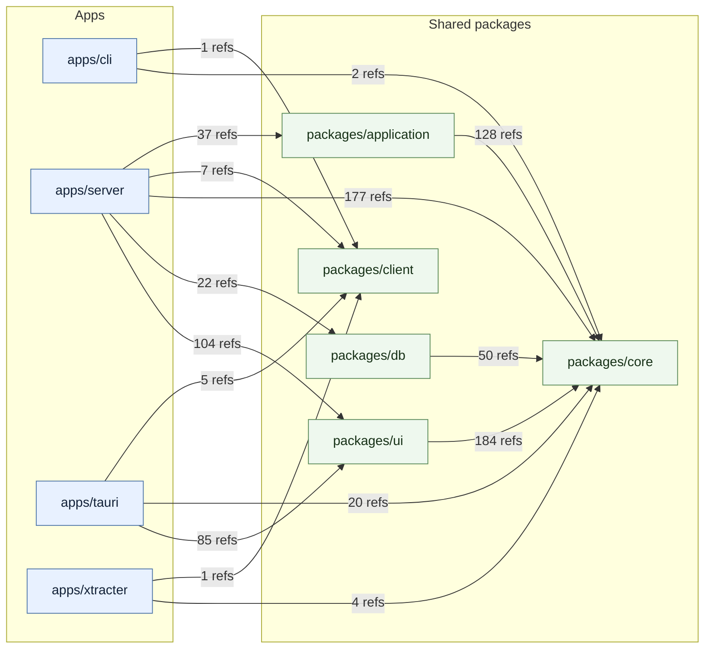

# solid-imager package dependencies

Updated **2026-11-01**, dependency-boundary fixes based on `b22d4dd6`. Indexion 0.19.0 extraction plus AST verification; see the [audit and limitations](dependency-audit-2026-11-01.md) and [source diagrams](indexion-dependency-graph.md).

Edges count source reference occurrences (imports, re-exports, and literal dynamic imports) in non-test TypeScript/JavaScript files. Package-local and external dependencies are omitted. Unlike the source diagrams, repeated statements are counted separately. These counts do not represent exported symbols or bundle sizes.

| From | To | Value | Type-only | Dynamic | Total |
| --- | --- | ---: | ---: | ---: | ---: |
| `apps/cli` | `packages/client` | 1 | 0 | 0 | 1 |
| `apps/cli` | `packages/core` | 1 | 1 | 0 | 2 |
| `apps/server` | `packages/application` | 25 | 12 | 0 | 37 |
| `apps/server` | `packages/client` | 7 | 0 | 0 | 7 |
| `apps/server` | `packages/core` | 66 | 109 | 2 | 177 |
| `apps/server` | `packages/db` | 18 | 4 | 0 | 22 |
| `apps/server` | `packages/ui` | 96 | 8 | 0 | 104 |
| `apps/tauri` | `packages/client` | 5 | 0 | 0 | 5 |
| `apps/tauri` | `packages/core` | 2 | 18 | 0 | 20 |
| `apps/tauri` | `packages/ui` | 81 | 4 | 0 | 85 |
| `apps/xtracter` | `packages/client` | 1 | 0 | 0 | 1 |
| `apps/xtracter` | `packages/core` | 2 | 2 | 0 | 4 |
| `packages/application` | `packages/core` | 26 | 102 | 0 | 128 |
| `packages/db` | `packages/core` | 21 | 29 | 0 | 50 |
| `packages/ui` | `packages/core` | 31 | 153 | 0 | 184 |

No workspace-package cycles or reverse dependencies from `core` / `application` to infrastructure were found. The three audit findings have been fixed: scroll state lives in shared UI, registry reset no longer imports concrete services, and shared UI contracts live in independent type modules. No static or dynamic value-reference cycles remain; the two remaining type-inclusive cycles are generated router/type connections.
