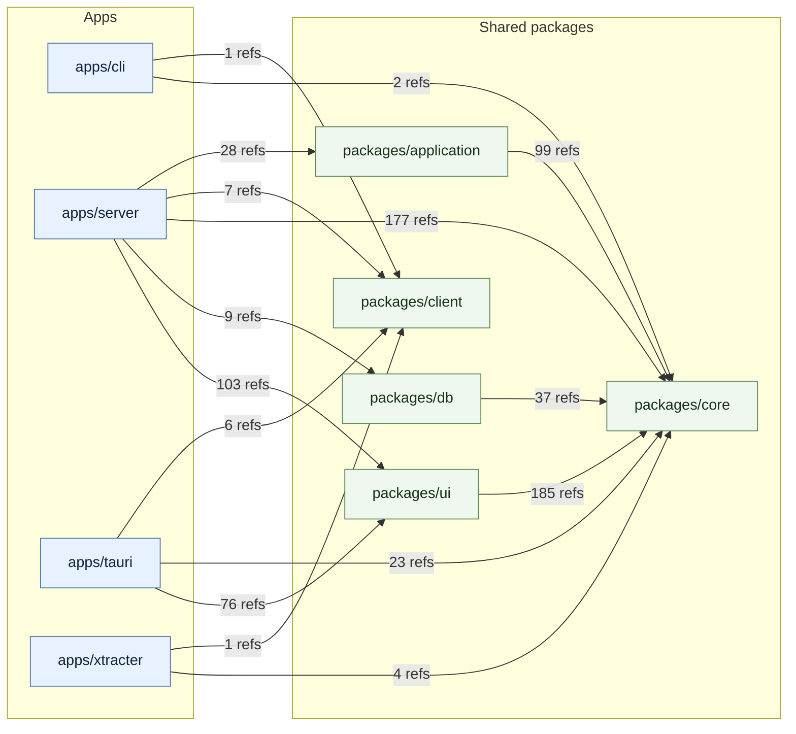

# solid-imager package dependencies

Updated **2026-11-04** from `521b18a7` on [#837](https://github.com/hmjn023/solid-imager/pull/837). Indexion 0.19.0 output was checked against the TypeScript/JavaScript AST. See the [audit and limitations](dependency-audit-2026-11-04.md) and [source diagrams](indexion-dependency-graph.md).

Edges count source reference occurrences (imports, re-exports, and literal dynamic imports) in non-test TypeScript/JavaScript files. Each arrow counts statements crossing a workspace boundary. Across the same 15 package pairs, references fell from **875 to 758**, and the number of distinct target files fell from **190 to 103**.

| From | To | Value | Type-only | Dynamic | Total | Before #836 |
| --- | --- | ---: | ---: | ---: | ---: | ---: |
| `apps/cli` | `packages/client` | 1 | 0 | 0 | 1 | 1 |
| `apps/cli` | `packages/core` | 1 | 1 | 0 | 2 | 2 |
| `apps/server` | `packages/application` | 21 | 7 | 0 | 28 | 37 |
| `apps/server` | `packages/client` | 7 | 0 | 0 | 7 | 7 |
| `apps/server` | `packages/core` | 80 | 95 | 2 | 177 | 198 |
| `apps/server` | `packages/db` | 5 | 4 | 0 | 9 | 22 |
| `apps/server` | `packages/ui` | 99 | 4 | 0 | 103 | 115 |
| `apps/tauri` | `packages/client` | 6 | 0 | 0 | 6 | 6 |
| `apps/tauri` | `packages/core` | 4 | 19 | 0 | 23 | 22 |
| `apps/tauri` | `packages/ui` | 76 | 0 | 0 | 76 | 87 |
| `apps/xtracter` | `packages/client` | 1 | 0 | 0 | 1 | 1 |
| `apps/xtracter` | `packages/core` | 2 | 2 | 0 | 4 | 4 |
| `packages/application` | `packages/core` | 25 | 74 | 0 | 99 | 128 |
| `packages/db` | `packages/core` | 21 | 16 | 0 | 37 | 51 |
| `packages/ui` | `packages/core` | 30 | 155 | 0 | 185 | 194 |

The package graph has no cycles. No cross-workspace reference from core or application points to infrastructure. The server tool catalog now uses the same feature routers as the API, removing the former runtime cycle through the settings router. The [audit](dependency-audit-2026-11-04.md) traces the new dependency direction. The only remaining file cycles come from generated router types in Web and Tauri.
