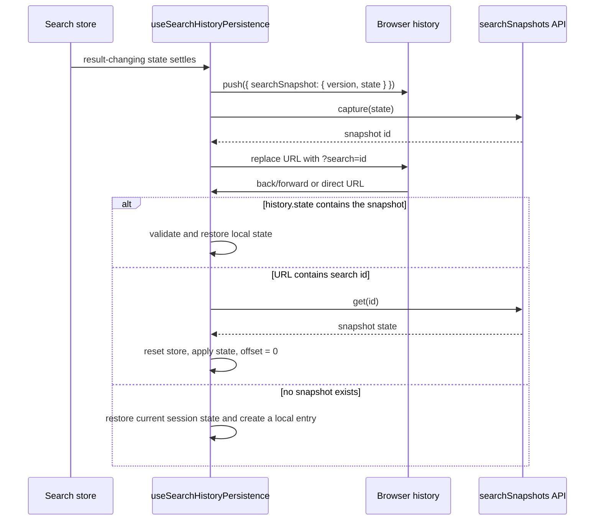

# Search history and browser navigation

検索結果は検索ストアの現在値だけでなく、ブラウザの履歴エントリごとに復元できる状態として扱う。これにより、検索 → 詳細画面 → 戻る／進むという遷移でも、各検索結果を同じ画面に再表示できる。

## 保存する状態

`SearchSnapshotState` は `packages/core/src/domain/search/schema.ts` の `searchStateSchema` から、結果を決めない UI ローカル値を除いたスナップショットである。

- 除外: `activePresetId`, `offset`, `scrollY`
- 含む: mode、検索語、タグ／エンティティの絞り込み、類似検索の anchor と topK、limit、sort
- 履歴 state: `history.state.searchSnapshot = { version: 1, id?, state }`
- URL: サーバーに保存されたスナップショットは `?search=<uuid>` で参照する

スクロール位置は検索条件とは別に、ルーターが提供する履歴エントリキーを含めて保存する。したがって、同じ検索条件を別の履歴エントリで開いた場合もスクロール位置が混ざらない。

## ライフサイクル

Web と Tauri の global search は `@solid-imager/ui/search` の
`useSearchWorkspace` で検索・履歴・スクロール復元を組み立てる。route は検索 API、
filter query、履歴 client、メディア操作 API、通知を渡す。ページサイズの下限、
更新 debounce、履歴確定とスクロール保存の接続はこの共通層が持つ。

選択・削除・コピー・移動・一括操作後の再取得は
`packages/ui/src/hooks/use-media-collection-actions.ts` に置く。表示順に沿う選択は
検索結果から導出し、結果の再取得で同じ ID が残る場合は選択を保持する。
削除成功時は対象だけを選択から外し、一括操作の部分成功では選択を保持する。
処理中の単体操作は二重送信と対象の差し替えを拒否する。

`@solid-imager/ui/screens/search` の `SearchWorkspace` が表示部品と共通ダイアログを
接続する。各アプリには詳細画面への遷移、画像表示、イベント購読、API client の
組み立てを残す。Web の workspace view 連携と Tauri の戻り先保存も各アプリが担当する。
この共通化では session の保存キーや接続先切替時の状態分離は変更しない。

`useSearchHistoryPersistence` は通常の入力変更を 500 ms デバウンスして履歴へ追加し、明示的な検索操作は `commitNow` で即時確定する。復元処理で同じ state がストアから再通知されても、新しい履歴エントリを作らない。

## サーバー側スナップショット

`packages/core/src/domain/contract/search-snapshots.contract.ts` の contract と `apps/server/src/infrastructure/api/routers/search-snapshots-router.ts` の router が次の API を提供する。

| Operation | Input | Output | 用途 |
| --- | --- | --- | --- |
| `searchSnapshots.capture` | `SearchSnapshotState` | `{ id }` | state を fingerprint 付きで保存し、同じ検索を再利用する |
| `searchSnapshots.get` | UUID | `SafeSearchSnapshot` | 直接 URL、リロード、履歴復元から公開対象の state を取得する |

保存先は `packages/db/src/schema.ts` の `search_snapshots` テーブルで、`fingerprint` は一意、`state` は JSON、`created_at` には index を持つ。fingerprint は version と state をキー順に安定シリアライズして SHA-256 化するため、保存順に依存しない。

## 適用範囲とフォールバック

- Web と Tauri の global search、source search、旧URLからの転送は `searchHistoryQuerySchema` で `search` query を検証する。
- 共通の復元処理は `packages/ui/src/hooks/use-search-history-persistence.ts` に置き、route 側は API client を渡す。Web と Tauri で保存先や復元処理を分岐しない。
- API が利用できない場合は `history.state` のローカルエントリをそのまま利用する。
- UUID が削除済み・不正な場合は query を除去し、現在の session state に戻す。履歴操作自体は失敗させない。
- user preset には自動保存した検索を混ぜない。preset は検索 state の復元元として別に扱う。

## ブラウザー内の保存キー

`packages/ui/src/ui-storage.ts` が検索条件、スクロール位置、表示設定、詳細画面の戻り先のキーを定義する。検索条件は `solid-imager:search-state:current-all` または `solid-imager:search-state:current-<sourceId>`、スクロール位置は `solid-imager:search-scroll:` 配下へ保存する。履歴エントリのスクロール位置には `history:<entryKey>` を使う。

以前の Web / Tauri キーは読み込み時に移行する。正規キーの値を優先し、旧キーしかない場合はコピーを確認してから移行元を削除する。容量不足などで保存に失敗した場合は旧データを残す。新しい書き込みには旧UIのキーを使わない。

## 検証

`apps/server/src/tests/e2e/search-history.spec.ts` は、2つのファイル名検索を別々の履歴エントリにした後、詳細画面から `goBack()` を複数回実行し、各検索結果と direct URL reload が復元されることを確認する。

`use-media-collection-actions.test.ts` は選択の再照合、部分成功、単体操作の失敗・再試行、
二重送信と処理中の対象保持を検証する。
`apps/server/src/tests/e2e/search-workspace.spec.ts` は Web と Tauri の両 project で
同じシナリオを実行し、選択、確認の取消、一括操作ダイアログ、隔離したソース間の
実コピー・移動・削除と検索結果の再取得を確認する。Tauri project はブラウザ上の
adapter による検証であり、native desktop の SQLite・HTTP plugin の実機検証を代替しない。
